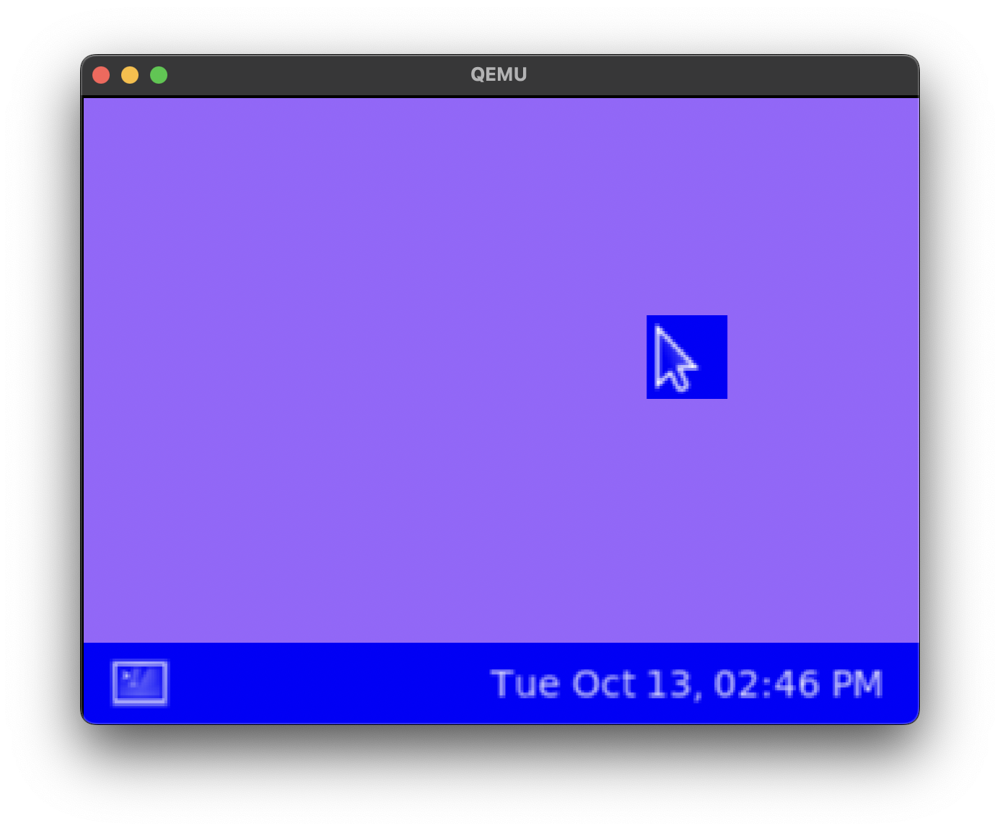

# OpenGPU

OpenGPU is an open-source RISC-V SIMT GPU written in Chisel 7.x. It combines a
programmable shader core with a small fixed-function graphics pipeline, then
connects that hardware to a Linux DRM/KMS driver, Mesa/Gallium, and an ARTI/QEMU
full-system model.

The project is meant to be useful at three levels:

- **Architecture research:** change the core, memory system, command path, or
  graphics pipeline in synthesizable Chisel.
- **Software bring-up:** submit compute and render work through the same host
  interface used by the Linux driver and userspace examples.
- **System validation:** boot a real ARM64 Linux guest and watch Weston draw a
  desktop with pixels produced by the simulated GPU.

In other words, this repository is not only a shader core. It is the hardware,
driver, userspace, and test path needed to make a small GPU observable from a
Linux application all the way down to RTL.

## The current proof



The checked-in screenshot comes from a 640×480 FlashSim run. A Debian ARM64 guest
boots the OpenGPU DRM/KMS driver, starts the Weston Wayland desktop, renders
through the OpenGPU Mesa/Gallium driver, and presents the guest-memory scanout
in a QEMU window.

```text
Weston / Wayland
        ↓
Mesa EGL + OpenGPU Gallium (opengpu_dri.so)
        ↓
Linux gpu_drv.ko and DRM/KMS ioctls
        ↓
ARTI full-system model + OpenGPU RTL
        ↓
guest GEM framebuffer and scanout registers
        ↓
QEMU display window
```

The image is a real GPU result: render and shading jobs write the guest GEM
buffers, and QEMU only displays the resulting scanout. The proof does not
replace a failed render with a CPU-painted framebuffer. The display path also
covers the coordinate-origin conversion needed when Mesa's texture convention
meets a top-to-bottom linear scanout buffer.

## What is implemented

OpenGPU grows as a stack, so the useful boundaries are more informative than a
single list of instruction names:

| Layer | What is covered today |
| --- | --- |
| **SIMT core** | RISC-V RV32 integer execution, scalar floating point, selected RVV operations, per-warp scheduling, lane masks, divergence/reconvergence, scoreboards, traps, and memory access. |
| **Memory and commands** | Shared memory and L2, translated accesses with Sv32/TLBs, unified compute/render/DMA commands, backpressure, completions, fences, and fault reporting. |
| **Graphics** | Transform and clipping, triangle rasterization, perspective interpolation, depth/stencil/blend, texture sampling, MSAA/resolve, clear/blit/strided-copy, and scanout. Vertex and fragment shaders use the unified SIMT path. |
| **Linux stack** | GEM resources, validated bindings, GPU virtual memory, DRM/KMS modesetting, queued jobs, sync objects, and fence-backed page flips in `gpu_drv.ko`. |
| **System proof** | Deterministic userspace examples, host-side driver validation, ARTI guest DRM tests, Mesa/Gallium draw lowering, and a real Weston desktop in QEMU. |

The detailed capability matrix and the honest “implemented vs. next” boundary
live in [docs/GRAPHICS_ROADMAP.md](docs/GRAPHICS_ROADMAP.md). Hardware defaults
are intentionally configurable through `GpuConfig`; the emitter and ARTI
scripts expose the system-level choices without making the README a catalog of
every queue depth and cache dimension.

## Quick start: build and test the RTL

For the core and Scala test suite, install a JDK 11+ and sbt. Verilator is
needed by the simulation-backed tests.

```sh
sbt compile
sbt test
```

The tests use `opengpu.testutil.GpuSim`, which caches compiled Verilator models
under `target/chiselsim`. The first run spends most of its time compiling RTL;
later runs reuse models by content hash. Use the uncached path when diagnosing
the simulator or measuring a clean build:

```sh
sbt -Dopengpu.simCache=off test
```

For the host-side ABI and validator checks:

```sh
python3 scripts/test_driver.py
```

The release-style local gate runs the Scala suite, host tests, and both ARTI
guest DRM paths. It needs the sibling ARTI/FlashSim workspace and the guest
toolchain described in [docs/FUNCTIONAL_QUALIFICATION.md](docs/FUNCTIONAL_QUALIFICATION.md):

```sh
scripts/qualify_functional.sh
```

## Quick start: boot the graphical desktop

The desktop path is intentionally separate from `sbt test`: it builds the
embedded model, Linux driver, guest image, and Mesa/Gallium pieces. Prepare the
GTK-enabled Debian image once as described in
[docs/GTK_COVERAGE.md](docs/GTK_COVERAGE.md), then build the display profile and
Mesa driver:

```sh
scripts/build_arti_debian_display.sh
bash scripts/build_mesa_opengpu.sh
```

Boot Weston in a visible QEMU window:

```sh
OPENGPU_AUTO_DISPLAY=weston \
DEBIAN_BASE=../arti-work/debian-gtk-arm64.qcow2 \
DISK="$PWD/arti-weston-current.qcow2" \
REBUILD_DISK=0 \
REBUILD_CLOUDINIT=1 \
GPU_SIM=flashsim \
QEMU_DISPLAY=cocoa \
bash scripts/run_arti_debian.sh
```

For repeated boots, keep the generated model and disk and set
`REBUILD_CLOUDINIT=0` (and `BUILD_USERSPACE=0` when the userspace payload is
already staged). FlashSim is cycle-accurate and a compositor frame can take
minutes; an upright Weston clock and launcher in the QEMU window is the visual
success condition. The serial log should also show completed fence-backed
OpenGPU draws.

## How the pieces fit

```text
RISC-V SIMT front-end
  scalar ALU/FPU + RVV + warp control
              │
              ▼
        unified shader core ─────── shared memory / L2 / Sv32
              │
              ▼
       command router and host AXI
          ┌──────────┴──────────┐
          ▼                     ▼
   compute + DMA jobs      render host
                                │
                                ▼
      transform → clip → rasterize → interpolate → depth/blend → scanout
```

The same command and memory contracts are exercised by the Scala tests, the
small C userspace library, and the Linux driver. That makes it possible to
debug a feature at the cheapest level first, then carry it through an ARTI
guest when the RTL behavior is ready.

## Repository map

- `src/main/scala/opengpu/` — Chisel hardware: core, memory, commands,
  elaboration, and graphics pipeline.
- `src/test/scala/` — Scala/Chisel specifications and the shared cached
  Verilator harness.
- `driver/` — out-of-tree Linux DRM/GPU driver and kernel-free validators.
- `userspace/` — small DRM wrapper plus compute, render, texture, MSAA, and
  presentation examples.
- `scripts/` — RTL emission, ARTI/QEMU integration, Mesa build, validation,
  benchmarking, and qualification entry points.
- `docs/` — design contracts and end-to-end procedures.
- `timing/` — ASAP7-oriented timing/PPA work and reports.

## Where to go next

Choose the path that matches what you want to learn or change:

- **Understand the graphics contract:** [docs/HOST_INTERFACE.md](docs/HOST_INTERFACE.md)
  and [docs/DRIVER_ARCHITECTURE.md](docs/DRIVER_ARCHITECTURE.md).
- **See what is complete and what is still experimental:**
  [docs/GRAPHICS_ROADMAP.md](docs/GRAPHICS_ROADMAP.md).
- **Set up a fresh checkout and see which repo owns which step:**
  [docs/BOOTSTRAP.md](docs/BOOTSTRAP.md) and `scripts/bootstrap_arti_debian.sh`.
- **Run deterministic display and GTK proofs:**
  [docs/GTK_COVERAGE.md](docs/GTK_COVERAGE.md).
- **Run or extend the C examples:** [`userspace/README.md`](userspace/README.md).
- **Work on physical implementation:** [`timing/README.md`](timing/README.md).

The project is still an active hardware/software co-design effort. The next
work is concentrated on broader shader and Gallium coverage, faster large-frame
simulation, more interactive Wayland/GTK workloads, and continued RVV,
memory-system, and multi-render-target coverage.
