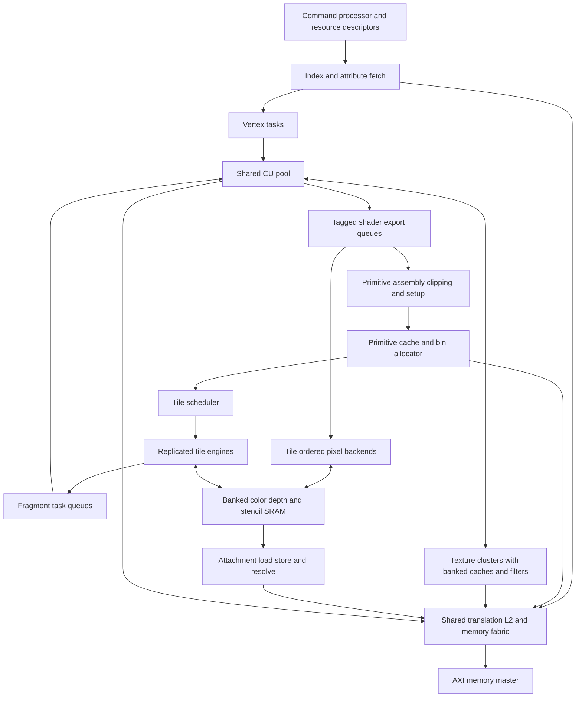

# Mobile GPU hardware alignment proposal

Status: proposed hardware architecture with H0/H1 implementation in progress, 2026-10-17. Baseline: `d038228`.

Evolve OpenGPU into a mobile rendering architecture by extending the shared CU pool with persistent tile storage, GPU geometry fetching, scalable texture and pixel backends, and general graphics resource descriptors. Keep shader arithmetic on the existing CUs. The first functional target is hardware sufficient for a complete GLES 3.0 implementation; a Mali-G31-class commercial comparison requires further feature, performance, and physical qualification.

The configuration and rates below are design targets, not measured capabilities. Implementation should proceed in bounded milestones, with correctness, throughput and timing gates before integration. Compiler and driver implementation are outside this plan; hardware interfaces needed by them are included.

## Target and scope

Use Mali-G31 as an older commercial reference class, rather than treating it as the definition of a current entry-level GPU. Arm lists GLES 3.2 support for that device. GLES 3.0 is therefore an intermediate capability target. [Arm Mali-G31](https://support.arm.com/compute-ip/mali-g31)

The initial OpenGPU product target is four shared CUs, with a 720p workload suite targeting 30 FPS first and 60 FPS subsequently at a physically qualified clock. Test desktop composition, textured 3D, opaque overdraw, transparent layers, small triangles, and 4x MSAA separately. These targets do not imply measured performance parity with a particular commercial device.

The hardware contract must cover shader execution, geometry, texture resources, rasterization, framebuffer operations, synchronization and faults. Display scanout remains a consumer of completed images. Its refresh rate is separate from rendering throughput.

## Current hardware and gaps

| Area | Current RTL or interface | Required evolution |
|---|---|---|
| Shader execution | Shared compute CUs already execute vertex and fragment tasks; vector FP32 arithmetic, including FMA, is connected | Improve task input/output transport, occupancy, control-flow/resource contracts and sustained issue/writeback throughput |
| Configuration | `GpuConfig` defaults to 16 lanes and eight warps; the mobile CU-count constant is four | One compute/graphics execution configuration; discoverable resource limits and explicit supported configuration combinations |
| Interstage transport | CU-scaled fragment workers, staging transactions and ordered output retirement | On-chip payload storage, export queues and tile-local retirement; avoid mandatory global-memory staging of every batch |
| Geometry | Clip, viewport, triangle setup and quad rasterization exist | Native index/attribute fetch, vertex reuse, instancing and complete required primitive behavior |
| Tiling | Optional single resident 16x16 tile, RGBA8 plus D24S8, up to four samples; binner replays eight triangle records per chunk | Render-pass attachment lifetime, scalable bin storage, multiple tile engines and spill/restart handling |
| Texturing | Per-worker samplers; four physical tap-read credits per sampler; bilinear and mip/trilinear paths; a shared single-word request/response fabric | Banked texture hits, scalable filtering throughput, general image/sampler descriptors, more dimensions and formats |
| Pixel operations | Depth/stencil/blending and MSAA exist; OM has configurable concurrent RMW slots | Banked tile-local pixel pipelines, legal early rejection, multiple color outputs and complete format semantics |
| Memory | Shared banked L2, Sv32 translation, GPU cache invalidation and AXI memory master | Aggregate bandwidth and outstanding budgets, context-tagged tile/texture state, scoped barriers and robust bin/payload memory |

The constructor default AXI beat is eight bytes, while emission supports 4 through 64 bytes. Benchmark configurations must record the selected width; there is no single width shared by every existing artifact. See [GpuHostSystemAxi](../src/main/scala/opengpu/system/GpuHostSystemAxi.scala) and [the emitter](../src/main/scala/opengpu/elaboration/EmitGpuHostSystemAxi.scala).

Program length limits also belong to different layers: the checked-in Gallium emitter has a 256-word code container, while the driver validator admits at most 512 instructions and four forward branch states. These are not a demonstrated 256-instruction CU fetch limit. General shader support requires a new submission and protection contract, rather than merely enlarging an RTL array. See [the validator](../driver/opengpu_shader_validator.h), [Gallium emitter](../userspace/gallium/opengpu_fs_emit.c) and [kernel shader launch](../src/main/scala/opengpu/graphics/KernelShaderStage.scala).

## Proposed block organization

A tile engine contains raster work generation, fragment dispatch state, a pixel backend and attachment storage. It can dispatch work to the shared CUs without owning a separate shader core. Texture clusters initially have locality affinity to pairs of CUs; scheduling may steal work when the destination has the necessary descriptors and payload access.

Shader lane count comes only from `GpuConfig`. A raster quad remains four pixels because derivatives use a 2x2 neighborhood. Raster quads, texture taps, SRAM banks and pixel pipelines are throughput resources with different units; none introduces a second shader VLEN.

## Initial four CU sizing

Keep these values in one proposed hardware configuration record. Derive transaction IDs, queue indices and SRAM addressing from it. Architectural limits, runtime bindings and elaboration-time capacities must be separate fields.

| Resource | Initial proposal | Meaning and scaling rule |
|---|---|---|
| Shared CUs | 4 CUs, 16 lanes, 8 resident warps per CU | Reuse existing execution profile; retain supported lane/warp parameterization |
| Tile engines | 2, initially 1 for bring-up | Default `ceil(CUs / 2)` for balanced configurations; independently selectable for isolation experiments |
| Raster output | 1 quad/cycle/engine | Eight candidate pixels/cycle at two engines; coverage and interpolation availability can reduce useful output |
| Texture clusters | 2 | Initially one per pair of CUs; requests include task, lane, descriptor and destination tags |
| Texture throughput | 1 RGBA8 bilinear sample/cycle/cluster | Conflict-free resident-data target; four tap words/cycle/cluster. Trilinear requires two bilinear groups |
| Texture cache | 8 KiB data/cluster, 64-byte lines, at least 4 word banks | Starting point for a capacity/bank sweep, including refill and response bandwidth |
| Texture outstanding fills | Start at 16 line fills/cluster; sweep 8/16/32 | Final value follows measured miss demand and memory latency; separate line fills from sample/tap credits |
| Pixel throughput | 4 sample updates/cycle/engine | RGBA8 plus D24S8, conflict-free resident data; includes the required old-value reads and writebacks |
| Tile attachment SRAM | 64 KiB data/engine | Two 32 KiB slots for rendering and attachment transfer; tags, queues and metadata are additional |
| Shader payload SRAM | 64 KiB shared, banked | Sweep 32/64/128 KiB; admission accounts for live input/output bytes and reserves a spill or drain path |
| Primitive and state cache | 32 KiB shared | Cache compact primitive/state records; software-allocated bin pages provide bounded backing storage |
| Color attachments | Architectural capacity 4 | MRT can serialize attachment work; the single-target throughput target does not imply four-target peak throughput |
| Shared L2 | Initially 128 KiB and 4 banks; sweep 64/128/256 KiB | Include bin, payload, texture and instruction contention in the comparison |
| External AXI | Initial integration candidate 256 bits; retain width parameter | Compare 128/256/512 at equal memory latency, controller limits and realistic bus efficiency |

At two texture clusters, the bilinear target needs eight 32-bit taps/cycle, or 32 bytes/cycle of cache-hit delivery. At two pixel engines, the target is eight sample updates/cycle: at most eight pixels/cycle at 1x, or two pixels/cycle at 4x when every sample is processed. Neither rate is a whole-frame guarantee.

The tile data calculation is:

`bytes per tile = width * height * samples * (sum(color attachment bytes) + depth/stencil bytes)`

| Tile layout | Data bytes | Data capacity |
|---|---:|---:|
| One RGBA8 plus D24S8, 4x | 8,192 | 8 KiB |
| Four RGBA8 plus D24S8, 4x | 20,480 | 20 KiB |
| Four RGBA16F plus D24S8, 4x | 36,864 | 36 KiB |
| Four RGBA16F plus D24S8, 4x, using 8x8 tiles | 9,216 | 9 KiB |

A 32 KiB slot therefore handles four RGBA8 attachments at 4x but requires smaller tiles for the illustrated four-RGBA16F layout. Support 8x8 and 16x16 tile classes through a shared descriptor and address calculation. Select a fitting tile class at pass admission. RGBA16F rendering/blending is a later product feature with explicit semantics; it is not implied to be required by base GLES 3.0.

The proposed tile, texture, payload, primitive and 128 KiB L2 arrays total 368 KiB of data storage. This excludes CU register files, instruction/data caches, shared memory, tags, queues and other state. SRAM area and energy depend on the selected technology and port organization; this is a capacity budget rather than a chip-area estimate.

Payload occupancy must also be counted in bytes. For example, 64 FP32 varying components across 128 resident threads occupy 32 KiB of input values per CU before outputs or metadata. A 64 KiB shared payload budget cannot hold that case for all four CUs simultaneously. Admission must reduce concurrency, interpolate values on demand, or spill through the defined fallback; it must never assume maximum varying count and maximum task residency are free to combine.

## Hardware work packages

### Render pass descriptors and tile lifetime

Add versioned descriptors for attachments, image views, samplers, shader resources, vertex layouts and render passes. Attachment views carry base, allocation bounds, format, extent, row/layer pitch, mip/layer selection and sample count. A pass snapshots its descriptors and assigns a context, pass ID and generation so later host updates cannot change in-flight work.

Keep attachments resident across compatible draws. Implement load, clear and discard on entry; store, discard and resolve on exit. A partial clear or scissor must preserve untouched samples. Clear tags may defer SRAM initialization, but reads must materialize the specified clear value. Resolve samples in tile storage and export only the selected result where permitted.

Texture reads of prior render output, DMA access, CPU visibility, incompatible attachments, queries requiring completion, and explicit barriers establish dependency boundaries. Store required dirty state and publish it to the relevant GPU cache domain before admitting dependent reads. Do not equate an L2 write with immediate CPU-cache coherence.

### Primitive storage and tile scheduling

Replace the hardcoded eight-triangle limit with bounded on-chip primitive/state caches and software-allocated bin pages. Store compact references to immutable primitive and draw state. Allocate pages with checked bounds and tagged ownership; overflow either spills to valid backing storage or stops at a defined restart point. No primitive may be silently dropped or executed twice.

Maintain submission order for operations affecting the same pixel/sample. Assign each active tile one attachment owner. Independent tiles can retire out of order; within a tile, primitive sequence numbers and completion masks prevent later fragments from overtaking earlier depth/stencil/blend work. Shading may run ahead only when its side effects and query semantics permit it.

Use load-balanced tile assignment, double-buffered attachment transfer and bounded fairness between vertex, fragment and compute work. Avoid a global fragment-retirement queue that makes one slow tile stop every engine. A full export queue must not prevent the scheduler from running the task needed to drain it; reserve progress credits and verify this dependency explicitly.

### On chip shader payload and exports

Introduce a banked payload SRAM addressed by task/payload handles. Raster/interpolation produces fragment inputs there; vertex and fragment tasks consume or export values through bounded CU-local ports. Start with SRAM payloads and explicit exports, then evaluate direct register delivery where register-file ports and occupancy justify it.

Retain a memory-backed path for oversized payloads and controlled spills. Reserve output capacity before dispatch and keep payload/state ownership until completion, cancellation or fault drain. Descriptors specify varying layout, masks, interpolation qualifiers, output locations and scratch bounds. Fragment exports carry tile, primitive order, coverage, discard, optional depth and attachment outputs.

Keep helper-lane execution distinct from coverage and side-effect masks. Derivative/quad exchange must work with partial warps and divergence, without allowing helper lanes to update memory or framebuffer state. Lane counts that cannot execute a full quad need an explicit supported grouping scheme or must reject graphics elaboration.

### Texture clusters

Replace the shared single-word bottleneck with banked cache access and tagged multiword replies. Specify bank mapping for adjacent 2x2 taps; measure conflicts on other patterns. Provide response queues, same-line miss joining, replacement rules and refill arbitration. Filter pipelines must sustain the proposed rate after warm-up; adding request ports alone is insufficient.

Cache identity includes physical line and relevant context/generation attributes. Preserve read/write permission faults and cache invalidation across image rebinding, translation changes and render-to-texture transitions. Retain pending fill ownership until cancellation is drained; do not interpret a failed translation as a successful zero texel.

Generalize descriptors and address generation for multiple images, cube/array/3D resources, explicit and implicit LOD, gradient-based sampling, depth comparison, and all required wrap modes. Remove the power-of-two-only repeat assumption. Use per-level metadata or cached mip offsets instead of requiring a serial level walk on every sample.

Add format-aware fetch/decode before filtering, including signed/unsigned and normalized values, required sRGB behavior, and ETC2/EAC block decode. Cache decoded blocks where useful. Integer fetches bypass inappropriate filtering. Packed FP16 arithmetic and ASTC are later efficiency/product extensions with separate area and compatibility decisions.

### Pixel pipelines and visibility rejection

Replace global address hazard searches with tile-local bank/row ownership and pipelined sample scoreboards. SRAM organization must support the promised read/modify/write rate, including color blending, depth/stencil, coverage and masks. Bank conflicts and repeated writes to one sample must serialize without corrupting order.

Introduce conservative early depth rejection, followed by hierarchical depth summaries where profitable. Track summary validity across clears, depth writes and tile transfers. Distinguish early testing from committing depth/stencil: shader discard, depth override, stencil outcomes, side effects and queries may require deferred updates or a late path. Correctness decides eligibility.

Extend outputs and format packing for MRT, integer targets, required depth formats, sRGB conversion and format-dependent blending. The existing 32-bit packed-color word must not become the universal shader export representation. Pipeline address calculation and arbitration to remove long coordinate-to-ready combinational paths.

### Geometry and general execution

Add GPU index reads, attribute descriptors and format conversion, vertex/instance IDs, divisors, restart and post-transform vertex reuse. Include points, lines, clipping, flat interpolation and provoking-vertex rules in the functional closure matrix; triangles alone do not complete the target. Provide transform-feedback export and query/count hooks with defined ordering.

Reuse existing FP32 FMA, conversion, division and square-root machinery. Measure register-file, issue, scoreboard and writeback limits before adding arithmetic lanes. Define shader-visible numeric behavior, rounding, denormals and precision by operation. Add reciprocal/other approximations only with measured error bounds and valid compiler contracts.

General loops and richer memory access require bounded scratch/resource descriptors, fetch/execute permissions, SIMT reconvergence overflow handling, watchdog interruption and fault attribution. Existing CU branch machinery and the restrictive shader validator are different layers. Increasing code length alone does not resolve safe execution or termination.

### Memory fabric and physical design

Keep a shared L2 and translation fabric, with request classes for instructions, texture fills, geometry/bin data, payload spills and attachment transfer. Partition or reserve credits so bulk binning/store traffic cannot starve fault completion or shader progress. Carry context and generation through requests and responses, with no transaction-ID aliasing during drain/reset.

Size miss windows from `outstanding lines >= sustained miss bytes/cycle * latency cycles / line bytes`. For example, 16 bytes/cycle of aggregate miss demand at 200-cycle latency needs at least 50 outstanding 64-byte lines, before headroom. This is an illustrative latency model, not a recommendation to allocate 50 slots in every sampler.

Use SRAM macros or characterized SRAM models for tile and cache arrays. Include read latency, port count, banking and arbitration in both functional timing and area. Add valid-based clock enables to CU, texture, tile and transfer pipelines; quantify switching on representative workloads. Physical power domains and retention can follow SoC integration requirements.

## Capability closure contract

The first hardware feature matrix should trace each GLES 3.0 requirement to native hardware, CU-executed support, or an explicit unsupported milestone. Selected minimum limits include four draw buffers, 16 vertex attributes, 2048-square 2D/cube textures, 256 array layers and a 256-texel 3D dimension. Cover uniforms, shader texture access in both stages, varying precision, integer operations, required formats, transform feedback, queries and synchronization in the complete matrix. [GLES 3.0 specification](https://registry.khronos.org/OpenGL/specs/es/3.0/es_spec_3.0.pdf)

Architectural capacity does not require fully parallel hardware for each binding. Descriptor tables and serialized operations may satisfy functional capacity while a smaller number of texture/filter/pixel pipelines provide throughput. Hardware capabilities must describe implemented limits accurately; Mesa exposure and conformance follow as a separate integration effort.

Commercial feature alignment continues after the initial GLES 3.0 hardware milestone:

| Capability stage | Additional hardware work | Architecture consequence |
|---|---|---|
| GLES 3.1 | Shader storage/image descriptors and access, required atomics, memory barriers, indirect work submission and compute resource limits | Extend existing compute/atomic machinery; define visibility across shader, texture, pixel and DMA clients |
| GLES 3.2 | Geometry and tessellation stage execution, primitive amplification, patch storage and synchronization, and the remaining texture/raster/blending requirements | Run programmable stages on the shared CUs; add bounded patch/output queues and a tessellation primitive-generation path before binning |
| Vulkan product target | Selected-version resource, synchronization, robustness and scheduling contract, followed by driver/conformance integration | Reuse tile/CU resources while validating the chosen API requirements independently |

Geometry and tessellation are part of the GLES 3.2 specification, so they belong in the longer commercial-alignment plan even if they follow the first mobile rendering backend. [GLES 3.2 specification](https://registry.khronos.org/OpenGL/specs/es/3.2/es_spec_3.2.pdf) Reserve stage tags, descriptor versioning and resource-table space in H0. Detail the later-stage limit matrix before committing their storage sizes or claiming API support.

## Performance model and acceptance gates

For a selected workload, calculate a lower bound in cycles:

`C >= max(warp instructions / sustained issue rate, FP operations / sustained FP rate, texture samples / sustained sample rate, sample updates / sustained pixel rate, setup work / setup rate, payload bytes / payload service rate, external bytes / sustained bytes per cycle)`

Use measured effective rates for the actual instruction/format mix. Add serial phases, launch overhead, dependency latency and pipeline drain to the scheduling model. The maximum of these terms is a lower bound, not a cycle prediction by itself.

At an assumed 500 MHz, 30 FPS permits about 16.67 million cycles/frame and 60 FPS about 8.33 million. A single RGBA8 1280x720 final store is 3,686,400 bytes/frame, or 221,184,000 bytes/second at 60 FPS. This excludes texture, geometry, bin, attachment-load, spill and display-read traffic. The proposed two-cluster texture cache-hit bandwidth is 16 GB/s at that assumed clock. A 256-bit AXI read channel also has a 16 GB/s ideal beat rate at 500 MHz, but actual DRAM service and utilization must be modeled separately.

Tile storage reduces repeated external attachment traffic by retaining intermediate values on chip. This is a mobile bandwidth/power design principle, not a guaranteed speedup for every scene. [Arm Mobile GPU 101](https://developer.arm.com/cfs-file/__key/communityserver-blogs-components-weblogfiles/00-00-00-20-66/siggraph_5F00_mmg_5F00_2024_5F00_Mobile101.pdf)

| Gate | Acceptance criterion |
|---|---|
| Functional | Reference-image/numeric checks for formats, MSAA, order, hazards, faults and overflow; randomized backpressure and reordered memory responses |
| Texture throughput | Each cluster reaches one bilinear RGBA8 result/cycle on a long conflict-free resident-data stream; separately report trilinear, misses, bank conflicts and dependent samples |
| Pixel throughput | Each engine reaches four RGBA8+D24S8 sample updates/cycle on a long conflict-free resident stream; include enabled blend/depth/stencil cases and report supported rates per mode |
| Attachment locality | An eligible clear/discard-start pass avoids old attachment reads; blending/depth intermediates stay on chip; final stores/resolves match the requested outputs |
| CU scaling | Target at least 3.2x for a specified long shader-bound 1-to-4-CU test with fixed non-CU resources and identical work; attribute the remaining gap with counters |
| Balanced scaling | Separately test 1/2/4 CUs with proportional texture/tile resources; retain a realistic fixed external-bandwidth case and identify its saturation point |
| Physical | Meet setup/hold and I/O constraints at the selected clock, with SRAM assumptions and implementation stage reported; compare area and energy/frame |
| Product workload | Meet the agreed 720p frame budget on each selected workload at a qualified clock, including binning, geometry, rendering and store/resolve |

The current qualified textured scene is 32,341 cycles on one CU and 11,566 on four, or about 2.80x. It is a retained regression workload, not a general theoretical scaling limit. [Qualification handoff](performance/optimization-pause-2026-10-17.json)

Current texture traces found a peak of 10 occupied slots out of 16 and about 0.06 percent cross-CU duplicate candidates in the captured desktop workload. Prioritize service bandwidth and bank conflicts over owner-table growth or duplicate multicast for that workload; these opportunity counters do not establish a causal speedup. [Texture contention measurements](performance/texture-arbiter-contention-2026-10-17.json)

Existing OM screening also failed the 1 GHz timing gate for both baseline and sharing candidates. Use that result to justify pipelined admission/address/hazard control. A design with fewer cycles must also improve or preserve elapsed time at its achievable clock. [Paused physical screening](performance/optimization-pause-2026-10-17.json)

## Implementation milestones

| Milestone | Deliverable | Exit evidence | Primary RTL touchpoints |
|---|---|---|---|
| H0 | Hardware capability/configuration record, descriptor definitions, counters and analytic workload budgets | Units and limits documented; supported elaboration combinations checked; baseline counters explain stage utilization | `GpuConfig`, `GraphicsConfig`, `JobConfig`, `SharedCuGraphicsPort`, performance bundles |
| H1 | One tile engine with pass-lifetime attachments and versioned state | Multiple ordered draws retain attachments; clear/load/store/discard/resolve and dependency boundaries are correct | `TileAttachmentStore`, `RenderPipeline`, render descriptors |
| H2 | Scalable bin pages and two independently progressing tile engines | Overflow/spill/restart, ordering, load balancing, double buffering and backpressure pass; attachment bytes/frame measured | Replacement/evolution of `TileDrawBinner`; new tile scheduler and transfer engine |
| H3 | Banked pixel backend, legal early rejection and pipelined hazards | Pixel throughput gate, adversarial same-sample ordering, early/late equivalence and physical timing | `OutputMerger`, tile SRAM, sample expansion and retirement |
| H4 | Banked texture clusters with general resource descriptors | Cache-hit throughput gate, miss/translation stress, multiple bindings and render-to-texture visibility | `TextureUnit`, `FragmentTextureArbiter`, `BufferedTextureWordPort`, translation routing |
| H5 | On-chip shader payload/export path and GPU geometry fetching | No mandatory per-fragment global staging in the common path; index/instance reuse, fault drain and task progress verified | `KernelFragStage`, `ParallelKernelFragStage`, shared task router, vertex stages and CU interfaces |
| H6 | Required format/primitive/resource coverage and product qualification | Hardware feature matrix closed, targeted API integration tests, 720p suite and physical reports | Format, texture, raster, execution, query and synchronization blocks |
| H7 | GLES 3.1 hardware closure | Storage/image access, atomics, barriers, indirect work and resource-limit matrix verified | CU memory, descriptor tables, command processor and shared cache/translation fabric |
| H8 | GLES 3.2 hardware closure | Geometry/tessellation, bounded amplification, stage ordering and remaining feature matrix verified | Shared task scheduling, patch SRAM, primitive generation and graphics backends |

H3 and H4 depend on the H0 interfaces but can be developed against unit harnesses before H2 completes. H5 payload and geometry changes should be separate reviewable series. Bring up one attachment and existing formats first; add MRT and the wider format contract after ownership and ordering are stable. Apply synthesis/timing gates throughout rather than postponing physical work until H6.

The first implementation slice should be **H0 plus H1**: define the hardware contract, then make several compatible draws render into one resident tile without intermediate attachment writeback. This creates a measurable bandwidth result and a stable base for subsequent parallel engines.

For H1, use overlapping triangles from multiple draws with blending and depth/stencil enabled, all within one tile. After a clear-start pass, require zero external reads of the cleared attachment contents and no intermediate attachment writes before the pass ends. Compare final stored samples against the existing ordered path. Repeat with a load-start pass, partial clear, texture/DMA dependency boundary, cancellation and a store fault. These checks distinguish persistent tile lifetime from merely changing triangle traversal order.

## Verification and delivery discipline

Add counters for tile residency/evictions, attachment bytes by operation, bin allocation/spill, active engines, primitive occupancy, payload traffic, queue stalls, eligible/rejected early tests, texture bank conflicts, useful cache bytes, fill occupancy and per-CU active/helper lanes. Avoid summing overlapping stall counters as if they were exclusive causes.

Use arithmetic/ordering proofs and component tests first, followed by small cycle benchmarks, synthesis, native trace replay and selected full-system smoke tests. Run full desktop validation at integration milestones. Freeze source/configuration and workload hashes for comparisons; report simulator wall time separately from GPU cycles and estimated silicon frame time.

Deliver each milestone as independently reviewable changes with its functional and throughput evidence. Keep the currently qualified desktop path available during bring-up. This proposal does not promote the paused private OM experiments into production RTL.

## Implementation evidence: H0/H1 bring-up

The implementation is experimental and does not close either milestone. The
original requirements, resource targets and H0–H8 exit gates above remain in
force. Evidence and hashes are recorded in
[the H0/H1 measurement record](performance/mobile-h1-tile-lifetime-2026-10-17.json).

Implemented and tested components:

- `MobileGpuConfig` records the proposed execution/resource profile, derives
  capacity and identifier sizes, selects fitting 8x8/16x16 tile classes, and
  rejects unsupported capacity combinations. These values are not advertised
  as implemented device capabilities.
- `MobileGpuBudget` computes conservative frame-cycle lower bounds from
  explicit work counts and sustained rates, preserves rate provenance, and
  distinguishes a fitting lower bound from a frame-rate pass.
- Versioned tile-pass descriptors snapshot attachment bounds, pitches,
  formats, load/store/resolve choices and context/pass/generation identity.
  Staged admission validates address arithmetic without 32-bit wraparound,
  including the exclusive 4 GiB allocation boundary.
- `PersistentTileAttachmentStore` retains one RGBA8-compatible color plane
  and one D24S8 plane across draws. It supports load/clear/discard, final
  store/discard, masked rectangle clears, and byte-wise half-up on-tile
  resolve at 1x/2x/4x. Both tile classes share the same SRAM address layout.
  At the maximum sample count, the current engine contains 8 KiB of attachment
  data, rather than the final proposed 64 KiB engine allocation.
- Attachment data uses synchronous single-port SRAM banks, with behavioral
  and characterized-macro implementations sharing the same read latency.
  Transfers use registered addresses/data; cancellation retains offered or
  outstanding memory ownership until drain, and faults fail the tagged pass.
- The optional `RenderPipeline(persistentAttachments = true)` triangle-record
  path intersects draw scissors with the admitted tile and freezes attachment
  and viewport state. A queued clear lets older OM work drain before taking
  ownership. The existing host/unified-command path keeps its prior behavior.

Component checks cover invalid descriptors, old-response drain, cancellation,
load/store/resolve faults, backpressure, partial clears, every supported sample
capacity, both tile classes and all four 8x8 quadrants. Fixed-function pipeline
checks compare four overlapping draws against the existing ordered path with
blending, depth/stencil, scissoring and an intervening masked clear. Clear-start
passes assert zero old-attachment reads and zero intermediate stores, and final
color/depth/stencil samples match the reference.

These checks establish correctness and attachment-locality progress, not a
throughput or whole-system performance pass. The current transfer engine has
one outstanding external transaction and the SRAM service is serialized. Its
small-scene cycle counts still exceed the ordered reference. The reference
models partial clear as an immediate memory update after draw drain, so its
clear-operation cost is not a fair hardware performance comparison. Use a
dedicated matched workload when qualifying transfer/backend speedups.

Remaining H0/H1 work includes broader resource descriptors and implemented
capability discovery, host command/VM integration, cache-domain publication for
dependent texture/DMA access, programmable shared-CU pass validation, concurrent
attachment transfers with reordered fault drain, post-route setup/hold and
power qualification, and the integration-milestone desktop smoke. H2–H8 remain
required. The standalone synthesis screens in the measurement record are
component estimates and do not qualify the integrated GPU clock or energy/frame.
The staged-admission/SRAM component passes its 1 GHz synthesis setup screen
at TC/SLVT with the stated 25% I/O budget: core slack +26.670 ps and reported
I/O slack +39.924 ps. Post-route setup/hold qualification remains separate.

A separate [attachment transfer-credit candidate](performance/mobile-h1-transfer-credits-2026-10-17.json)
passes isolated tests for 1/3/8 credits, reordered acknowledgements, stable
backpressure, repeated-address serialization and cancellation/fault drain.
It sustains one request/cycle with a ready port after warm-up and passes its
standalone 1 GHz synthesis setup screen. It is not yet integrated into the
tile engine, so the one-outstanding-transaction limitation above still applies.
