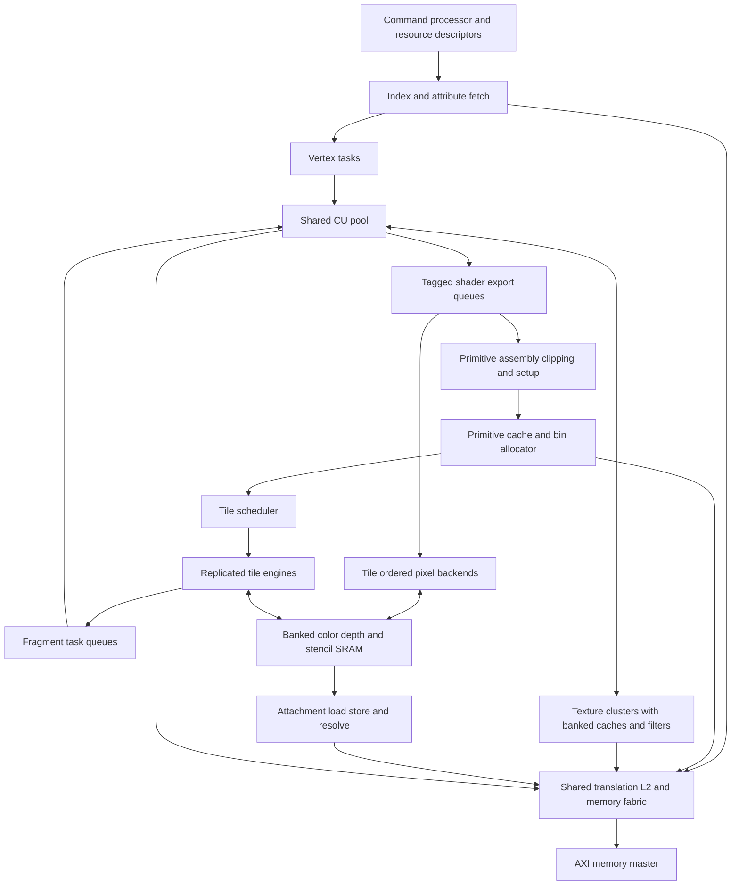

# Mobile GPU hardware alignment proposal

Status: proposed hardware architecture with H0/H1 implementation in progress, 2026-10-18. Baseline: `d038228`.

Evolve OpenGPU into a mobile rendering architecture by extending the shared CU pool with persistent tile storage, GPU geometry fetching, scalable texture and pixel backends, and general graphics resource descriptors. Keep shader arithmetic on the existing CUs. The first functional target is hardware sufficient for a complete GLES 3.0 implementation; a Mali-G31-class commercial comparison requires further feature, performance, and physical qualification.

The configuration and rates below are design targets, not measured capabilities. Implementation should proceed in bounded milestones, with correctness, throughput and timing gates before integration. Compiler and driver implementation are outside this plan; hardware interfaces needed by them are included.

## Target and scope

Use Mali-G31 as an older commercial reference class, rather than treating it as the definition of a current entry-level GPU. Arm lists GLES 3.2 support for that device. GLES 3.0 is therefore an intermediate capability target. [Arm Mali-G31](https://support.arm.com/compute-ip/mali-g31)

The initial OpenGPU product target is four shared CUs, with a 720p workload suite targeting 30 FPS first and 60 FPS subsequently at a physically qualified clock. Test desktop composition, textured 3D, opaque overdraw, transparent layers, small triangles, and 4x MSAA separately. These targets do not imply measured performance parity with a particular commercial device.

The hardware contract must cover shader execution, geometry, texture resources, rasterization, framebuffer operations, synchronization and faults. Display scanout remains a consumer of completed images. Its refresh rate is separate from rendering throughput.

## Current hardware and gaps

| Area | Current RTL or interface | Required evolution |
|---|---|---|
| Shader execution | Shared compute CUs already execute vertex and fragment tasks; vector FP32 arithmetic, including FMA, is connected | Improve task input/output transport, occupancy, control-flow/resource contracts and sustained issue/writeback throughput |
| Configuration | `GpuConfig` defaults to 16 lanes and eight warps; the mobile CU-count constant is four | One compute/graphics execution configuration; discoverable resource limits and explicit supported configuration combinations |
| Interstage transport | CU-scaled fragment workers, staging transactions and ordered output retirement | On-chip payload storage, export queues and tile-local retirement; avoid mandatory global-memory staging of every batch |
| Geometry | Clip, viewport, triangle setup and quad rasterization exist | Native index/attribute fetch, vertex reuse, instancing and complete required primitive behavior |
| Tiling | Optional single resident 16x16 tile, RGBA8 plus D24S8, up to four samples; binner replays eight triangle records per chunk | Render-pass attachment lifetime, scalable bin storage, multiple tile engines and spill/restart handling |
| Texturing | Per-worker samplers; four physical tap-read credits per sampler; bilinear and mip/trilinear paths; a shared single-word request/response fabric | Banked texture hits, scalable filtering throughput, general image/sampler descriptors, more dimensions and formats |
| Pixel operations | Depth/stencil/blending and MSAA exist; OM has configurable concurrent RMW slots | Banked tile-local pixel pipelines, legal early rejection, multiple color outputs and complete format semantics |
| Memory | Shared banked L2, Sv32 translation, GPU cache invalidation and AXI memory master | Aggregate bandwidth and outstanding budgets, context-tagged tile/texture state, scoped barriers and robust bin/payload memory |

The constructor default AXI beat is eight bytes, while emission supports 4 through 64 bytes. Benchmark configurations must record the selected width; there is no single width shared by every existing artifact. See [GpuHostSystemAxi](../src/main/scala/opengpu/system/GpuHostSystemAxi.scala) and [the emitter](../src/main/scala/opengpu/elaboration/EmitGpuHostSystemAxi.scala).

Program length limits also belong to different layers: the checked-in Gallium emitter has a 256-word code container, while the driver validator admits at most 512 instructions and four forward branch states. These are not a demonstrated 256-instruction CU fetch limit. General shader support requires a new submission and protection contract, rather than merely enlarging an RTL array. See [the validator](../driver/opengpu_shader_validator.h), [Gallium emitter](../userspace/gallium/opengpu_fs_emit.c) and [kernel shader launch](../src/main/scala/opengpu/graphics/KernelShaderStage.scala).

## Proposed block organization

A tile engine contains raster work generation, fragment dispatch state, a pixel backend and attachment storage. It can dispatch work to the shared CUs without owning a separate shader core. Texture clusters initially have locality affinity to pairs of CUs; scheduling may steal work when the destination has the necessary descriptors and payload access.

Shader lane count comes only from `GpuConfig`. A raster quad remains four pixels because derivatives use a 2x2 neighborhood. Raster quads, texture taps, SRAM banks and pixel pipelines are throughput resources with different units; none introduces a second shader VLEN.

## Initial four CU sizing

Keep these values in one proposed hardware configuration record. Derive transaction IDs, queue indices and SRAM addressing from it. Architectural limits, runtime bindings and elaboration-time capacities must be separate fields.

| Resource | Initial proposal | Meaning and scaling rule |
|---|---|---|
| Shared CUs | 4 CUs, 16 lanes, 8 resident warps per CU | Reuse existing execution profile; retain supported lane/warp parameterization |
| Tile engines | 2, initially 1 for bring-up | Default `ceil(CUs / 2)` for balanced configurations; independently selectable for isolation experiments |
| Raster output | 1 quad/cycle/engine | Eight candidate pixels/cycle at two engines; coverage and interpolation availability can reduce useful output |
| Texture clusters | 2 | Initially one per pair of CUs; requests include task, lane, descriptor and destination tags |
| Texture throughput | 1 RGBA8 bilinear sample/cycle/cluster | Conflict-free resident-data target; four tap words/cycle/cluster. Trilinear requires two bilinear groups |
| Texture cache | 8 KiB data/cluster, 64-byte lines, at least 4 word banks | Starting point for a capacity/bank sweep, including refill and response bandwidth |
| Texture outstanding fills | Start at 16 line fills/cluster; sweep 8/16/32 | Final value follows measured miss demand and memory latency; separate line fills from sample/tap credits |
| Pixel throughput | 4 sample updates/cycle/engine | RGBA8 plus D24S8, conflict-free resident data; includes the required old-value reads and writebacks |
| Tile attachment SRAM | 64 KiB data/engine | Two 32 KiB slots for rendering and attachment transfer; tags, queues and metadata are additional |
| Shader payload SRAM | 64 KiB shared, banked | Sweep 32/64/128 KiB; admission accounts for live input/output bytes and reserves a spill or drain path |
| Primitive and state cache | 32 KiB shared | Cache compact primitive/state records; software-allocated bin pages provide bounded backing storage |
| Color attachments | Architectural capacity 4 | MRT can serialize attachment work; the single-target throughput target does not imply four-target peak throughput |
| Shared L2 | Initially 128 KiB and 4 banks; sweep 64/128/256 KiB | Include bin, payload, texture and instruction contention in the comparison |
| External AXI | Initial integration candidate 256 bits; retain width parameter | Compare 128/256/512 at equal memory latency, controller limits and realistic bus efficiency |

At two texture clusters, the bilinear target needs eight 32-bit taps/cycle, or 32 bytes/cycle of cache-hit delivery. At two pixel engines, the target is eight sample updates/cycle: at most eight pixels/cycle at 1x, or two pixels/cycle at 4x when every sample is processed. Neither rate is a whole-frame guarantee.

The tile data calculation is:

`bytes per tile = width * height * samples * (sum(color attachment bytes) + depth/stencil bytes)`

| Tile layout | Data bytes | Data capacity |
|---|---:|---:|
| One RGBA8 plus D24S8, 4x | 8,192 | 8 KiB |
| Four RGBA8 plus D24S8, 4x | 20,480 | 20 KiB |
| Four RGBA16F plus D24S8, 4x | 36,864 | 36 KiB |
| Four RGBA16F plus D24S8, 4x, using 8x8 tiles | 9,216 | 9 KiB |

A 32 KiB slot therefore handles four RGBA8 attachments at 4x but requires smaller tiles for the illustrated four-RGBA16F layout. Support 8x8 and 16x16 tile classes through a shared descriptor and address calculation. Select a fitting tile class at pass admission. RGBA16F rendering/blending is a later product feature with explicit semantics; it is not implied to be required by base GLES 3.0.

The proposed tile, texture, payload, primitive and 128 KiB L2 arrays total 368 KiB of data storage. This excludes CU register files, instruction/data caches, shared memory, tags, queues and other state. SRAM area and energy depend on the selected technology and port organization; this is a capacity budget rather than a chip-area estimate.

Payload occupancy must also be counted in bytes. For example, 64 FP32 varying components across 128 resident threads occupy 32 KiB of input values per CU before outputs or metadata. A 64 KiB shared payload budget cannot hold that case for all four CUs simultaneously. Admission must reduce concurrency, interpolate values on demand, or spill through the defined fallback; it must never assume maximum varying count and maximum task residency are free to combine.

## Hardware work packages

### Render pass descriptors and tile lifetime

Add versioned descriptors for attachments, image views, samplers, shader resources, vertex layouts and render passes. Attachment views carry base, allocation bounds, format, extent, row/layer pitch, mip/layer selection and sample count. A pass snapshots its descriptors and assigns a context, pass ID and generation so later host updates cannot change in-flight work.

Keep attachments resident across compatible draws. Implement load, clear and discard on entry; store, discard and resolve on exit. A partial clear or scissor must preserve untouched samples. Clear tags may defer SRAM initialization, but reads must materialize the specified clear value. Resolve samples in tile storage and export only the selected result where permitted.

Texture reads of prior render output, DMA access, CPU visibility, incompatible attachments, queries requiring completion, and explicit barriers establish dependency boundaries. Store required dirty state and publish it to the relevant GPU cache domain before admitting dependent reads. Do not equate an L2 write with immediate CPU-cache coherence.

### Primitive storage and tile scheduling

Replace the hardcoded eight-triangle limit with bounded on-chip primitive/state caches and software-allocated bin pages. Store compact references to immutable primitive and draw state. Allocate pages with checked bounds and tagged ownership; overflow either spills to valid backing storage or stops at a defined restart point. No primitive may be silently dropped or executed twice.

Maintain submission order for operations affecting the same pixel/sample. Assign each active tile one attachment owner. Independent tiles can retire out of order; within a tile, primitive sequence numbers and completion masks prevent later fragments from overtaking earlier depth/stencil/blend work. Shading may run ahead only when its side effects and query semantics permit it.

Use load-balanced tile assignment, double-buffered attachment transfer and bounded fairness between vertex, fragment and compute work. Avoid a global fragment-retirement queue that makes one slow tile stop every engine. A full export queue must not prevent the scheduler from running the task needed to drain it; reserve progress credits and verify this dependency explicitly.

### On chip shader payload and exports

Introduce a banked payload SRAM addressed by task/payload handles. Raster/interpolation produces fragment inputs there; vertex and fragment tasks consume or export values through bounded CU-local ports. Start with SRAM payloads and explicit exports, then evaluate direct register delivery where register-file ports and occupancy justify it.

Retain a memory-backed path for oversized payloads and controlled spills. Reserve output capacity before dispatch and keep payload/state ownership until completion, cancellation or fault drain. Descriptors specify varying layout, masks, interpolation qualifiers, output locations and scratch bounds. Fragment exports carry tile, primitive order, coverage, discard, optional depth and attachment outputs.

Keep helper-lane execution distinct from coverage and side-effect masks. Derivative/quad exchange must work with partial warps and divergence, without allowing helper lanes to update memory or framebuffer state. Lane counts that cannot execute a full quad need an explicit supported grouping scheme or must reject graphics elaboration.

### Texture clusters

Replace the shared single-word bottleneck with banked cache access and tagged multiword replies. Specify bank mapping for adjacent 2x2 taps; measure conflicts on other patterns. Provide response queues, same-line miss joining, replacement rules and refill arbitration. Filter pipelines must sustain the proposed rate after warm-up; adding request ports alone is insufficient.

Cache identity includes physical line and relevant context/generation attributes. Preserve read/write permission faults and cache invalidation across image rebinding, translation changes and render-to-texture transitions. Retain pending fill ownership until cancellation is drained; do not interpret a failed translation as a successful zero texel.

Generalize descriptors and address generation for multiple images, cube/array/3D resources, explicit and implicit LOD, gradient-based sampling, depth comparison, and all required wrap modes. Remove the power-of-two-only repeat assumption. Use per-level metadata or cached mip offsets instead of requiring a serial level walk on every sample.

Add format-aware fetch/decode before filtering, including signed/unsigned and normalized values, required sRGB behavior, and ETC2/EAC block decode. Cache decoded blocks where useful. Integer fetches bypass inappropriate filtering. Packed FP16 arithmetic and ASTC are later efficiency/product extensions with separate area and compatibility decisions.

### Pixel pipelines and visibility rejection

Replace global address hazard searches with tile-local bank/row ownership and pipelined sample scoreboards. SRAM organization must support the promised read/modify/write rate, including color blending, depth/stencil, coverage and masks. Bank conflicts and repeated writes to one sample must serialize without corrupting order.

Introduce conservative early depth rejection, followed by hierarchical depth summaries where profitable. Track summary validity across clears, depth writes and tile transfers. Distinguish early testing from committing depth/stencil: shader discard, depth override, stencil outcomes, side effects and queries may require deferred updates or a late path. Correctness decides eligibility.

Extend outputs and format packing for MRT, integer targets, required depth formats, sRGB conversion and format-dependent blending. The existing 32-bit packed-color word must not become the universal shader export representation. Pipeline address calculation and arbitration to remove long coordinate-to-ready combinational paths.

### Geometry and general execution

Add GPU index reads, attribute descriptors and format conversion, vertex/instance IDs, divisors, restart and post-transform vertex reuse. Include points, lines, clipping, flat interpolation and provoking-vertex rules in the functional closure matrix; triangles alone do not complete the target. Provide transform-feedback export and query/count hooks with defined ordering.

Reuse existing FP32 FMA, conversion, division and square-root machinery. Measure register-file, issue, scoreboard and writeback limits before adding arithmetic lanes. Define shader-visible numeric behavior, rounding, denormals and precision by operation. Add reciprocal/other approximations only with measured error bounds and valid compiler contracts.

General loops and richer memory access require bounded scratch/resource descriptors, fetch/execute permissions, SIMT reconvergence overflow handling, watchdog interruption and fault attribution. Existing CU branch machinery and the restrictive shader validator are different layers. Increasing code length alone does not resolve safe execution or termination.

### Memory fabric and physical design

Keep a shared L2 and translation fabric, with request classes for instructions, texture fills, geometry/bin data, payload spills and attachment transfer. Partition or reserve credits so bulk binning/store traffic cannot starve fault completion or shader progress. Carry context and generation through requests and responses, with no transaction-ID aliasing during drain/reset.

Size miss windows from `outstanding lines >= sustained miss bytes/cycle * latency cycles / line bytes`. For example, 16 bytes/cycle of aggregate miss demand at 200-cycle latency needs at least 50 outstanding 64-byte lines, before headroom. This is an illustrative latency model, not a recommendation to allocate 50 slots in every sampler.

Use SRAM macros or characterized SRAM models for tile and cache arrays. Include read latency, port count, banking and arbitration in both functional timing and area. Add valid-based clock enables to CU, texture, tile and transfer pipelines; quantify switching on representative workloads. Physical power domains and retention can follow SoC integration requirements.

## Capability closure contract

The first hardware feature matrix should trace each GLES 3.0 requirement to native hardware, CU-executed support, or an explicit unsupported milestone. Selected minimum limits include four draw buffers, 16 vertex attributes, 2048-square 2D/cube textures, 256 array layers and a 256-texel 3D dimension. Cover uniforms, shader texture access in both stages, varying precision, integer operations, required formats, transform feedback, queries and synchronization in the complete matrix. [GLES 3.0 specification](https://registry.khronos.org/OpenGL/specs/es/3.0/es_spec_3.0.pdf)

Architectural capacity does not require fully parallel hardware for each binding. Descriptor tables and serialized operations may satisfy functional capacity while a smaller number of texture/filter/pixel pipelines provide throughput. Hardware capabilities must describe implemented limits accurately; Mesa exposure and conformance follow as a separate integration effort.

Commercial feature alignment continues after the initial GLES 3.0 hardware milestone:

| Capability stage | Additional hardware work | Architecture consequence |
|---|---|---|
| GLES 3.1 | Shader storage/image descriptors and access, required atomics, memory barriers, indirect work submission and compute resource limits | Extend existing compute/atomic machinery; define visibility across shader, texture, pixel and DMA clients |
| GLES 3.2 | Geometry and tessellation stage execution, primitive amplification, patch storage and synchronization, and the remaining texture/raster/blending requirements | Run programmable stages on the shared CUs; add bounded patch/output queues and a tessellation primitive-generation path before binning |
| Vulkan product target | Selected-version resource, synchronization, robustness and scheduling contract, followed by driver/conformance integration | Reuse tile/CU resources while validating the chosen API requirements independently |

Geometry and tessellation are part of the GLES 3.2 specification, so they belong in the longer commercial-alignment plan even if they follow the first mobile rendering backend. [GLES 3.2 specification](https://registry.khronos.org/OpenGL/specs/es/3.2/es_spec_3.2.pdf) Reserve stage tags, descriptor versioning and resource-table space in H0. Detail the later-stage limit matrix before committing their storage sizes or claiming API support.

## Performance model and acceptance gates

For a selected workload, calculate a lower bound in cycles:

`C >= max(warp instructions / sustained issue rate, FP operations / sustained FP rate, texture samples / sustained sample rate, sample updates / sustained pixel rate, setup work / setup rate, payload bytes / payload service rate, external bytes / sustained bytes per cycle)`

Use measured effective rates for the actual instruction/format mix. Add serial phases, launch overhead, dependency latency and pipeline drain to the scheduling model. The maximum of these terms is a lower bound, not a cycle prediction by itself.

At an assumed 500 MHz, 30 FPS permits about 16.67 million cycles/frame and 60 FPS about 8.33 million. A single RGBA8 1280x720 final store is 3,686,400 bytes/frame, or 221,184,000 bytes/second at 60 FPS. This excludes texture, geometry, bin, attachment-load, spill and display-read traffic. The proposed two-cluster texture cache-hit bandwidth is 16 GB/s at that assumed clock. A 256-bit AXI read channel also has a 16 GB/s ideal beat rate at 500 MHz, but actual DRAM service and utilization must be modeled separately.

Tile storage reduces repeated external attachment traffic by retaining intermediate values on chip. This is a mobile bandwidth/power design principle, not a guaranteed speedup for every scene. [Arm Mobile GPU 101](https://developer.arm.com/cfs-file/__key/communityserver-blogs-components-weblogfiles/00-00-00-20-66/siggraph_5F00_mmg_5F00_2024_5F00_Mobile101.pdf)

| Gate | Acceptance criterion |
|---|---|
| Functional | Reference-image/numeric checks for formats, MSAA, order, hazards, faults and overflow; randomized backpressure and reordered memory responses |
| Texture throughput | Each cluster reaches one bilinear RGBA8 result/cycle on a long conflict-free resident-data stream; separately report trilinear, misses, bank conflicts and dependent samples |
| Pixel throughput | Each engine reaches four RGBA8+D24S8 sample updates/cycle on a long conflict-free resident stream; include enabled blend/depth/stencil cases and report supported rates per mode |
| Attachment locality | An eligible clear/discard-start pass avoids old attachment reads; blending/depth intermediates stay on chip; final stores/resolves match the requested outputs |
| CU scaling | Target at least 3.2x for a specified long shader-bound 1-to-4-CU test with fixed non-CU resources and identical work; attribute the remaining gap with counters |
| Balanced scaling | Separately test 1/2/4 CUs with proportional texture/tile resources; retain a realistic fixed external-bandwidth case and identify its saturation point |
| Physical | Meet setup/hold and I/O constraints at the selected clock, with SRAM assumptions and implementation stage reported; compare area and energy/frame |
| Product workload | Meet the agreed 720p frame budget on each selected workload at a qualified clock, including binning, geometry, rendering and store/resolve |

The current qualified textured scene is 32,341 cycles on one CU and 11,566 on four, or about 2.80x. It is a retained regression workload, not a general theoretical scaling limit. [Qualification handoff](performance/optimization-pause-2026-10-17.json)

Current texture traces found a peak of 10 occupied slots out of 16 and about 0.06 percent cross-CU duplicate candidates in the captured desktop workload. Prioritize service bandwidth and bank conflicts over owner-table growth or duplicate multicast for that workload; these opportunity counters do not establish a causal speedup. [Texture contention measurements](performance/texture-arbiter-contention-2026-10-17.json)

Existing OM screening also failed the 1 GHz timing gate for both baseline and sharing candidates. Use that result to justify pipelined admission/address/hazard control. A design with fewer cycles must also improve or preserve elapsed time at its achievable clock. [Paused physical screening](performance/optimization-pause-2026-10-17.json)

## Implementation milestones

| Milestone | Deliverable | Exit evidence | Primary RTL touchpoints |
|---|---|---|---|
| H0 | Hardware capability/configuration record, descriptor definitions, counters and analytic workload budgets | Units and limits documented; supported elaboration combinations checked; baseline counters explain stage utilization | `GpuConfig`, `GraphicsConfig`, `JobConfig`, `SharedCuGraphicsPort`, performance bundles |
| H1 | One tile engine with pass-lifetime attachments and versioned state | Multiple ordered draws retain attachments; clear/load/store/discard/resolve and dependency boundaries are correct | `TileAttachmentStore`, `RenderPipeline`, render descriptors |
| H2 | Scalable bin pages and two independently progressing tile engines | Overflow/spill/restart, ordering, load balancing, double buffering and backpressure pass; attachment bytes/frame measured | Replacement/evolution of `TileDrawBinner`; new tile scheduler and transfer engine |
| H3 | Banked pixel backend, legal early rejection and pipelined hazards | Pixel throughput gate, adversarial same-sample ordering, early/late equivalence and physical timing | `OutputMerger`, tile SRAM, sample expansion and retirement |
| H4 | Banked texture clusters with general resource descriptors | Cache-hit throughput gate, miss/translation stress, multiple bindings and render-to-texture visibility | `TextureUnit`, `FragmentTextureArbiter`, `BufferedTextureWordPort`, translation routing |
| H5 | On-chip shader payload/export path and GPU geometry fetching | No mandatory per-fragment global staging in the common path; index/instance reuse, fault drain and task progress verified | `KernelFragStage`, `ParallelKernelFragStage`, shared task router, vertex stages and CU interfaces |
| H6 | Required format/primitive/resource coverage and product qualification | Hardware feature matrix closed, targeted API integration tests, 720p suite and physical reports | Format, texture, raster, execution, query and synchronization blocks |
| H7 | GLES 3.1 hardware closure | Storage/image access, atomics, barriers, indirect work and resource-limit matrix verified | CU memory, descriptor tables, command processor and shared cache/translation fabric |
| H8 | GLES 3.2 hardware closure | Geometry/tessellation, bounded amplification, stage ordering and remaining feature matrix verified | Shared task scheduling, patch SRAM, primitive generation and graphics backends |

H3 and H4 depend on the H0 interfaces but can be developed against unit harnesses before H2 completes. H5 payload and geometry changes should be separate reviewable series. Bring up one attachment and existing formats first; add MRT and the wider format contract after ownership and ordering are stable. Apply synthesis/timing gates throughout rather than postponing physical work until H6.

The first implementation slice should be **H0 plus H1**: define the hardware contract, then make several compatible draws render into one resident tile without intermediate attachment writeback. This creates a measurable bandwidth result and a stable base for subsequent parallel engines.

For H1, use overlapping triangles from multiple draws with blending and depth/stencil enabled, all within one tile. After a clear-start pass, require zero external reads of the cleared attachment contents and no intermediate attachment writes before the pass ends. Compare final stored samples against the existing ordered path. Repeat with a load-start pass, partial clear, texture/DMA dependency boundary, cancellation and a store fault. These checks distinguish persistent tile lifetime from merely changing triangle traversal order.

## Verification and delivery discipline

Add counters for tile residency/evictions, attachment bytes by operation, bin allocation/spill, active engines, primitive occupancy, payload traffic, queue stalls, eligible/rejected early tests, texture bank conflicts, useful cache bytes, fill occupancy and per-CU active/helper lanes. Avoid summing overlapping stall counters as if they were exclusive causes.

Use arithmetic/ordering proofs and component tests first, followed by small cycle benchmarks, synthesis, native trace replay and selected full-system smoke tests. Run full desktop validation at integration milestones. Freeze source/configuration and workload hashes for comparisons; report simulator wall time separately from GPU cycles and estimated silicon frame time.

Deliver each milestone as independently reviewable changes with its functional and throughput evidence. Keep the currently qualified desktop path available during bring-up. This proposal does not promote the paused private OM experiments into production RTL.

## Implementation evidence: H0/H1 bring-up

The implementation is experimental and does not close either milestone. The
original requirements, resource targets and H0–H8 exit gates above remain in
force. Evidence and hashes are recorded in
[the H0/H1 measurement record](performance/mobile-h1-tile-lifetime-2026-10-17.json).

Implemented and tested components:

- `MobileGpuConfig` records the proposed execution/resource profile, derives
  capacity and identifier sizes, selects fitting 8x8/16x16 tile classes, and
  rejects unsupported capacity combinations. These values are not advertised
  as implemented device capabilities.
- `MobileGpuBudget` computes conservative frame-cycle lower bounds from
  explicit work counts and sustained rates, preserves rate provenance, and
  distinguishes a fitting lower bound from a frame-rate pass.
- Versioned tile-pass descriptors snapshot attachment bounds, pitches,
  formats, load/store/resolve choices and context/pass/generation identity.
  Staged admission validates address arithmetic without 32-bit wraparound,
  including the exclusive 4 GiB allocation boundary.
- `PersistentTileAttachmentStore` retains one RGBA8-compatible color plane
  and one D24S8 plane across draws. It supports load/clear/discard, final
  store/discard, masked rectangle clears, and byte-wise half-up on-tile
  resolve at 1x/2x/4x. Both tile classes share the same SRAM address layout.
  At the maximum sample count, the current engine contains 8 KiB of attachment
  data, rather than the final proposed 64 KiB engine allocation.
- Attachment data uses synchronous single-port SRAM banks, with behavioral
  and characterized-macro implementations sharing the same read latency.
  Transfers use registered addresses/data; cancellation retains offered or
  outstanding memory ownership until drain, and faults fail the tagged pass.
- The optional `RenderPipeline(persistentAttachments = true)` triangle-record
  path intersects draw scissors with the admitted tile and freezes attachment
  and viewport state. A queued clear lets older OM work drain before taking
  ownership. The existing host/unified-command path keeps its prior behavior.

Component checks cover invalid descriptors, old-response drain, cancellation,
load/store/resolve faults, backpressure, partial clears, every supported sample
capacity, both tile classes and all four 8x8 quadrants. Fixed-function pipeline
checks compare four overlapping draws against the existing ordered path with
blending, depth/stencil, scissoring and an intervening masked clear. Clear-start
passes assert zero old-attachment reads and zero intermediate stores, and final
color/depth/stencil samples match the reference.

These checks establish correctness and attachment-locality progress, not a
whole-system performance pass. The serial reference has one outstanding
external transaction and the SRAM service is serialized. Its small-scene cycle
counts still exceed the ordered reference. The reference
models partial clear as an immediate memory update after draw drain, so its
clear-operation cost is not a fair hardware performance comparison. Use a
dedicated matched workload when qualifying transfer/backend speedups.

Remaining H0/H1 work includes broader resource descriptors and implemented
capability discovery, host command/VM integration, cache-domain publication for
dependent texture/DMA access, programmable shared-CU pass validation, concurrent
attachment-transfer product qualification, post-route setup/hold and
power qualification, and the integration-milestone desktop smoke. H2–H8 remain
required. The standalone synthesis screens in the measurement record are
component estimates and do not qualify the integrated GPU clock or energy/frame.
The staged-admission/SRAM component passes its 1 GHz synthesis setup screen
at TC/SLVT with the stated 25% I/O budget: core slack +26.670 ps and reported
I/O slack +39.924 ps. The completed exploration-mode route has zero DRC and
antenna errors but fails 1 GHz setup/hold: worst setup -530.636 ps, worst hold
-7.686 ps. The reported core setup estimate is 668.381 MHz, not a qualified
operating clock. A timing-repair flow remains separate from this result.

A separate [initial transfer-credit candidate](performance/mobile-h1-transfer-credits-2026-10-17.json)
passes isolated tests for 1/3/8 credits, reordered acknowledgements, stable
backpressure, repeated-address serialization and cancellation/fault drain.
It sustains one request/cycle with a ready port after warm-up and passes its
standalone 1 GHz synthesis setup screen.

The [concurrent transfer integration](performance/mobile-h1-concurrent-transfers-2026-10-17.json)
adds optional bounded write credits while retaining the serial reference.
Private preparation acknowledgements transfer ownership to the write queue;
pass completion waits for every actual external acknowledgement. Late faults,
reordered replies, context reuse and randomized load/clear/discard/resolve
lifetimes are tested. The proposed mobile profile starts with eight credits;
the existing default remains the serial path during physical qualification.

In a matched 4x-MSAA component workload with identical hardware clear work,
936 stores, fixed 32-cycle word response latency and an eight-request external
window, eight credits reduce total cycles from 43,399 to 15,005. Pre-store draw
work stays at 10,757 cycles and final samples match. A 2/4/8/16/32-credit sweep
gives 27,617/19,201/15,005/14,656/14,656 cycles. This is a word-service model,
not an AXI/DRAM or whole-frame performance claim. Both eight- and sixteen-credit
components pass their standalone 1 GHz synthesis setup screens; post-route
timing and area/energy tradeoffs remain under qualification.

The completed eight-credit timing-repair route passes hold (+26.809 ps), DRC,
antenna and placement checks, but still fails 1 GHz setup (-124.621 ps including
I/O; core-only -20.28 ps). Its worst endpoint is the `clearRead` diagnostic
output. A [registered diagnostic candidate](performance/mobile-h1-registered-events-2026-10-17.json)
preserves exact event totals with a one-cycle delay and passes 16 concurrent
component checks. Its synthesis setup screen reports +8.170 ps core and
+256.364 ps I/O. Its completed route still fails 1 GHz setup by 2.460 ps on
one core path; hold is +27.297 ps, I/O setup is +68.84 ps, and DRC/antenna
checks pass. The remaining worst path is an admission partial product, rather
than the diagnostic output. This frozen component predates execution-fault input
changes, so it cannot qualify the latest component or the integrated GPU.

The [execution-failure path](performance/mobile-h1-execution-faults-2026-10-17.json)
now fails the resident pass on accepted fragment traps, unsuccessful task
completions and staging-memory faults. Completion retains context/pass/generation
through producer and memory drain; a later pass starts with a fresh status.
The experimental completion status is three bits, preserving values 0–3 and
adding execution failure as value 4. The existing host `shaderFault` output
also reports failed fragment completions and staging faults.

Thirty-nine checks pass on the recorded source, including single/parallel
shared-CU boundary failure cases, native CU-backed rendering, both tile classes,
randomized attachment lifetimes and the matched transfer benchmark. The shared
boundary harness models the shader ABI protocol; full system CU-pool and VM/cache
integration remain required. Legacy word staging also waits for the first quad's
producer write and correctly sizes indices for non-power-of-two batch capacities;
4/8/12/16/112/128-fragment configurations are checked with faults and reuse.

An [optional command-fetch ownership path](performance/mobile-h1-command-drain-2026-10-17.json)
snapshots the command base/count, discards unaccepted records on cancellation,
and drains offered or issued reads before admitting another binding. Its
registered sequential address advances only on a read handshake. Eleven checks
cover both record formats, queued-record discard, bus backpressure and reuse,
including the three existing decoder regressions. The subsequent command-core
integration below connects this prerequisite to `RenderCore`. At that checkpoint,
unified host submission, VM/allocation ownership and cache-domain publication
remained required; subsequent host checkpoints below address those interfaces.
With the same eight-record FIFO and 1 GHz synthesis constraints, the optional
reader reports +503.856 ps core and +456.246 ps I/O setup slack; the existing
reader reports +285.019 ps and +11.587 ps. These are setup synthesis screens,
not post-route clocks or whole-frame measurements.

The [bounded command-driven tile core](performance/mobile-h1-command-core-2026-10-17.json)
adds an optional `RenderCore(persistentAttachments = true)` job interface. A
`TileCommandJob` snapshots the pass, viewport, draw defaults and command binding;
the exclusive command limit is checked with 33-bit end arithmetic before fetch.
Commands start after pass admission, and final store/resolve waits for command
and render drain. Cancellation, command-memory faults and shader failures stop
prefetch while retaining outstanding read ownership. The controller latches one
tagged completion after all traffic drains and keeps it stable under backpressure.
Command-memory faults use completion status 5; other existing status values stay
unchanged.

Five controller checks and a sixteen-scenario command-driven rendering check
cover invalid/overflowing bounds, the exact 4 GiB boundary, empty jobs, descriptor
mutation, early and in-flight cancellation, command/store faults, final samples,
completion stability, default blending, per-record overrides and healthy reuse.
All resolved draw defaults are materialized from the job snapshot for records
without an override. Seven existing `RenderCore` regressions also pass in the
same thirteen-check cohort, including actual CU-backed shader rendering. At that
checkpoint the new job interface was separate from `RenderHost`/unified AXI
submission. The later host profile below connects it; mixed clear/draw host
commands and broader dependency publication remain required. Controller and
fixed-function core synthesis screens are recorded
separately; neither is a full-GPU physical or 720p frame-rate qualification.
The controller passes its 1 GHz synthesis setup screen (+462.011 ps core,
+413.436 ps I/O). The larger fixed-function core screen is rejected because
the `syn` engine omitted division operators; no renderer frequency follows
from that partial netlist. The subsequent
[Yosys mapping attempt](performance/mobile-h1-core-mapping-failure-2026-10-18.json)
also terminated without a mapped netlist: error 247 after 32:54, with peak memory
near 30 GB. Its exact termination cause is not proven by the retained logs.
It establishes neither renderer timing nor area; the division-heavy geometry
datapaths still need a complete, successfully mapped physical implementation.
The [mapping audit](performance/mobile-h1-mapping-audit-2026-10-18.json) records
the prior screens; the qualifier now rejects omitted operators and missing
mapping evidence, with 24 Python checks covering mapping and timing gates.

The [next admission pipeline](performance/mobile-h1-admission-pipeline-2026-10-18.json)
registers pitch-half products and splits address sums at bit 16 while retaining
their full high carries. It adds three admission cycles. Twenty-seven integration
checks pass, and an expanded 248-descriptor BigInt interval oracle covers upper
coordinates, high pitches, carry boundaries, overflow and exact 4 GiB allocation
ends. The matched eight-credit workload is now 15,008 cycles (serial 43,402),
with unchanged samples and traffic. The component passes its 1 GHz synthesis
setup and mapping screen at +73.113 ps core and +242.262 ps I/O. The completed
component route is recorded below; workload energy and integrated GPU
performance remain unqualified.

The experimental persistent core now has an accepted-response texture-fault
sideband. A failed texture response cancels command prefetch and attachment
export, drains outstanding work, and returns status 6 with the original pass
identity. A fault sideband without an accepted response has no effect. Secondary
shader failures during texture drain cannot hide that attribution; an already
published completion stays stable even if later fault inputs change.

The [shared-system validation](performance/mobile-h1-shared-system-2026-10-18.json)
connects persistent command jobs to actual system CUs, their coherent caches,
shared L2 and existing Sv32 clients, without private graphics CUs. Four
configuration checks cover two CUs in Bare and Sv32 modes, four CUs with
four lanes/two warps, and four CUs with sixteen lanes/eight warps. All assert
multi-CU graphics ownership, overlapping graphics/compute CU occupancy, a
colliding local command ID, exact stored color/depth samples, shader-trap drain
and healthy reuse. The Sv32 cases change roots, ASIDs and physical backing at
drained boundaries, reject an invalid command mapping, and then render again.
An overwrite draw makes stale shader inputs observable instead of hiding them
behind equal-depth rejection. Responses are delayed, reordered and backpressured;
transaction IDs cannot alias live requests.

Eleven distinct checks pass: four system configurations, six controller checks,
and one fixed-function job check containing seventeen scenarios. The latter
includes an accepted texture fault with zero attachment exports. Run the large
configuration with `sbt -J-Xmx8G 'testOnly opengpu.graphics.PersistentTileSharedSystemSpec'`;
it explicitly reports insufficient heap below 4 GiB. These small 8x8,
single-sample workloads use dispatch limits of eight or sixteen fragments and
do not establish full warp occupancy, scaling, bandwidth, FPS or energy. The
harness pins VM state externally until complete drain; production host/AXI
submission, context ownership, dependency publication and the remaining H0–H8
gates are still required.

The [integrated host now enforces a serialized VM boundary](performance/mobile-h1-vm-ownership-2026-10-18.json), advertised as
`GPU_CAP_PROTECTED_VM_STATE` (bit 29). SATP and TLB-flush writes are rejected
with AXI `SLVERR` while staged commands, executing graphics/compute/DMA,
cache invalidations, lower-memory traffic, reset or unconsumed results retain
ownership. Rejection preserves both SATPs and suppresses the flush pulse.
The AXI response retains a rejected beat through a backpressured burst result;
invalid bus addresses cannot drive the register file. This replaces the earlier
software-only quiescence precondition for the integrated host. Explicit persistent
job descriptors and host submission, concurrent context scheduling and scoped
dependency publication remain required.

Twenty-six checks pass on the final VM-guard source, including actual stalled
descriptor reads, translated compute, software-held completions, buffered and
unbuffered command clients, twelve-cycle response backpressure and a rejected
burst whose final beat succeeds. An earlier guard also passes the twenty-three
existing full-system regression checks; that run predates the final stricter
response-presentation check. Kernel-free driver tests pass. The protected MMIO
control block passes its standalone 1 GHz synthesis/mapping screen at +434.332 ps
core and +306.617 ps I/O; this excludes system quiescence aggregation, the AXI
adapter and post-route timing.

The frozen admission-pipeline tile store now
[passes its 1 GHz post-route qualification](performance/mobile-h1-post-route-2026-10-18.json)
at the selected TC/SLVT corner with the recorded 25% I/O timing budget. Global
setup slack is +19.219 ps, hold is +29.397 ps, and I/O setup is +63.10 ps.
Setup/hold violations, route DRC, antenna, placement and flow errors are zero;
mapping is complete. Its emitted RTL is byte-identical to the prior passing
synthesis candidate. The tool reports instance area 12,929.3 and estimated
power 0.161291 W; no workload-specific switching or frame energy was measured.
This qualifies the eight-credit attachment component with synchronous SRAM,
including admission, clear, transfer and resolve logic. Integrated renderer
mapping/timing, broader physical corners and the full performance/product
qualification remain required.

The [bounded persistent host profile](performance/mobile-h1-persistent-host-2026-10-18.json)
now connects memory descriptors to `TileCommandJob` through the unified AXI
host and the protected VM boundary. It is explicitly selected with
`persistentAttachments = true` or `--persistent-tile-jobs`; the default desktop
profile keeps its existing descriptor and capability contract. The new profile
advertises bit 30 and opcode 7, rejects the legacy render opcode, and fetches a
versioned 256-byte descriptor as four uncached cache-line reads. It validates the
full 33-bit allocation before fetch, rejects reserved/truncated encodings, then
retains attachment views and all draw defaults through completion. The descriptor
reuses four reserved DMA transaction IDs before staging starts, adding no
simultaneous ID owner. Reads can overlap and responses may return in any order;
cancellation or a line fault retains every stalled offer and live response until
drain. The C ABI and every field offset are checked.

Unified DMA/resolve/invalidate commands serialize against tile jobs in queue
order; unrelated compute remains dispatchable in the same VM. A small outstanding
memory-owner counter covers queued and executing commands through completion,
including reset. Native 256-bit AXI tests queue tile → strided DMA → tile: the
transfer sees all 512 exported tile bytes before the next descriptor fetch, and
the final blended pass loads and preserves that copy. Descriptor reset/cancellation,
Sv32 rebinding, failed descriptor/command/attachment reads, shader traps, texture
faults, stable results and healthy reuse run through the real hierarchy. The
programmable host tests cover two actual shared CUs with four lanes/two warps
and four shared CUs with sixteen lanes/eight warps. Final-image, traffic, fault,
reset and Sv32 checks run through the complete host path. Smaller whole-warp
fragment batches activate all configured CUs; the counter observes four active
CUs in the four-CU host test. This does not establish full warp occupancy or a
scaling result.

An attachment-load fault exposed a producer-drain deadlock: the store failed
while command prefetch kept a later draw live. Accepted attachment faults now
cancel prefetch, retain attachment-fault status 3 through secondary failures,
and drain before host retirement. Both fixed-function and shared-CU host tests
verify zero attachment exports for the failed job. A two-draw load-start pass
with depth `NEVER` fetches each covered old depth sample once (49 reads) and
exports nothing; a clear-start pass reads no old attachments and exports exactly
512 bytes after both draws.

The initial host implementation passed 52 distinct checks, as recorded above.
The [descriptor-window evidence](performance/mobile-h1-descriptor-window-2026-10-18.json)
records subsequent validation and physical checks. In a controlled reader test
with twelve-cycle responses, a transport limited to one outstanding line takes
54 cycles to offer the job; permitting four takes 18 cycles with identical
decoded state. These are component cycles, not an AXI/frame-rate measurement.
The final cohorts pass 56 distinct checks: 47 unchanged ABI/legacy/control checks,
six descriptor-reader checks and three host configurations. The host checks in
the earlier 50-test regression are repeated by the final nine-test cohort and
counted once.
The updated reader passes its standalone 1 GHz synthesis/mapping screen
(+294.981 ps core, +406.521 ps I/O) and its TC/SLVT 1 GHz routed check with a
25% I/O delay budget: +282.140 ps worst setup, +27.1948 ps worst hold and zero
setup/hold, DRC, antenna, placement or flow errors. Both checks cover only the
descriptor reader; they exclude the host, shared CUs and full renderer. The
reported power has no workload activity and does not qualify energy per frame.
The initial profile rejected command/texture buffering and framebuffer write
coalescing until their fault callbacks carried the required ownership. Command
buffering is now validated below; texture buffering and framebuffer combining
remain gated. Version-2
mixed clear/draw commands are described below. Broader resources, scoped dependency events,
driver adoption, multiple tile engines and the remaining H0–H8 gates remain
required. No frame-rate, energy or commercial-GPU parity follows from this
single-tile correctness workload.

## Implementation evidence: render-to-texture publication

The [native texture-publication record](performance/mobile-h1-texture-publication-2026-10-18.json)
adds three system checks covering fixed-function rendering, two shared CUs at
four lanes/two warps, and four shared CUs at sixteen lanes/eight warps. Each
profile uses the proposed 128 KiB four-bank L2 and repeats its sequence in Bare
and Sv32 modes: thirty jobs across six backend/VM combinations. This validates
that cache capacity in the native functional model, without qualifying its
physical timing or sustained bandwidth.

Two initial sampling jobs prove a physical texture line is resident: the first
causes one lower-memory source-line fetch and the second causes none. A producer
then renders new contents into that image while a dependent sampling job is
queued. The consumer cannot fetch its descriptor before producer result
publication and all 512 attachment bytes have been acknowledged. It refills the
source line once and samples the new contents. A following format-only rebind
decodes the same cached bytes as BGRA without another lower-memory source fetch.
Every job checks all 64 color/depth positions, including untouched clear pixels;
RGBA output packing, shader alpha, fixed-function modulation and ordered depth
rejection use independent expected values.

A controlled negative test temporarily disabled resident-line invalidation at
L2 store acceptance. The consumer then produced the old sampled color instead
of the new one. The production source was restored byte-for-byte before the
final passing run. Existing L2 publication and per-instruction shader tap-cache
invalidation already satisfy this tested path; no RTL change was needed.

This covers one hot-line render-to-texture dependency through the current
serialized host boundary. General bounded image resources, broader formats and
filtering, scoped dependencies, concurrent engines, the proposed texture-cache
clusters and throughput, scalable command storage and the other
H0–H8 exit gates remain required. These checks do not establish frame rate,
full warp occupancy, power or commercial-GPU parity.

## Implementation evidence: ordered clear/draw command streams

The [typed-command record](performance/mobile-h1-typed-commands-2026-10-18.json)
adds descriptor magic `0x47545002` and capability bit 31. Its 164-byte records
carry one type word and forty payload words. Draw payloads retain the full
existing inline layout, including scissors; clear payloads carry a tile-local
rectangle and packed color/depth masks and values. Version 1 and the default
desktop ABI retain their 160-byte draw records. Count/range admission checks
the selected stride with the full 33-bit end, including the exact 4 GiB case.

A shared FIFO stores a type and a union payload rather than duplicating a draw
and clear payload in each entry. Clear admission waits for older accepted
geometry and OM work before closing the draw gate, so an older clipped fan can
still progress. An accepted clear holds younger draws until completion.
Cancellation discards unaccepted tokens, drains offered/issued command reads
and waits for the accepted clear owner to retire. Invalid encodings or
rectangles fail with status 1; a clear-load fault retains attachment status 3.

Native AXI checks cover fixed-function rendering, two shared CUs at four
lanes/two warps and four shared CUs at sixteen lanes/eight warps, with both Bare
and Sv32 addressing. A six-command stream runs a no-op clear, three overlapping
draws and two masked clears. The checks independently compute additive and
destination-preserving blending, depth rejection, stencil comparison/inversion,
and preserved alpha/channels, including uncovered pixels. Successful passes
fetch 984 logical command bytes, read zero old attachment data and export only
512 final attachment bytes. Short bounds, unsupported types, reserved payload,
invalid rectangles, a masked-clear LOAD fault, reset during that read and healthy
reuse also pass. The final regression covers 78 distinct checks across twelve
suites; parser/scissor and expanded native replays count repeated checks once.
The driver/C layout tests verify both record sizes and clear-field offsets.

Fresh synthesis/mapping and routed checks are recorded separately for the
parser, controller and descriptor reader. They cover those components, with
explicit standalone floorplans and I/O budgets, rather than the integrated
renderer. The controller's initial floorplan could not place all exposed I/O;
its enlarged floorplan retains the clock and I/O constraints. No full GPU clock
or energy qualification follows. At TC/SLVT, 1 GHz and a 25% I/O delay budget,
all three routes have zero setup/hold violations, DRC, antenna, placement or
flow errors:

| Block | Worst setup slack (ps) | Worst hold slack (ps) |
|---|---:|---:|
| Typed command parser | +76.5107 | +29.5621 |
| Pass controller, enlarged standalone floorplan | +315.989 | +15.3648 |
| Descriptor reader | +244.566 | +31.3226 |

Typed host clear coverage here uses 1x and
the small test L2; the separate texture-publication checks exercise the proposed
128 KiB cache. Full product combinations, compact command/bin references,
broader resources and the remaining H0–H8 gates
remain required.

## Implementation evidence: buffered command replies and fault status

The [buffered-command record](performance/mobile-h1-buffered-commands-2026-10-18.json)
adds job-local command reuse to the persistent profile with
`--buffer-command-reads`. Fills still bypass L2; one immutable 64-byte line is
retained until replacement or invalidation. Idle/job boundaries, reset entry,
SATP changes and TLB flushes revoke reuse, including pending fills, while accepted
word replies keep their data and fault status through backpressure and drain.

The legacy translated-client fault pulse occurs when the lower line response
is consumed. A buffered word is offered later, so qualifying that earlier pulse
with word-response acceptance loses the fault. The command buffer now retains
fault status alongside its word, clears it on clean cache hits, and exposes it
to the persistent controller at that word's handshake. The legacy line event
is unchanged. A controlled negative test restored the old connection and a
command-faulted job incorrectly exported an attachment; the corrected source
was restored before the final passing runs.

Matched native host checks retain the same input records, bus delays and pixel
oracles in both cache modes. For two version-1 draws, physical command-line
reads fall from 80 to 5; for the six-command version-2 clear/draw stream they
fall from 246 to 16 (15.375 times fewer requests). Logical completion bytes
remain 320/984 respectively, with zero old reads for clear-start attachments
and 512 final export bytes. These source-line counts exclude other GPU traffic.

For the Sv32 healthy recovery job, measured cycles from after submission to
completion IRQ are:

| Backend | Unbuffered cycles | Buffered cycles | Reduction |
|---|---:|---:|---:|
| Fixed-function reference | 6,843 | 4,392 | 35.8% |
| Two shared CUs, 4 lanes/2 warps | 10,210 | 9,202 | 9.9% |
| Four shared CUs, 16 lanes/8 warps | 7,658 | 6,294 | 17.8% |

These timings cover one deterministic small-scene trace with the small test
L2, including the cache/arbitration effects of that trace. They are not isolated
cold starts, sustained scaling measurements or frame-rate estimates. Starting
a new job in the previous cached tail line after CPU replacement tests the
actual job invalidation boundary; merely starting on a different line would
evict the old line and miss that failure. First/last-line faults, reset during a
command fill, clear faults, VM rebinding, precise status and healthy reuse are
also checked. Texture buffering and framebuffer combining remain gated until
their logical fault ownership is implemented. The original H0–H8 resource,
throughput, physical and API-facing requirements remain in force.

The command bridge accepts only one outstanding word/miss. Its translator now
uses one registered, non-flowing pending entry instead of the default sixteen;
other clients retain their existing queue window. For the isolated generic
read/write client with 16 word IDs and 256 line IDs, mapped synthesis area falls
from 8,125.05 to 1,915 tool units (76.4%). Both netlists pass mapping and 1 GHz
synthesis setup at TC/SLVT with 25% I/O delays. This is a client-level comparison;
the integrated read-only command path may constant-fold more logic, and these
numbers do not establish whole-GPU area, power or clock.

At the same 1 GHz clock, corner, I/O budget and 10% standalone floorplan
utilization, routed results are:

| Pending entries | Mapped routed area, tool units | Sequential cells | Setup slack, ps | Hold slack, ps | DRC errors |
|---|---:|---:|---:|---:|---:|
| 16, original baseline | 8,101.44 | 11,904 | -3.26117 | +30.0672 | 0 |
| 1, revised client | 2,049.66 | 2,803 | +145.297 | +15.2867 | 0 |

The original baseline fails setup; the revised client passes the complete
mapping and routed gate, including I/O, setup/hold, placement, DRC and antenna.
Routed instance area decreases 74.7%. All 66 buffered typed-job trace records,
including cycle counts, are identical before and after queue reduction.

The regression covers 106 distinct checks in 17 suites. The 28 checks affected
by queue reduction are replayed on the final source and counted once, replacing
their earlier results. Final emitted RTL is byte-identical to the frozen
one-entry client used for physical qualification. Native typed MSAA/product
combinations and attachment-store AXI B-response faults remain separate work;
these results do not close H0/H1 or any later milestone.

## H1 product-profile MSAA and attachment write faults

[The native functional checkpoint](performance/mobile-h1-product-functional-2026-10-18.json)
records 135 passing checks in 22 suites. This includes the previous 106 checks,
25 raster checks, two product MSAA checks and two attachment-write fault checks;
repeated discovery runs are counted once.

The rasterizer now intersects its walk bounds with the snapshotted runtime
scissor in every configuration. Previously only bin replay enabled this
optimization, so a persistent tile could scan a screen-sized triangle for each
small tile. Odd bounds retain complete 2x2 helper groups; empty or inverted
scissors finish without requiring output readiness. Independent plane/sample
checks cover 84 submissions at a 1280x720 viewport, both scan orders and all
three sample counts. The prior implementation fails the bounded-walk check.

The native product matrix covers 24 jobs: fixed and shared shader backends,
1x/2x/4x MSAA, 8x8/16x16 tiles, Bare/Sv32 translation, and alternating clear/load
starts. Each job uses the proposed 128 KiB four-bank L2 and 256-bit AXI bus.
Shared shading uses all four CUs with 16 lanes and eight warps. Every stored
color/depth/stencil sample and resolved pixel is checked after an ordered typed
draw/partial-clear/blend stream. These are single-tile functional measurements,
not complete 720p frames or an FPS result.

A further 68 jobs inject first/last color, depth and resolve B-response errors,
reset during STORE, and reset combined with an error, followed by healthy
reuse. Completion waits for all accepted transfers to drain; errors report
status 3 and reset discards the old completion. Already accepted writes may
change backing memory. A negative control disconnecting attachment-fault
propagation fails the status assertion as expected.

Qualification remains incomplete. The real 1280x720 quad rasterizer baseline
maps fully but fails the routed 1 GHz setup gate at TC/SLVT with 25% I/O delays
and 25% utilization: setup -966.104 ps, hold +30.8655 ps, DRC errors zero.
The scissor-only revision also fails setup: -965.301 ps, with 1,863 violating
setup endpoints, hold +31.7091 ps and zero DRC errors. The fixed Linux DRM smoke
also failed a compute-fence timeout; this checkpoint does not claim a passing
desktop integration. Arithmetic/timing improvements and that investigation
continue separately. All original H0–H8 requirements remain in force.

## Exact wide arithmetic components

[The isolated arithmetic record](performance/mobile-exact-prefix-arithmetic-2026-10-18.json)
qualifies reusable block-prefix addition and carry-save three-term summation.
They preserve full unsigned results and exact signed modular results without
approximation. Twenty-two numeric checks cover exhaustive small widths,
partial carry groups, long carries and wider boundary/randomized inputs.

Equal registered-endpoint fixtures produce these routed results at 1 GHz,
ASAP7 TC/SLVT, 25% I/O delay and 25% utilization:

| Fixture | Implementation | Area, tool units | Sequential cells | Setup, ps | Hold, ps | DRC errors |
|---|---|---:|---:|---:|---:|---:|
| Two 64-bit terms plus carry-in | Native | 169.245 | 194 | +209.820 | +49.3737 | 0 |
| Two 64-bit terms plus carry-in | Block prefix | 146.325 | 194 | +470.042 | +41.1603 | 0 |
| Three 64-bit terms | Native | 228.337 | 258 | +0.802358 | +44.3334 | 0 |
| Three 64-bit terms | Carry save plus block prefix | 204.091 | 258 | +185.004 | +44.0361 | 0 |

All four fixtures pass mapping and the complete routed gate. These results
justify evaluating the primitives in wider raster datapaths. They do not
qualify an integrated rasterizer, renderer, CU or whole-GPU clock; integration
requires separate numeric, ordering, throughput and physical evidence.

## Native replay of the Linux compute smoke

[The compute replay record](performance/mobile-drm-compute-replay-2026-10-18.json)
checks the actual Linux smoke shader on both four-lane and sixteen-lane CU
profiles in Bare and private Sv32 modes. The 23-word shader defines the
slide-down destination and masks its last active lane, preserving the intended
reduction result without reading an undefined tail beyond VL=4. The native
test requires its instruction words to match the C smoke source exactly.

Both profile checks pass, including every kernarg word, masked/strided/indexed
memory operations, prior FILL event dependency, private code mapping and
physical code-cache publication before restoring the job VM. The aggregate
27-check run also retains the first queued raster revision's 24 product MSAA
jobs and 23 integer ALU checks. Later raster revisions need their own replay.
The first Linux guest run failed during paced flip-event delivery. A fresh
64x64 fixed-function run with the configurable emulator wait budget passes
the complete configured DRM smoke on the frozen scissor-only RTL. Subsequent
arithmetic, queue and resident-path revisions still need their own full-system
qualification; this is not a 720p or whole-GPU clock result.

## Queued quad rasterization and resident traversal

[The raster integration record](performance/mobile-raster-pipeline-2026-10-18.json)
tracks the staged setup, registered sample offsets and two non-flowing quad
queues. Filtering empty quads after the output register removes coverage
arithmetic from its write enable. Draw admission waits for the final queued
output, preserving its snapshotted context under backpressure.

Forty-six component checks pass on both V8 and V9, including 512 consecutive
quad outputs in each sample mode and 144 cycle-for-cycle comparisons between
tiled and row-major traversal on admitted tile scissors. Persistent passes
now use the row-major scanner: admission and draw-scissor intersection keep
each job inside one aligned 8x8/16x16 tile. Attachment storage remains on the
original engine configuration, and the general tiled walker remains available.

V8 passes 24 native product MSAA jobs on fixed and shared-CU backends with
the 128 KiB L2, 256-bit AXI and 1280x720 viewport. These are single-tile jobs.
Universal combinational proofs cover parallel bounds, sample offsets,
bottom-right quad sums, cross-product subtraction and V9 scan-step additions;
their individual source versions and arithmetic scopes are recorded.

At unchanged 1 GHz TC/SLVT synthesis constraints, the resident V7 and V8
screens fail setup at -318.114 ps and -235.250 ps respectively. V9 also fails,
at -258.308 ps: its critical path now runs from the area/cull calculation to
wide engine register enables. All three map completely. These are pre-layout
screens, not routed clock qualifications; V1-V5 use the general tiled profile
and must not be treated as an isolated arithmetic comparison with V6-V9.
Direct current-candidate product replay, Linux integration, post-route
qualification and the original H0-H8 gates remain open.

V10 removes the area/cull decision from scan-data register enables. Only
`active` gates output validity; inactive scan data can load because prior
outputs must drain before a new draw is admitted. Setup gains no extra cycle.
All 47 component checks pass, including degenerate/front/back rejection under
stalls followed by healthy coverage reuse. V10 also passes all 24 native
single-tile product jobs on fixed and shared-CU backends. Synthesis maps
completely but still fails at -222.905 ps; the next
verified path is vertex X through minimum selection and bound padding.

The signed32 prefix-padding experiment (V11) preserves all bound/offset
combinations formally and passes the same 47 component checks, but worsens
synthesis setup to -275.645 ps. That implementation was removed; its frozen
source, proof and negative timing result remain in the measurement record.

V12 retains native bound padding and uses a prefix carry-out with explicit
sign selection for the signed comparisons. All 47 component checks and the
universal 96-input-bit min/max proof pass. Synthesis maps completely and
improves worst setup to -170.732 ps, with I/O setup +229.416 ps. It still
fails 1 GHz. The next netlist-confirmed path is a signed32x32 cross-product
multiply, from `vHold_v1_y[8]` to `crossLeft_2[62]`.

The V8 STORE/reset/fault replay also passes all 68 jobs on fixed and shared
profiles. Those clear-only jobs verify ownership and accepted-write drain;
they do not demonstrate shader activity or qualify later source revisions.

V13 splits each signed32 cross-product multiply into registered half-word
products and an exact assembly stage. It adds one setup cycle and retains
512 consecutive quad outputs per sample mode. All 48 component checks pass,
including 2,673 full signed-product cases; all 24 native product jobs also
pass on the frozen V13 classes. A universal proof covers all 130 assembly
input bits. The separate full-multiply bit-level proof timed out after 30
seconds and remains unproven. Synthesis still fails at -148.267 ps.

V14 replaces wide coefficient negation on top-left flags with sign/zero
predicates, including the fixed-width minimum-negative corner. All 48
component checks and the universal 69-input-bit predicate proof pass. The
overall synthesis result still fails and worsens versus V13; the critical
path now reaches the area-product register from a plane coefficient. This
is a remaining native multiply, not a qualified clock or a throughput win.

## Exact programmable desktop image oracle

[The fragment image replay](performance/mobile-drm-fragment-image-2026-10-18.json)
explains a programmable 64x64 Linux smoke failure on the frozen scissor-only
baseline. The guest rendered 1,009 sampled-color pixels, while its count
formula required 1,008. Independent top-left coverage and nonempty-quad
enumeration predict 1,009: the shader discards warp zero, and edge quads do
not contain equal numbers of covered lanes.

A native replay checks all 4,096 pixels against that independent mask on both
initial rendering and recovery, and requires the fragment instructions to
match the actual 21-word C shader. Both images pass. The C smoke now derives
its exact count from coverage, quad order and batch capacity; its checks for
alternate colors and subsequent render/stencil/teardown results remain.
The corrected full Linux smoke passes on the identical frozen model and
powers off cleanly. Its archived log and exact binary/kernel/driver/test
hashes are recorded, including paced flip intervals of 65,980 and 37,802 us.
This four-lane legacy graphics evidence does not qualify the current raster
revision or the proposed shared-CU mobile product.

## Raster setup and queue retiming follow-up

[The retiming measurements](performance/mobile-raster-retiming-2026-10-18.json)
record V15–V18 independently, with frozen source hashes and direct product
replays. V15 stages the area multiply, V16 replaces pointer-selected quad
queues with registered-head queues, V17 uses prefix additions for adjacent
quad edges, and V18 registers area before the rejection and winding decision.
V15 and V18 each add one setup cycle; V16 and V17 add none. V16 preserves all
24 V15 product-job cycle counts exactly. The queue contract also passes a
24-step bounded proof against Chisel Queue2, randomized comparisons at three
payload widths, and reset/reuse tests. This is not an unbounded queue proof.

All 52 V18 component checks and 24 native product jobs pass. The fixed and
shared-CU product jobs cover one resident tile at a time, including 1x/2x/4x
samples and Bare/Sv32 memory. Synthesis maps completely, but worst setup
still fails at -83.529 ps at the unchanged 1 GHz target. The remaining path
reaches the row-origin register through the origin edge sum. No current
post-route or whole-renderer clock qualification follows from these results.

The fresh V15 fixed-function Linux smoke also passes and powers off cleanly.
Its archived binary and serial log identify the legacy 64x64 compatibility
configuration. That pass does not qualify later raster revisions, the
programmable configuration, or mobile whole-frame throughput. The original
H0–H8 capability, scaling and physical acceptance gates remain open.

V19 compresses the three origin terms into sum/carry bits during the existing
area stage, then resolves the carry during load. The same product registers
are reused at 64 bits, with the original signed59 product truncations explicit.
It adds no setup cycle versus V18. All 52 component checks pass, and a
universal 184-input-bit proof establishes the exact low64 origin result.
Synthesis maps completely and improves worst setup to -62.625 ps, with I/O
setup +642.831 ps. The 1 GHz gate still fails; the next OpenDB-confirmed path
is vertex X through minimum selection and padding into `paddedMinX[31]`.
All 24 V19 native product jobs pass with total cycle counts identical to V18.

V20 captures extrema before applying the original signed32 padding in the
existing cross-product assembly stage. It reuses the same bounds registers
and adds no setup cycle. All 52 component checks pass; the origin arithmetic
proof RTL is byte-identical to V19. Complete-mapping synthesis improves worst
setup to -18.552 ps, with I/O setup +644.731 ps. The remaining path reaches
the area register through the three-term area sum. This still fails 1 GHz;
V20 direct product and full-system qualification remain separate gates.

V21 compresses the assembled area products and the constant edge term in
the existing area stage. Load then resolves the registered sum/carry pair.
It reuses the area registers and adds no setup cycle. All 52 component checks
and a universal 200-input-bit area-sum proof pass. Complete-mapping synthesis
passes at the unchanged 1 GHz TC/SLVT target: core setup +34.557 ps and I/O
setup +634.440 ps, with 25% I/O delays and 25% core utilization. The resident
720p quad rasterizer is the measured component; this does not qualify the
whole renderer. Routed setup/hold and physical checks, direct V21 product
replay and full-system integration remain open.
