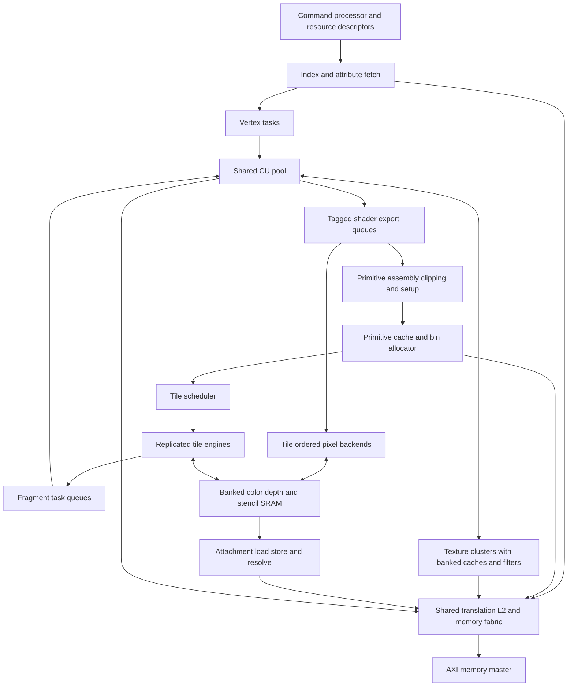

# Mobile GPU hardware alignment proposal

Status: proposed hardware architecture with H0/H1/H2 implementation in progress, 2026-10-19. Baseline: `d038228`. Current PPA evaluation uses synthesis only; functional hardware development remains in progress.

Evolve OpenGPU into a mobile rendering architecture by extending the shared CU pool with persistent tile storage, GPU geometry fetching, scalable texture and pixel backends, and general graphics resource descriptors. Keep shader arithmetic on the existing CUs. The first functional target is hardware sufficient for a complete GLES 3.0 implementation; a Mali-G31-class commercial comparison requires further feature, performance, and physical qualification.

The configuration and rates below are design targets, not measured capabilities. Implementation should proceed in bounded milestones, with correctness, throughput and timing gates before integration. Compiler and driver implementation are outside this plan; hardware interfaces needed by them are included.

## Target and scope

Use Mali-G31 as an older commercial reference class, rather than treating it as the definition of a current entry-level GPU. Arm lists GLES 3.2 support for that device. GLES 3.0 is therefore an intermediate capability target. [Arm Mali-G31](https://support.arm.com/compute-ip/mali-g31)

The initial OpenGPU product target is four shared CUs, with a 720p workload suite targeting 30 FPS first and 60 FPS subsequently at a physically qualified clock. Test desktop composition, textured 3D, opaque overdraw, transparent layers, small triangles, and 4x MSAA separately. These targets do not imply measured performance parity with a particular commercial device.

The hardware contract must cover shader execution, geometry, texture resources, rasterization, framebuffer operations, synchronization and faults. Display scanout remains a consumer of completed images. Its refresh rate is separate from rendering throughput.

## Current hardware and gaps

| Area | Current RTL or interface | Required evolution |
|---|---|---|
| Shader execution | Shared compute CUs already execute vertex and fragment tasks; vector FP32 arithmetic, including FMA, is connected | Improve task input/output transport, occupancy, control-flow/resource contracts and sustained issue/writeback throughput |
| Configuration | `GpuConfig` defaults to 16 lanes and eight warps; the mobile CU-count constant is four | One compute/graphics execution configuration; discoverable resource limits and explicit supported configuration combinations |
| Interstage transport | CU-scaled fragment workers, staging transactions and ordered output retirement | On-chip payload storage, export queues and tile-local retirement; avoid mandatory global-memory staging of every batch |
| Geometry | Clip, viewport, triangle setup and quad rasterization exist | Native index/attribute fetch, vertex reuse, instancing and complete required primitive behavior |
| Tiling | Optional pass-lifetime RGBA8 plus D24S8 attachments with two SRAM slots per engine; paged rendering, two engines, automatic continuation, masked line transfers, bounded unified AXI host submission/reset/VM and sequential GPU input publication | Concurrent producer dependencies, physical allocation ownership and representative transfer/frame throughput |
| Texturing | Per-worker samplers; four physical tap-read credits per sampler; bilinear and mip/trilinear paths; a shared single-word request/response fabric | Banked texture hits, scalable filtering throughput, general image/sampler descriptors, more dimensions and formats |
| Pixel operations | Depth/stencil/blending and MSAA exist; OM has configurable concurrent RMW slots | Banked tile-local pixel pipelines, legal early rejection, multiple color outputs and complete format semantics |
| Memory | Shared banked L2, Sv32 translation, GPU cache invalidation and AXI memory master | Aggregate bandwidth and outstanding budgets, context-tagged tile/texture state, scoped barriers and robust bin/payload memory |

The constructor default AXI beat is eight bytes, while emission supports 4 through 64 bytes. Benchmark configurations must record the selected width; there is no single width shared by every existing artifact. See [GpuHostSystemAxi](../src/main/scala/opengpu/system/GpuHostSystemAxi.scala) and [the emitter](../src/main/scala/opengpu/elaboration/EmitGpuHostSystemAxi.scala).

Program length limits also belong to different layers: the checked-in Gallium emitter has a 256-word code container, while the driver validator admits at most 512 instructions and four forward branch states. These are not a demonstrated 256-instruction CU fetch limit. General shader support requires a new submission and protection contract, rather than merely enlarging an RTL array. See [the validator](../driver/opengpu_shader_validator.h), [Gallium emitter](../userspace/gallium/opengpu_fs_emit.c) and [kernel shader launch](../src/main/scala/opengpu/graphics/KernelShaderStage.scala).

## Proposed block organization

A tile engine contains raster work generation, fragment dispatch state, a pixel backend and attachment storage. It can dispatch work to the shared CUs without owning a separate shader core. Texture clusters initially have locality affinity to pairs of CUs; scheduling may steal work when the destination has the necessary descriptors and payload access.

Shader lane count comes only from `GpuConfig`. A raster quad remains four pixels because derivatives use a 2x2 neighborhood. Raster quads, texture taps, SRAM banks and pixel pipelines are throughput resources with different units; none introduces a second shader VLEN.

## Initial four CU sizing

Keep these values in one proposed hardware configuration record. Derive transaction IDs, queue indices and SRAM addressing from it. Architectural limits, runtime bindings and elaboration-time capacities must be separate fields.

| Resource | Initial proposal | Meaning and scaling rule |
|---|---|---|
| Shared CUs | 4 CUs, 16 lanes, 8 resident warps per CU | Reuse existing execution profile; retain supported lane/warp parameterization |
| Tile engines | 2, initially 1 for bring-up | Default `ceil(CUs / 2)` for balanced configurations; independently selectable for isolation experiments |
| Raster output | 1 quad/cycle/engine | Eight candidate pixels/cycle at two engines; coverage and interpolation availability can reduce useful output |
| Texture clusters | 2 | Initially one per pair of CUs; requests include task, lane, descriptor and destination tags |
| Texture throughput | 1 RGBA8 bilinear sample/cycle/cluster | Conflict-free resident-data target; four tap words/cycle/cluster. Trilinear requires two bilinear groups |
| Texture cache | 8 KiB data/cluster, 64-byte lines, at least 4 word banks | Starting point for a capacity/bank sweep, including refill and response bandwidth |
| Texture outstanding fills | Start at 16 line fills/cluster; sweep 8/16/32 | Final value follows measured miss demand and memory latency; separate line fills from sample/tap credits |
| Pixel throughput | 4 sample updates/cycle/engine | RGBA8 plus D24S8, conflict-free resident data; includes the required old-value reads and writebacks |
| Tile attachment SRAM | 64 KiB data/engine | Two 32 KiB slots for rendering and attachment transfer; tags, queues and metadata are additional |
| Shader payload SRAM | 64 KiB shared, banked | Sweep 32/64/128 KiB; admission accounts for live input/output bytes and reserves a spill or drain path |
| Primitive and state cache | 32 KiB shared | Cache compact primitive/state records; software-allocated bin pages provide bounded backing storage |
| Color attachments | Architectural capacity 4 | MRT can serialize attachment work; the single-target throughput target does not imply four-target peak throughput |
| Shared L2 | Initially 128 KiB and 4 banks; sweep 64/128/256 KiB | Include bin, payload, texture and instruction contention in the comparison |
| External AXI | Initial integration candidate 256 bits; retain width parameter | Compare 128/256/512 at equal memory latency, controller limits and realistic bus efficiency |

At two texture clusters, the bilinear target needs eight 32-bit taps/cycle, or 32 bytes/cycle of cache-hit delivery. At two pixel engines, the target is eight sample updates/cycle: at most eight pixels/cycle at 1x, or two pixels/cycle at 4x when every sample is processed. Neither rate is a whole-frame guarantee.

The tile data calculation is:

`bytes per tile = width * height * samples * (sum(color attachment bytes) + depth/stencil bytes)`

| Tile layout | Data bytes | Data capacity |
|---|---:|---:|
| One RGBA8 plus D24S8, 4x | 8,192 | 8 KiB |
| Four RGBA8 plus D24S8, 4x | 20,480 | 20 KiB |
| Four RGBA16F plus D24S8, 4x | 36,864 | 36 KiB |
| Four RGBA16F plus D24S8, 4x, using 8x8 tiles | 9,216 | 9 KiB |

A 32 KiB slot therefore handles four RGBA8 attachments at 4x but requires smaller tiles for the illustrated four-RGBA16F layout. Support 8x8 and 16x16 tile classes through a shared descriptor and address calculation. Select a fitting tile class at pass admission. RGBA16F rendering/blending is a later product feature with explicit semantics; it is not implied to be required by base GLES 3.0.

The proposed tile, texture, payload, primitive and 128 KiB L2 arrays, plus four 64-byte attachment read-cache lines per slot, total 369 KiB of data storage. The read caches contribute 1 KiB over two engines and two slots per engine. This excludes CU register files, instruction/data caches, shared memory, tags, queues and other state, including 512 bytes of registered attachment write-gather data. SRAM area and energy depend on the selected technology and port organization; this is a capacity budget rather than a chip-area estimate. Earlier frozen evidence retains its original 368 KiB budget.

Payload occupancy must also be counted in bytes. For example, 64 FP32 varying components across 128 resident threads occupy 32 KiB of input values per CU before outputs or metadata. A 64 KiB shared payload budget cannot hold that case for all four CUs simultaneously. Admission must reduce concurrency, interpolate values on demand, or spill through the defined fallback; it must never assume maximum varying count and maximum task residency are free to combine.

## Hardware work packages

### Render pass descriptors and tile lifetime

Add versioned descriptors for attachments, image views, samplers, shader resources, vertex layouts and render passes. Attachment views carry base, allocation bounds, format, extent, row/layer pitch, mip/layer selection and sample count. A pass snapshots its descriptors and assigns a context, pass ID and generation so later host updates cannot change in-flight work.

Keep attachments resident across compatible draws. Implement load, clear and discard on entry; store, discard and resolve on exit. A partial clear or scissor must preserve untouched samples. Clear tags may defer SRAM initialization, but reads must materialize the specified clear value. Resolve samples in tile storage and export only the selected result where permitted.

Texture reads of prior render output, DMA access, CPU visibility, incompatible attachments, queries requiring completion, and explicit barriers establish dependency boundaries. Store required dirty state and publish it to the relevant GPU cache domain before admitting dependent reads. Do not equate an L2 write with immediate CPU-cache coherence.

### Primitive storage and tile scheduling

Replace the hardcoded eight-triangle limit with bounded on-chip primitive/state caches and software-allocated bin pages. Store compact references to immutable primitive and draw state. Allocate pages with checked bounds and tagged ownership; overflow either spills to valid backing storage or stops at a defined restart point. No primitive may be silently dropped or executed twice.

Maintain submission order for operations affecting the same pixel/sample. Assign each active tile one attachment owner. Independent tiles can retire out of order; within a tile, primitive sequence numbers and completion masks prevent later fragments from overtaking earlier depth/stencil/blend work. Shading may run ahead only when its side effects and query semantics permit it.

Use load-balanced tile assignment, double-buffered attachment transfer and bounded fairness between vertex, fragment and compute work. Avoid a global fragment-retirement queue that makes one slow tile stop every engine. A full export queue must not prevent the scheduler from running the task needed to drain it; reserve progress credits and verify this dependency explicitly.

### On chip shader payload and exports

Introduce a banked payload SRAM addressed by task/payload handles. Raster/interpolation produces fragment inputs there; vertex and fragment tasks consume or export values through bounded CU-local ports. Start with SRAM payloads and explicit exports, then evaluate direct register delivery where register-file ports and occupancy justify it.

Retain a memory-backed path for oversized payloads and controlled spills. Reserve output capacity before dispatch and keep payload/state ownership until completion, cancellation or fault drain. Descriptors specify varying layout, masks, interpolation qualifiers, output locations and scratch bounds. Fragment exports carry tile, primitive order, coverage, discard, optional depth and attachment outputs.

Keep helper-lane execution distinct from coverage and side-effect masks. Derivative/quad exchange must work with partial warps and divergence, without allowing helper lanes to update memory or framebuffer state. Lane counts that cannot execute a full quad need an explicit supported grouping scheme or must reject graphics elaboration.

### Texture clusters

Replace the shared single-word bottleneck with banked cache access and tagged multiword replies. Specify bank mapping for adjacent 2x2 taps; measure conflicts on other patterns. Provide response queues, same-line miss joining, replacement rules and refill arbitration. Filter pipelines must sustain the proposed rate after warm-up; adding request ports alone is insufficient.

Cache identity includes physical line and relevant context/generation attributes. Preserve read/write permission faults and cache invalidation across image rebinding, translation changes and render-to-texture transitions. Retain pending fill ownership until cancellation is drained; do not interpret a failed translation as a successful zero texel.

Generalize descriptors and address generation for multiple images, cube/array/3D resources, explicit and implicit LOD, gradient-based sampling, depth comparison, and all required wrap modes. Remove the power-of-two-only repeat assumption. Use per-level metadata or cached mip offsets instead of requiring a serial level walk on every sample.

Add format-aware fetch/decode before filtering, including signed/unsigned and normalized values, required sRGB behavior, and ETC2/EAC block decode. Cache decoded blocks where useful. Integer fetches bypass inappropriate filtering. Packed FP16 arithmetic and ASTC are later efficiency/product extensions with separate area and compatibility decisions.

### Pixel pipelines and visibility rejection

Replace global address hazard searches with tile-local bank/row ownership and pipelined sample scoreboards. SRAM organization must support the promised read/modify/write rate, including color blending, depth/stencil, coverage and masks. Bank conflicts and repeated writes to one sample must serialize without corrupting order.

Introduce conservative early depth rejection, followed by hierarchical depth summaries where profitable. Track summary validity across clears, depth writes and tile transfers. Distinguish early testing from committing depth/stencil: shader discard, depth override, stencil outcomes, side effects and queries may require deferred updates or a late path. Correctness decides eligibility.

Extend outputs and format packing for MRT, integer targets, required depth formats, sRGB conversion and format-dependent blending. The existing 32-bit packed-color word must not become the universal shader export representation. Pipeline address calculation and arbitration to remove long coordinate-to-ready combinational paths.

### Geometry and general execution

Add GPU index reads, attribute descriptors and format conversion, vertex/instance IDs, divisors, restart and post-transform vertex reuse. Include points, lines, clipping, flat interpolation and provoking-vertex rules in the functional closure matrix; triangles alone do not complete the target. Provide transform-feedback export and query/count hooks with defined ordering.

Reuse existing FP32 FMA, conversion, division and square-root machinery. Measure register-file, issue, scoreboard and writeback limits before adding arithmetic lanes. Define shader-visible numeric behavior, rounding, denormals and precision by operation. Add reciprocal/other approximations only with measured error bounds and valid compiler contracts.

General loops and richer memory access require bounded scratch/resource descriptors, fetch/execute permissions, SIMT reconvergence overflow handling, watchdog interruption and fault attribution. Existing CU branch machinery and the restrictive shader validator are different layers. Increasing code length alone does not resolve safe execution or termination.

### Memory fabric and physical design

Keep a shared L2 and translation fabric, with request classes for instructions, texture fills, geometry/bin data, payload spills and attachment transfer. Partition or reserve credits so bulk binning/store traffic cannot starve fault completion or shader progress. Carry context and generation through requests and responses, with no transaction-ID aliasing during drain/reset.

Size miss windows from `outstanding lines >= sustained miss bytes/cycle * latency cycles / line bytes`. For example, 16 bytes/cycle of aggregate miss demand at 200-cycle latency needs at least 50 outstanding 64-byte lines, before headroom. This is an illustrative latency model, not a recommendation to allocate 50 slots in every sampler.

Use SRAM macros or characterized SRAM models for tile and cache arrays. Include read latency, port count, banking and arbitration in both functional timing and area. Add valid-based clock enables to CU, texture, tile and transfer pipelines; quantify switching on representative workloads. Physical power domains and retention can follow SoC integration requirements.

## Capability closure contract

The first hardware feature matrix should trace each GLES 3.0 requirement to native hardware, CU-executed support, or an explicit unsupported milestone. Selected minimum limits include four draw buffers, 16 vertex attributes, 2048-square 2D/cube textures, 256 array layers and a 256-texel 3D dimension. Cover uniforms, shader texture access in both stages, varying precision, integer operations, required formats, transform feedback, queries and synchronization in the complete matrix. [GLES 3.0 specification](https://registry.khronos.org/OpenGL/specs/es/3.0/es_spec_3.0.pdf)

Architectural capacity does not require fully parallel hardware for each binding. Descriptor tables and serialized operations may satisfy functional capacity while a smaller number of texture/filter/pixel pipelines provide throughput. Hardware capabilities must describe implemented limits accurately; Mesa exposure and conformance follow as a separate integration effort.

Commercial feature alignment continues after the initial GLES 3.0 hardware milestone:

| Capability stage | Additional hardware work | Architecture consequence |
|---|---|---|
| GLES 3.1 | Shader storage/image descriptors and access, required atomics, memory barriers, indirect work submission and compute resource limits | Extend existing compute/atomic machinery; define visibility across shader, texture, pixel and DMA clients |
| GLES 3.2 | Geometry and tessellation stage execution, primitive amplification, patch storage and synchronization, and the remaining texture/raster/blending requirements | Run programmable stages on the shared CUs; add bounded patch/output queues and a tessellation primitive-generation path before binning |
| Vulkan product target | Selected-version resource, synchronization, robustness and scheduling contract, followed by driver/conformance integration | Reuse tile/CU resources while validating the chosen API requirements independently |

Geometry and tessellation are part of the GLES 3.2 specification, so they belong in the longer commercial-alignment plan even if they follow the first mobile rendering backend. [GLES 3.2 specification](https://registry.khronos.org/OpenGL/specs/es/3.2/es_spec_3.2.pdf) Reserve stage tags, descriptor versioning and resource-table space in H0. Detail the later-stage limit matrix before committing their storage sizes or claiming API support.

## Performance model and acceptance gates

For the current development stage, the user selected synthesis-only PPA
screening on 2026-10-18. Use mapped synthesis timing (including I/O), area and
explicit SRAM assumptions to guide RTL iterations. Do not require new
place-and-route runs for these iterations. Existing routed reports remain
historical evidence for their frozen emissions. Full physical and product
qualification below remains a later milestone gate, not a claim supported by
synthesis alone.

For a selected workload, calculate a lower bound in cycles:

`C >= max(warp instructions / sustained issue rate, FP operations / sustained FP rate, texture samples / sustained sample rate, sample updates / sustained pixel rate, setup work / setup rate, payload bytes / payload service rate, external bytes / sustained bytes per cycle)`

Use measured effective rates for the actual instruction/format mix. Add serial phases, launch overhead, dependency latency and pipeline drain to the scheduling model. The maximum of these terms is a lower bound, not a cycle prediction by itself.

At an assumed 500 MHz, 30 FPS permits about 16.67 million cycles/frame and 60 FPS about 8.33 million. A single RGBA8 1280x720 final store is 3,686,400 bytes/frame, or 221,184,000 bytes/second at 60 FPS. This excludes texture, geometry, bin, attachment-load, spill and display-read traffic. The proposed two-cluster texture cache-hit bandwidth is 16 GB/s at that assumed clock. A 256-bit AXI read channel also has a 16 GB/s ideal beat rate at 500 MHz, but actual DRAM service and utilization must be modeled separately.

Tile storage reduces repeated external attachment traffic by retaining intermediate values on chip. This is a mobile bandwidth/power design principle, not a guaranteed speedup for every scene. [Arm Mobile GPU 101](https://developer.arm.com/cfs-file/__key/communityserver-blogs-components-weblogfiles/00-00-00-20-66/siggraph_5F00_mmg_5F00_2024_5F00_Mobile101.pdf)

| Gate | Acceptance criterion |
|---|---|
| Functional | Reference-image/numeric checks for formats, MSAA, order, hazards, faults and overflow; randomized backpressure and reordered memory responses |
| Texture throughput | Each cluster reaches one bilinear RGBA8 result/cycle on a long conflict-free resident-data stream; separately report trilinear, misses, bank conflicts and dependent samples |
| Pixel throughput | Each engine reaches four RGBA8+D24S8 sample updates/cycle on a long conflict-free resident stream; include enabled blend/depth/stencil cases and report supported rates per mode |
| Attachment locality | An eligible clear/discard-start pass avoids old attachment reads; blending/depth intermediates stay on chip; final stores/resolves match the requested outputs |
| CU scaling | Target at least 3.2x for a specified long shader-bound 1-to-4-CU test with fixed non-CU resources and identical work; attribute the remaining gap with counters |
| Balanced scaling | Separately test 1/2/4 CUs with proportional texture/tile resources; retain a realistic fixed external-bandwidth case and identify its saturation point |
| Physical | Meet setup/hold and I/O constraints at the selected clock, with SRAM assumptions and implementation stage reported; compare area and energy/frame |
| Product workload | Meet the agreed 720p frame budget on each selected workload at a qualified clock, including binning, geometry, rendering and store/resolve |

The current qualified textured scene is 32,341 cycles on one CU and 11,566 on four, or about 2.80x. It is a retained regression workload, not a general theoretical scaling limit. [Qualification handoff](performance/optimization-pause-2026-10-17.json)

Current texture traces found a peak of 10 occupied slots out of 16 and about 0.06 percent cross-CU duplicate candidates in the captured desktop workload. Prioritize service bandwidth and bank conflicts over owner-table growth or duplicate multicast for that workload; these opportunity counters do not establish a causal speedup. [Texture contention measurements](performance/texture-arbiter-contention-2026-10-17.json)

Existing OM screening also failed the 1 GHz timing gate for both baseline and sharing candidates. Use that result to justify pipelined admission/address/hazard control. A design with fewer cycles must also improve or preserve elapsed time at its achievable clock. [Paused physical screening](performance/optimization-pause-2026-10-17.json)

## Implementation milestones

| Milestone | Deliverable | Exit evidence | Primary RTL touchpoints |
|---|---|---|---|
| H0 | Hardware capability/configuration record, descriptor definitions, counters and analytic workload budgets | Units and limits documented; supported elaboration combinations checked; baseline counters explain stage utilization | `GpuConfig`, `GraphicsConfig`, `JobConfig`, `SharedCuGraphicsPort`, performance bundles |
| H1 | One tile engine with pass-lifetime attachments and versioned state | Multiple ordered draws retain attachments; clear/load/store/discard/resolve and dependency boundaries are correct | `TileAttachmentStore`, `RenderPipeline`, render descriptors |
| H2 | Scalable bin pages and two independently progressing tile engines | Overflow/spill/restart, ordering, load balancing, double buffering and backpressure pass; attachment bytes/frame measured | Replacement/evolution of `TileDrawBinner`; new tile scheduler and transfer engine |
| H3 | Banked pixel backend, legal early rejection and pipelined hazards | Pixel throughput gate, adversarial same-sample ordering, early/late equivalence and physical timing | `OutputMerger`, tile SRAM, sample expansion and retirement |
| H4 | Banked texture clusters with general resource descriptors | Cache-hit throughput gate, miss/translation stress, multiple bindings and render-to-texture visibility | `TextureUnit`, `FragmentTextureArbiter`, `BufferedTextureWordPort`, translation routing |
| H5 | On-chip shader payload/export path and GPU geometry fetching | No mandatory per-fragment global staging in the common path; index/instance reuse, fault drain and task progress verified | `KernelFragStage`, `ParallelKernelFragStage`, shared task router, vertex stages and CU interfaces |
| H6 | Required format/primitive/resource coverage and product qualification | Hardware feature matrix closed, targeted API integration tests, 720p suite and physical reports | Format, texture, raster, execution, query and synchronization blocks |
| H7 | GLES 3.1 hardware closure | Storage/image access, atomics, barriers, indirect work and resource-limit matrix verified | CU memory, descriptor tables, command processor and shared cache/translation fabric |
| H8 | GLES 3.2 hardware closure | Geometry/tessellation, bounded amplification, stage ordering and remaining feature matrix verified | Shared task scheduling, patch SRAM, primitive generation and graphics backends |

H3 and H4 depend on the H0 interfaces but can be developed against unit harnesses before H2 completes. H5 payload and geometry changes should be separate reviewable series. Bring up one attachment and existing formats first; add MRT and the wider format contract after ownership and ordering are stable. Apply synthesis/timing gates throughout. Place-and-route and broader physical closure belong to later qualification under the current synthesis-only development policy.

The first implementation slice should be **H0 plus H1**: define the hardware contract, then make several compatible draws render into one resident tile without intermediate attachment writeback. This creates a measurable bandwidth result and a stable base for subsequent parallel engines.

For H1, use overlapping triangles from multiple draws with blending and depth/stencil enabled, all within one tile. After a clear-start pass, require zero external reads of the cleared attachment contents and no intermediate attachment writes before the pass ends. Compare final stored samples against the existing ordered path. Repeat with a load-start pass, partial clear, texture/DMA dependency boundary, cancellation and a store fault. These checks distinguish persistent tile lifetime from merely changing triangle traversal order.

## Verification and delivery discipline

Add counters for tile residency/evictions, attachment bytes by operation, bin allocation/spill, active engines, primitive occupancy, payload traffic, queue stalls, eligible/rejected early tests, texture bank conflicts, useful cache bytes, fill occupancy and per-CU active/helper lanes. Avoid summing overlapping stall counters as if they were exclusive causes.

Use arithmetic/ordering proofs and component tests first, followed by small cycle benchmarks, synthesis, native trace replay and selected full-system smoke tests. Run full desktop validation at integration milestones. Freeze source/configuration and workload hashes for comparisons; report simulator wall time separately from GPU cycles and estimated silicon frame time.

Deliver each milestone as independently reviewable changes with its functional and throughput evidence. Keep the currently qualified desktop path available during bring-up. This proposal does not promote the paused private OM experiments into production RTL.

## Implementation evidence: H0/H1 bring-up

The implementation is experimental and does not close either milestone. The
original requirements, resource targets and H0–H8 exit gates above remain in
force. Evidence and hashes are recorded in
[the H0/H1 measurement record](performance/mobile-h1-tile-lifetime-2026-10-17.json).

Implemented and tested components:

- `MobileGpuConfig` records the proposed execution/resource profile, derives
  capacity and identifier sizes, selects fitting 8x8/16x16 tile classes, and
  rejects unsupported capacity combinations. These values are not advertised
  as implemented device capabilities.
- `MobileGpuBudget` computes conservative frame-cycle lower bounds from
  explicit work counts and sustained rates, preserves rate provenance, and
  distinguishes a fitting lower bound from a frame-rate pass.
- Versioned tile-pass descriptors snapshot attachment bounds, pitches,
  formats, load/store/resolve choices and context/pass/generation identity.
  Staged admission validates address arithmetic without 32-bit wraparound,
  including the exclusive 4 GiB allocation boundary.
- `PersistentTileAttachmentStore` retains one RGBA8-compatible color plane
  and one D24S8 plane across draws. It supports load/clear/discard, final
  store/discard, masked rectangle clears, and byte-wise half-up on-tile
  resolve at 1x/2x/4x. Both tile classes share the same SRAM address layout.
  At the maximum sample count, the current engine contains 8 KiB of attachment
  data, rather than the final proposed 64 KiB engine allocation.
- Attachment data uses synchronous single-port SRAM banks, with behavioral
  and characterized-macro implementations sharing the same read latency.
  Transfers use registered addresses/data; cancellation retains offered or
  outstanding memory ownership until drain, and faults fail the tagged pass.
- The optional `RenderPipeline(persistentAttachments = true)` triangle-record
  path intersects draw scissors with the admitted tile and freezes attachment
  and viewport state. A queued clear lets older OM work drain before taking
  ownership. The existing host/unified-command path keeps its prior behavior.

Component checks cover invalid descriptors, old-response drain, cancellation,
load/store/resolve faults, backpressure, partial clears, every supported sample
capacity, both tile classes and all four 8x8 quadrants. Fixed-function pipeline
checks compare four overlapping draws against the existing ordered path with
blending, depth/stencil, scissoring and an intervening masked clear. Clear-start
passes assert zero old-attachment reads and zero intermediate stores, and final
color/depth/stencil samples match the reference.

These checks establish correctness and attachment-locality progress, not a
whole-system performance pass. The serial reference has one outstanding
external transaction and the SRAM service is serialized. Its small-scene cycle
counts still exceed the ordered reference. The reference
models partial clear as an immediate memory update after draw drain, so its
clear-operation cost is not a fair hardware performance comparison. Use a
dedicated matched workload when qualifying transfer/backend speedups.

Remaining H0/H1 work includes broader resource descriptors and implemented
capability discovery, host command/VM integration, cache-domain publication for
dependent texture/DMA access, programmable shared-CU pass validation, concurrent
attachment-transfer product qualification, post-route setup/hold and
power qualification, and the integration-milestone desktop smoke. H2–H8 remain
required. The standalone synthesis screens in the measurement record are
component estimates and do not qualify the integrated GPU clock or energy/frame.
The staged-admission/SRAM component passes its 1 GHz synthesis setup screen
at TC/SLVT with the stated 25% I/O budget: core slack +26.670 ps and reported
I/O slack +39.924 ps. The completed exploration-mode route has zero DRC and
antenna errors but fails 1 GHz setup/hold: worst setup -530.636 ps, worst hold
-7.686 ps. The reported core setup estimate is 668.381 MHz, not a qualified
operating clock. A timing-repair flow remains separate from this result.

A separate [initial transfer-credit candidate](performance/mobile-h1-transfer-credits-2026-10-17.json)
passes isolated tests for 1/3/8 credits, reordered acknowledgements, stable
backpressure, repeated-address serialization and cancellation/fault drain.
It sustains one request/cycle with a ready port after warm-up and passes its
standalone 1 GHz synthesis setup screen.

The [concurrent transfer integration](performance/mobile-h1-concurrent-transfers-2026-10-17.json)
adds optional bounded write credits while retaining the serial reference.
Private preparation acknowledgements transfer ownership to the write queue;
pass completion waits for every actual external acknowledgement. Late faults,
reordered replies, context reuse and randomized load/clear/discard/resolve
lifetimes are tested. The proposed mobile profile starts with eight credits;
the existing default remains the serial path during physical qualification.

In a matched 4x-MSAA component workload with identical hardware clear work,
936 stores, fixed 32-cycle word response latency and an eight-request external
window, eight credits reduce total cycles from 43,399 to 15,005. Pre-store draw
work stays at 10,757 cycles and final samples match. A 2/4/8/16/32-credit sweep
gives 27,617/19,201/15,005/14,656/14,656 cycles. This is a word-service model,
not an AXI/DRAM or whole-frame performance claim. Both eight- and sixteen-credit
components pass their standalone 1 GHz synthesis setup screens; post-route
timing and area/energy tradeoffs remain under qualification.

The completed eight-credit timing-repair route passes hold (+26.809 ps), DRC,
antenna and placement checks, but still fails 1 GHz setup (-124.621 ps including
I/O; core-only -20.28 ps). Its worst endpoint is the `clearRead` diagnostic
output. A [registered diagnostic candidate](performance/mobile-h1-registered-events-2026-10-17.json)
preserves exact event totals with a one-cycle delay and passes 16 concurrent
component checks. Its synthesis setup screen reports +8.170 ps core and
+256.364 ps I/O. Its completed route still fails 1 GHz setup by 2.460 ps on
one core path; hold is +27.297 ps, I/O setup is +68.84 ps, and DRC/antenna
checks pass. The remaining worst path is an admission partial product, rather
than the diagnostic output. This frozen component predates execution-fault input
changes, so it cannot qualify the latest component or the integrated GPU.

The [execution-failure path](performance/mobile-h1-execution-faults-2026-10-17.json)
now fails the resident pass on accepted fragment traps, unsuccessful task
completions and staging-memory faults. Completion retains context/pass/generation
through producer and memory drain; a later pass starts with a fresh status.
The experimental completion status is three bits, preserving values 0–3 and
adding execution failure as value 4. The existing host `shaderFault` output
also reports failed fragment completions and staging faults.

Thirty-nine checks pass on the recorded source, including single/parallel
shared-CU boundary failure cases, native CU-backed rendering, both tile classes,
randomized attachment lifetimes and the matched transfer benchmark. The shared
boundary harness models the shader ABI protocol; full system CU-pool and VM/cache
integration remain required. Legacy word staging also waits for the first quad's
producer write and correctly sizes indices for non-power-of-two batch capacities;
4/8/12/16/112/128-fragment configurations are checked with faults and reuse.

An [optional command-fetch ownership path](performance/mobile-h1-command-drain-2026-10-17.json)
snapshots the command base/count, discards unaccepted records on cancellation,
and drains offered or issued reads before admitting another binding. Its
registered sequential address advances only on a read handshake. Eleven checks
cover both record formats, queued-record discard, bus backpressure and reuse,
including the three existing decoder regressions. The subsequent command-core
integration below connects this prerequisite to `RenderCore`. At that checkpoint,
unified host submission, VM/allocation ownership and cache-domain publication
remained required; subsequent host checkpoints below address those interfaces.
With the same eight-record FIFO and 1 GHz synthesis constraints, the optional
reader reports +503.856 ps core and +456.246 ps I/O setup slack; the existing
reader reports +285.019 ps and +11.587 ps. These are setup synthesis screens,
not post-route clocks or whole-frame measurements.

The [bounded command-driven tile core](performance/mobile-h1-command-core-2026-10-17.json)
adds an optional `RenderCore(persistentAttachments = true)` job interface. A
`TileCommandJob` snapshots the pass, viewport, draw defaults and command binding;
the exclusive command limit is checked with 33-bit end arithmetic before fetch.
Commands start after pass admission, and final store/resolve waits for command
and render drain. Cancellation, command-memory faults and shader failures stop
prefetch while retaining outstanding read ownership. The controller latches one
tagged completion after all traffic drains and keeps it stable under backpressure.
Command-memory faults use completion status 5; other existing status values stay
unchanged.

Five controller checks and a sixteen-scenario command-driven rendering check
cover invalid/overflowing bounds, the exact 4 GiB boundary, empty jobs, descriptor
mutation, early and in-flight cancellation, command/store faults, final samples,
completion stability, default blending, per-record overrides and healthy reuse.
All resolved draw defaults are materialized from the job snapshot for records
without an override. Seven existing `RenderCore` regressions also pass in the
same thirteen-check cohort, including actual CU-backed shader rendering. At that
checkpoint the new job interface was separate from `RenderHost`/unified AXI
submission. The later host profile below connects it; mixed clear/draw host
commands and broader dependency publication remain required. Controller and
fixed-function core synthesis screens are recorded
separately; neither is a full-GPU physical or 720p frame-rate qualification.
The controller passes its 1 GHz synthesis setup screen (+462.011 ps core,
+413.436 ps I/O). The larger fixed-function core screen is rejected because
the `syn` engine omitted division operators; no renderer frequency follows
from that partial netlist. The subsequent
[Yosys mapping attempt](performance/mobile-h1-core-mapping-failure-2026-10-18.json)
also terminated without a mapped netlist: error 247 after 32:54, with peak memory
near 30 GB. Its exact termination cause is not proven by the retained logs.
It establishes neither renderer timing nor area; the division-heavy geometry
datapaths still need a complete, successfully mapped physical implementation.
The [mapping audit](performance/mobile-h1-mapping-audit-2026-10-18.json) records
the prior screens; the qualifier now rejects omitted operators and missing
mapping evidence, with 24 Python checks covering mapping and timing gates.

The [next admission pipeline](performance/mobile-h1-admission-pipeline-2026-10-18.json)
registers pitch-half products and splits address sums at bit 16 while retaining
their full high carries. It adds three admission cycles. Twenty-seven integration
checks pass, and an expanded 248-descriptor BigInt interval oracle covers upper
coordinates, high pitches, carry boundaries, overflow and exact 4 GiB allocation
ends. The matched eight-credit workload is now 15,008 cycles (serial 43,402),
with unchanged samples and traffic. The component passes its 1 GHz synthesis
setup and mapping screen at +73.113 ps core and +242.262 ps I/O. The completed
component route is recorded below; workload energy and integrated GPU
performance remain unqualified.

The experimental persistent core now has an accepted-response texture-fault
sideband. A failed texture response cancels command prefetch and attachment
export, drains outstanding work, and returns status 6 with the original pass
identity. A fault sideband without an accepted response has no effect. Secondary
shader failures during texture drain cannot hide that attribution; an already
published completion stays stable even if later fault inputs change.

The [shared-system validation](performance/mobile-h1-shared-system-2026-10-18.json)
connects persistent command jobs to actual system CUs, their coherent caches,
shared L2 and existing Sv32 clients, without private graphics CUs. Four
configuration checks cover two CUs in Bare and Sv32 modes, four CUs with
four lanes/two warps, and four CUs with sixteen lanes/eight warps. All assert
multi-CU graphics ownership, overlapping graphics/compute CU occupancy, a
colliding local command ID, exact stored color/depth samples, shader-trap drain
and healthy reuse. The Sv32 cases change roots, ASIDs and physical backing at
drained boundaries, reject an invalid command mapping, and then render again.
An overwrite draw makes stale shader inputs observable instead of hiding them
behind equal-depth rejection. Responses are delayed, reordered and backpressured;
transaction IDs cannot alias live requests.

Eleven distinct checks pass: four system configurations, six controller checks,
and one fixed-function job check containing seventeen scenarios. The latter
includes an accepted texture fault with zero attachment exports. Run the large
configuration with `sbt -J-Xmx8G 'testOnly opengpu.graphics.PersistentTileSharedSystemSpec'`;
it explicitly reports insufficient heap below 4 GiB. These small 8x8,
single-sample workloads use dispatch limits of eight or sixteen fragments and
do not establish full warp occupancy, scaling, bandwidth, FPS or energy. The
harness pins VM state externally until complete drain; production host/AXI
submission, context ownership, dependency publication and the remaining H0–H8
gates are still required.

The [integrated host now enforces a serialized VM boundary](performance/mobile-h1-vm-ownership-2026-10-18.json), advertised as
`GPU_CAP_PROTECTED_VM_STATE` (bit 29). SATP and TLB-flush writes are rejected
with AXI `SLVERR` while staged commands, executing graphics/compute/DMA,
cache invalidations, lower-memory traffic, reset or unconsumed results retain
ownership. Rejection preserves both SATPs and suppresses the flush pulse.
The AXI response retains a rejected beat through a backpressured burst result;
invalid bus addresses cannot drive the register file. This replaces the earlier
software-only quiescence precondition for the integrated host. Explicit persistent
job descriptors and host submission, concurrent context scheduling and scoped
dependency publication remain required.

Twenty-six checks pass on the final VM-guard source, including actual stalled
descriptor reads, translated compute, software-held completions, buffered and
unbuffered command clients, twelve-cycle response backpressure and a rejected
burst whose final beat succeeds. An earlier guard also passes the twenty-three
existing full-system regression checks; that run predates the final stricter
response-presentation check. Kernel-free driver tests pass. The protected MMIO
control block passes its standalone 1 GHz synthesis/mapping screen at +434.332 ps
core and +306.617 ps I/O; this excludes system quiescence aggregation, the AXI
adapter and post-route timing.

The frozen admission-pipeline tile store now
[passes its 1 GHz post-route qualification](performance/mobile-h1-post-route-2026-10-18.json)
at the selected TC/SLVT corner with the recorded 25% I/O timing budget. Global
setup slack is +19.219 ps, hold is +29.397 ps, and I/O setup is +63.10 ps.
Setup/hold violations, route DRC, antenna, placement and flow errors are zero;
mapping is complete. Its emitted RTL is byte-identical to the prior passing
synthesis candidate. The tool reports instance area 12,929.3 and estimated
power 0.161291 W; no workload-specific switching or frame energy was measured.
This qualifies the eight-credit attachment component with synchronous SRAM,
including admission, clear, transfer and resolve logic. Integrated renderer
mapping/timing, broader physical corners and the full performance/product
qualification remain required.

The [bounded persistent host profile](performance/mobile-h1-persistent-host-2026-10-18.json)
now connects memory descriptors to `TileCommandJob` through the unified AXI
host and the protected VM boundary. It is explicitly selected with
`persistentAttachments = true` or `--persistent-tile-jobs`; the default desktop
profile keeps its existing descriptor and capability contract. The new profile
advertises bit 30 and opcode 7, rejects the legacy render opcode, and fetches a
versioned 256-byte descriptor as four uncached cache-line reads. It validates the
full 33-bit allocation before fetch, rejects reserved/truncated encodings, then
retains attachment views and all draw defaults through completion. The descriptor
reuses four reserved DMA transaction IDs before staging starts, adding no
simultaneous ID owner. Reads can overlap and responses may return in any order;
cancellation or a line fault retains every stalled offer and live response until
drain. The C ABI and every field offset are checked.

Unified DMA/resolve/invalidate commands serialize against tile jobs in queue
order; unrelated compute remains dispatchable in the same VM. A small outstanding
memory-owner counter covers queued and executing commands through completion,
including reset. Native 256-bit AXI tests queue tile → strided DMA → tile: the
transfer sees all 512 exported tile bytes before the next descriptor fetch, and
the final blended pass loads and preserves that copy. Descriptor reset/cancellation,
Sv32 rebinding, failed descriptor/command/attachment reads, shader traps, texture
faults, stable results and healthy reuse run through the real hierarchy. The
programmable host tests cover two actual shared CUs with four lanes/two warps
and four shared CUs with sixteen lanes/eight warps. Final-image, traffic, fault,
reset and Sv32 checks run through the complete host path. Smaller whole-warp
fragment batches activate all configured CUs; the counter observes four active
CUs in the four-CU host test. This does not establish full warp occupancy or a
scaling result.

An attachment-load fault exposed a producer-drain deadlock: the store failed
while command prefetch kept a later draw live. Accepted attachment faults now
cancel prefetch, retain attachment-fault status 3 through secondary failures,
and drain before host retirement. Both fixed-function and shared-CU host tests
verify zero attachment exports for the failed job. A two-draw load-start pass
with depth `NEVER` fetches each covered old depth sample once (49 reads) and
exports nothing; a clear-start pass reads no old attachments and exports exactly
512 bytes after both draws.

The initial host implementation passed 52 distinct checks, as recorded above.
The [descriptor-window evidence](performance/mobile-h1-descriptor-window-2026-10-18.json)
records subsequent validation and physical checks. In a controlled reader test
with twelve-cycle responses, a transport limited to one outstanding line takes
54 cycles to offer the job; permitting four takes 18 cycles with identical
decoded state. These are component cycles, not an AXI/frame-rate measurement.
The final cohorts pass 56 distinct checks: 47 unchanged ABI/legacy/control checks,
six descriptor-reader checks and three host configurations. The host checks in
the earlier 50-test regression are repeated by the final nine-test cohort and
counted once.
The updated reader passes its standalone 1 GHz synthesis/mapping screen
(+294.981 ps core, +406.521 ps I/O) and its TC/SLVT 1 GHz routed check with a
25% I/O delay budget: +282.140 ps worst setup, +27.1948 ps worst hold and zero
setup/hold, DRC, antenna, placement or flow errors. Both checks cover only the
descriptor reader; they exclude the host, shared CUs and full renderer. The
reported power has no workload activity and does not qualify energy per frame.
The initial profile rejected command/texture buffering and framebuffer write
coalescing until their fault callbacks carried the required ownership. Command
buffering is now validated below; texture buffering and framebuffer combining
remain gated. Version-2
mixed clear/draw commands are described below. Broader resources, scoped dependency events,
driver adoption, multiple tile engines and the remaining H0–H8 gates remain
required. No frame-rate, energy or commercial-GPU parity follows from this
single-tile correctness workload.

## Implementation evidence: render-to-texture publication

The [native texture-publication record](performance/mobile-h1-texture-publication-2026-10-18.json)
adds three system checks covering fixed-function rendering, two shared CUs at
four lanes/two warps, and four shared CUs at sixteen lanes/eight warps. Each
profile uses the proposed 128 KiB four-bank L2 and repeats its sequence in Bare
and Sv32 modes: thirty jobs across six backend/VM combinations. This validates
that cache capacity in the native functional model, without qualifying its
physical timing or sustained bandwidth.

Two initial sampling jobs prove a physical texture line is resident: the first
causes one lower-memory source-line fetch and the second causes none. A producer
then renders new contents into that image while a dependent sampling job is
queued. The consumer cannot fetch its descriptor before producer result
publication and all 512 attachment bytes have been acknowledged. It refills the
source line once and samples the new contents. A following format-only rebind
decodes the same cached bytes as BGRA without another lower-memory source fetch.
Every job checks all 64 color/depth positions, including untouched clear pixels;
RGBA output packing, shader alpha, fixed-function modulation and ordered depth
rejection use independent expected values.

A controlled negative test temporarily disabled resident-line invalidation at
L2 store acceptance. The consumer then produced the old sampled color instead
of the new one. The production source was restored byte-for-byte before the
final passing run. Existing L2 publication and per-instruction shader tap-cache
invalidation already satisfy this tested path; no RTL change was needed.

This covers one hot-line render-to-texture dependency through the current
serialized host boundary. General bounded image resources, broader formats and
filtering, scoped dependencies, concurrent engines, the proposed texture-cache
clusters and throughput, scalable command storage and the other
H0–H8 exit gates remain required. These checks do not establish frame rate,
full warp occupancy, power or commercial-GPU parity.

## Implementation evidence: ordered clear/draw command streams

The [typed-command record](performance/mobile-h1-typed-commands-2026-10-18.json)
adds descriptor magic `0x47545002` and capability bit 31. Its 164-byte records
carry one type word and forty payload words. Draw payloads retain the full
existing inline layout, including scissors; clear payloads carry a tile-local
rectangle and packed color/depth masks and values. Version 1 and the default
desktop ABI retain their 160-byte draw records. Count/range admission checks
the selected stride with the full 33-bit end, including the exact 4 GiB case.

A shared FIFO stores a type and a union payload rather than duplicating a draw
and clear payload in each entry. Clear admission waits for older accepted
geometry and OM work before closing the draw gate, so an older clipped fan can
still progress. An accepted clear holds younger draws until completion.
Cancellation discards unaccepted tokens, drains offered/issued command reads
and waits for the accepted clear owner to retire. Invalid encodings or
rectangles fail with status 1; a clear-load fault retains attachment status 3.

Native AXI checks cover fixed-function rendering, two shared CUs at four
lanes/two warps and four shared CUs at sixteen lanes/eight warps, with both Bare
and Sv32 addressing. A six-command stream runs a no-op clear, three overlapping
draws and two masked clears. The checks independently compute additive and
destination-preserving blending, depth rejection, stencil comparison/inversion,
and preserved alpha/channels, including uncovered pixels. Successful passes
fetch 984 logical command bytes, read zero old attachment data and export only
512 final attachment bytes. Short bounds, unsupported types, reserved payload,
invalid rectangles, a masked-clear LOAD fault, reset during that read and healthy
reuse also pass. The final regression covers 78 distinct checks across twelve
suites; parser/scissor and expanded native replays count repeated checks once.
The driver/C layout tests verify both record sizes and clear-field offsets.

Fresh synthesis/mapping and routed checks are recorded separately for the
parser, controller and descriptor reader. They cover those components, with
explicit standalone floorplans and I/O budgets, rather than the integrated
renderer. The controller's initial floorplan could not place all exposed I/O;
its enlarged floorplan retains the clock and I/O constraints. No full GPU clock
or energy qualification follows. At TC/SLVT, 1 GHz and a 25% I/O delay budget,
all three routes have zero setup/hold violations, DRC, antenna, placement or
flow errors:

| Block | Worst setup slack (ps) | Worst hold slack (ps) |
|---|---:|---:|
| Typed command parser | +76.5107 | +29.5621 |
| Pass controller, enlarged standalone floorplan | +315.989 | +15.3648 |
| Descriptor reader | +244.566 | +31.3226 |

Typed host clear coverage here uses 1x and
the small test L2; the separate texture-publication checks exercise the proposed
128 KiB cache. Full product combinations, compact command/bin references,
broader resources and the remaining H0–H8 gates
remain required.

## Implementation evidence: buffered command replies and fault status

The [buffered-command record](performance/mobile-h1-buffered-commands-2026-10-18.json)
adds job-local command reuse to the persistent profile with
`--buffer-command-reads`. Fills still bypass L2; one immutable 64-byte line is
retained until replacement or invalidation. Idle/job boundaries, reset entry,
SATP changes and TLB flushes revoke reuse, including pending fills, while accepted
word replies keep their data and fault status through backpressure and drain.

The legacy translated-client fault pulse occurs when the lower line response
is consumed. A buffered word is offered later, so qualifying that earlier pulse
with word-response acceptance loses the fault. The command buffer now retains
fault status alongside its word, clears it on clean cache hits, and exposes it
to the persistent controller at that word's handshake. The legacy line event
is unchanged. A controlled negative test restored the old connection and a
command-faulted job incorrectly exported an attachment; the corrected source
was restored before the final passing runs.

Matched native host checks retain the same input records, bus delays and pixel
oracles in both cache modes. For two version-1 draws, physical command-line
reads fall from 80 to 5; for the six-command version-2 clear/draw stream they
fall from 246 to 16 (15.375 times fewer requests). Logical completion bytes
remain 320/984 respectively, with zero old reads for clear-start attachments
and 512 final export bytes. These source-line counts exclude other GPU traffic.

For the Sv32 healthy recovery job, measured cycles from after submission to
completion IRQ are:

| Backend | Unbuffered cycles | Buffered cycles | Reduction |
|---|---:|---:|---:|
| Fixed-function reference | 6,843 | 4,392 | 35.8% |
| Two shared CUs, 4 lanes/2 warps | 10,210 | 9,202 | 9.9% |
| Four shared CUs, 16 lanes/8 warps | 7,658 | 6,294 | 17.8% |

These timings cover one deterministic small-scene trace with the small test
L2, including the cache/arbitration effects of that trace. They are not isolated
cold starts, sustained scaling measurements or frame-rate estimates. Starting
a new job in the previous cached tail line after CPU replacement tests the
actual job invalidation boundary; merely starting on a different line would
evict the old line and miss that failure. First/last-line faults, reset during a
command fill, clear faults, VM rebinding, precise status and healthy reuse are
also checked. Texture buffering and framebuffer combining remain gated until
their logical fault ownership is implemented. The original H0–H8 resource,
throughput, physical and API-facing requirements remain in force.

The command bridge accepts only one outstanding word/miss. Its translator now
uses one registered, non-flowing pending entry instead of the default sixteen;
other clients retain their existing queue window. For the isolated generic
read/write client with 16 word IDs and 256 line IDs, mapped synthesis area falls
from 8,125.05 to 1,915 tool units (76.4%). Both netlists pass mapping and 1 GHz
synthesis setup at TC/SLVT with 25% I/O delays. This is a client-level comparison;
the integrated read-only command path may constant-fold more logic, and these
numbers do not establish whole-GPU area, power or clock.

At the same 1 GHz clock, corner, I/O budget and 10% standalone floorplan
utilization, routed results are:

| Pending entries | Mapped routed area, tool units | Sequential cells | Setup slack, ps | Hold slack, ps | DRC errors |
|---|---:|---:|---:|---:|---:|
| 16, original baseline | 8,101.44 | 11,904 | -3.26117 | +30.0672 | 0 |
| 1, revised client | 2,049.66 | 2,803 | +145.297 | +15.2867 | 0 |

The original baseline fails setup; the revised client passes the complete
mapping and routed gate, including I/O, setup/hold, placement, DRC and antenna.
Routed instance area decreases 74.7%. All 66 buffered typed-job trace records,
including cycle counts, are identical before and after queue reduction.

The regression covers 106 distinct checks in 17 suites. The 28 checks affected
by queue reduction are replayed on the final source and counted once, replacing
their earlier results. Final emitted RTL is byte-identical to the frozen
one-entry client used for physical qualification. Native typed MSAA/product
combinations and attachment-store AXI B-response faults remain separate work;
these results do not close H0/H1 or any later milestone.

## H1 product-profile MSAA and attachment write faults

[The native functional checkpoint](performance/mobile-h1-product-functional-2026-10-18.json)
records 135 passing checks in 22 suites. This includes the previous 106 checks,
25 raster checks, two product MSAA checks and two attachment-write fault checks;
repeated discovery runs are counted once.

The rasterizer now intersects its walk bounds with the snapshotted runtime
scissor in every configuration. Previously only bin replay enabled this
optimization, so a persistent tile could scan a screen-sized triangle for each
small tile. Odd bounds retain complete 2x2 helper groups; empty or inverted
scissors finish without requiring output readiness. Independent plane/sample
checks cover 84 submissions at a 1280x720 viewport, both scan orders and all
three sample counts. The prior implementation fails the bounded-walk check.

The native product matrix covers 24 jobs: fixed and shared shader backends,
1x/2x/4x MSAA, 8x8/16x16 tiles, Bare/Sv32 translation, and alternating clear/load
starts. Each job uses the proposed 128 KiB four-bank L2 and 256-bit AXI bus.
Shared shading uses all four CUs with 16 lanes and eight warps. Every stored
color/depth/stencil sample and resolved pixel is checked after an ordered typed
draw/partial-clear/blend stream. These are single-tile functional measurements,
not complete 720p frames or an FPS result.

A further 68 jobs inject first/last color, depth and resolve B-response errors,
reset during STORE, and reset combined with an error, followed by healthy
reuse. Completion waits for all accepted transfers to drain; errors report
status 3 and reset discards the old completion. Already accepted writes may
change backing memory. A negative control disconnecting attachment-fault
propagation fails the status assertion as expected.

Qualification remains incomplete. The real 1280x720 quad rasterizer baseline
maps fully but fails the routed 1 GHz setup gate at TC/SLVT with 25% I/O delays
and 25% utilization: setup -966.104 ps, hold +30.8655 ps, DRC errors zero.
The scissor-only revision also fails setup: -965.301 ps, with 1,863 violating
setup endpoints, hold +31.7091 ps and zero DRC errors. The fixed Linux DRM smoke
also failed a compute-fence timeout; this checkpoint does not claim a passing
desktop integration. Arithmetic/timing improvements and that investigation
continue separately. All original H0–H8 requirements remain in force.

## Exact wide arithmetic components

[The isolated arithmetic record](performance/mobile-exact-prefix-arithmetic-2026-10-18.json)
qualifies reusable block-prefix addition and carry-save three-term summation.
They preserve full unsigned results and exact signed modular results without
approximation. Twenty-two numeric checks cover exhaustive small widths,
partial carry groups, long carries and wider boundary/randomized inputs.

Equal registered-endpoint fixtures produce these routed results at 1 GHz,
ASAP7 TC/SLVT, 25% I/O delay and 25% utilization:

| Fixture | Implementation | Area, tool units | Sequential cells | Setup, ps | Hold, ps | DRC errors |
|---|---|---:|---:|---:|---:|---:|
| Two 64-bit terms plus carry-in | Native | 169.245 | 194 | +209.820 | +49.3737 | 0 |
| Two 64-bit terms plus carry-in | Block prefix | 146.325 | 194 | +470.042 | +41.1603 | 0 |
| Three 64-bit terms | Native | 228.337 | 258 | +0.802358 | +44.3334 | 0 |
| Three 64-bit terms | Carry save plus block prefix | 204.091 | 258 | +185.004 | +44.0361 | 0 |

All four fixtures pass mapping and the complete routed gate. These results
justify evaluating the primitives in wider raster datapaths. They do not
qualify an integrated rasterizer, renderer, CU or whole-GPU clock; integration
requires separate numeric, ordering, throughput and physical evidence.

## Native replay of the Linux compute smoke

[The compute replay record](performance/mobile-drm-compute-replay-2026-10-18.json)
checks the actual Linux smoke shader on both four-lane and sixteen-lane CU
profiles in Bare and private Sv32 modes. The 23-word shader defines the
slide-down destination and masks its last active lane, preserving the intended
reduction result without reading an undefined tail beyond VL=4. The native
test requires its instruction words to match the C smoke source exactly.

Both profile checks pass, including every kernarg word, masked/strided/indexed
memory operations, prior FILL event dependency, private code mapping and
physical code-cache publication before restoring the job VM. The aggregate
27-check run also retains the first queued raster revision's 24 product MSAA
jobs and 23 integer ALU checks. Later raster revisions need their own replay.
The first Linux guest run failed during paced flip-event delivery. A fresh
64x64 fixed-function run with the configurable emulator wait budget passes
the complete configured DRM smoke on the frozen scissor-only RTL. Subsequent
arithmetic, queue and resident-path revisions still need their own full-system
qualification; this is not a 720p or whole-GPU clock result.

## Queued quad rasterization and resident traversal

[The raster integration record](performance/mobile-raster-pipeline-2026-10-18.json)
tracks the staged setup, registered sample offsets and two non-flowing quad
queues. Filtering empty quads after the output register removes coverage
arithmetic from its write enable. Draw admission waits for the final queued
output, preserving its snapshotted context under backpressure.

Forty-six component checks pass on both V8 and V9, including 512 consecutive
quad outputs in each sample mode and 144 cycle-for-cycle comparisons between
tiled and row-major traversal on admitted tile scissors. Persistent passes
now use the row-major scanner: admission and draw-scissor intersection keep
each job inside one aligned 8x8/16x16 tile. Attachment storage remains on the
original engine configuration, and the general tiled walker remains available.

V8 passes 24 native product MSAA jobs on fixed and shared-CU backends with
the 128 KiB L2, 256-bit AXI and 1280x720 viewport. These are single-tile jobs.
Universal combinational proofs cover parallel bounds, sample offsets,
bottom-right quad sums, cross-product subtraction and V9 scan-step additions;
their individual source versions and arithmetic scopes are recorded.

At unchanged 1 GHz TC/SLVT synthesis constraints, the resident V7 and V8
screens fail setup at -318.114 ps and -235.250 ps respectively. V9 also fails,
at -258.308 ps: its critical path now runs from the area/cull calculation to
wide engine register enables. All three map completely. These are pre-layout
screens, not routed clock qualifications; V1-V5 use the general tiled profile
and must not be treated as an isolated arithmetic comparison with V6-V9.
Direct current-candidate product replay, Linux integration, post-route
qualification and the original H0-H8 gates remain open.

V10 removes the area/cull decision from scan-data register enables. Only
`active` gates output validity; inactive scan data can load because prior
outputs must drain before a new draw is admitted. Setup gains no extra cycle.
All 47 component checks pass, including degenerate/front/back rejection under
stalls followed by healthy coverage reuse. V10 also passes all 24 native
single-tile product jobs on fixed and shared-CU backends. Synthesis maps
completely but still fails at -222.905 ps; the next
verified path is vertex X through minimum selection and bound padding.

The signed32 prefix-padding experiment (V11) preserves all bound/offset
combinations formally and passes the same 47 component checks, but worsens
synthesis setup to -275.645 ps. That implementation was removed; its frozen
source, proof and negative timing result remain in the measurement record.

V12 retains native bound padding and uses a prefix carry-out with explicit
sign selection for the signed comparisons. All 47 component checks and the
universal 96-input-bit min/max proof pass. Synthesis maps completely and
improves worst setup to -170.732 ps, with I/O setup +229.416 ps. It still
fails 1 GHz. The next netlist-confirmed path is a signed32x32 cross-product
multiply, from `vHold_v1_y[8]` to `crossLeft_2[62]`.

The V8 STORE/reset/fault replay also passes all 68 jobs on fixed and shared
profiles. Those clear-only jobs verify ownership and accepted-write drain;
they do not demonstrate shader activity or qualify later source revisions.

V13 splits each signed32 cross-product multiply into registered half-word
products and an exact assembly stage. It adds one setup cycle and retains
512 consecutive quad outputs per sample mode. All 48 component checks pass,
including 2,673 full signed-product cases; all 24 native product jobs also
pass on the frozen V13 classes. A universal proof covers all 130 assembly
input bits. The separate full-multiply bit-level proof timed out after 30
seconds and remains unproven. Synthesis still fails at -148.267 ps.

V14 replaces wide coefficient negation on top-left flags with sign/zero
predicates, including the fixed-width minimum-negative corner. All 48
component checks and the universal 69-input-bit predicate proof pass. The
overall synthesis result still fails and worsens versus V13; the critical
path now reaches the area-product register from a plane coefficient. This
is a remaining native multiply, not a qualified clock or a throughput win.

## Exact programmable desktop image oracle

[The fragment image replay](performance/mobile-drm-fragment-image-2026-10-18.json)
explains a programmable 64x64 Linux smoke failure on the frozen scissor-only
baseline. The guest rendered 1,009 sampled-color pixels, while its count
formula required 1,008. Independent top-left coverage and nonempty-quad
enumeration predict 1,009: the shader discards warp zero, and edge quads do
not contain equal numbers of covered lanes.

A native replay checks all 4,096 pixels against that independent mask on both
initial rendering and recovery, and requires the fragment instructions to
match the actual 21-word C shader. Both images pass. The C smoke now derives
its exact count from coverage, quad order and batch capacity; its checks for
alternate colors and subsequent render/stencil/teardown results remain.
The corrected full Linux smoke passes on the identical frozen model and
powers off cleanly. Its archived log and exact binary/kernel/driver/test
hashes are recorded, including paced flip intervals of 65,980 and 37,802 us.
This four-lane legacy graphics evidence does not qualify the current raster
revision or the proposed shared-CU mobile product.

## Raster setup and queue retiming follow-up

[The retiming measurements](performance/mobile-raster-retiming-2026-10-18.json)
record V15–V18 independently, with frozen source hashes and direct product
replays. V15 stages the area multiply, V16 replaces pointer-selected quad
queues with registered-head queues, V17 uses prefix additions for adjacent
quad edges, and V18 registers area before the rejection and winding decision.
V15 and V18 each add one setup cycle; V16 and V17 add none. V16 preserves all
24 V15 product-job cycle counts exactly. The queue contract also passes a
24-step bounded proof against Chisel Queue2, randomized comparisons at three
payload widths, and reset/reuse tests. This is not an unbounded queue proof.

All 52 V18 component checks and 24 native product jobs pass. The fixed and
shared-CU product jobs cover one resident tile at a time, including 1x/2x/4x
samples and Bare/Sv32 memory. Synthesis maps completely, but worst setup
still fails at -83.529 ps at the unchanged 1 GHz target. The remaining path
reaches the row-origin register through the origin edge sum. No current
post-route or whole-renderer clock qualification follows from these results.

The fresh V15 fixed-function Linux smoke also passes and powers off cleanly.
Its archived binary and serial log identify the legacy 64x64 compatibility
configuration. That pass does not qualify later raster revisions, the
programmable configuration, or mobile whole-frame throughput. The original
H0–H8 capability, scaling and physical acceptance gates remain open.

V19 compresses the three origin terms into sum/carry bits during the existing
area stage, then resolves the carry during load. The same product registers
are reused at 64 bits, with the original signed59 product truncations explicit.
It adds no setup cycle versus V18. All 52 component checks pass, and a
universal 184-input-bit proof establishes the exact low64 origin result.
Synthesis maps completely and improves worst setup to -62.625 ps, with I/O
setup +642.831 ps. The 1 GHz gate still fails; the next OpenDB-confirmed path
is vertex X through minimum selection and padding into `paddedMinX[31]`.
All 24 V19 native product jobs pass with total cycle counts identical to V18.

V20 captures extrema before applying the original signed32 padding in the
existing cross-product assembly stage. It reuses the same bounds registers
and adds no setup cycle. All 52 component checks pass; the origin arithmetic
proof RTL is byte-identical to V19. Complete-mapping synthesis improves worst
setup to -18.552 ps, with I/O setup +644.731 ps. The remaining path reaches
the area register through the three-term area sum. This still fails 1 GHz;
V20 direct product and full-system qualification remain separate gates.

V21 compresses the assembled area products and the constant edge term in
the existing area stage. Load then resolves the registered sum/carry pair.
It reuses the area registers and adds no setup cycle. All 52 component checks
and a universal 200-input-bit area-sum proof pass. Complete-mapping synthesis
passes at the unchanged 1 GHz TC/SLVT target: core setup +34.557 ps and I/O
setup +634.440 ps, with 25% I/O delays and 25% core utilization. The resident
720p quad rasterizer is the measured component; this does not qualify the
whole renderer. All 24 native product jobs pass on the frozen V21 raster
with the original clipper; V19/V20/V21 total GPU-cycle counts are identical
for these jobs. Routed setup/hold, physical checks and full-system integration
remain open. These replays do not cover the subsequent iterative clipper.

## Exact clipping divider bring-up

[The clipping measurements](performance/mobile-clip-divider-2026-10-18.json)
replace one 192-bit inferred division with a shared iterative signed divider.
The selected signed32 or unsigned32 fields and their differences fit signed34;
the product with the signed34 edge distance fits signed68. The original34-bit
distance subtraction and low32 field results are retained. The divider uses
one quotient bit per cycle, separate sign correction and a held output. Reset
cancels both an active calculation and pending output.

Eleven component checks pass. An independent integer clipping model checks all
792 observable fields from 20 scenes against both the original clipper and the
new implementation, including all planes, extreme attributes, held results,
input mutation while busy and reset/reuse. The fully-inside path remains 28
cycles. Clipped scenes are substantially slower in simulated GPU cycles:
48,002 total versus 1,142 for the original combinational model. No elapsed-time
performance improvement is established.

The isolated68/34 divider maps completely and passes 1 GHz synthesis with
core setup +192.149 ps and I/O setup +484.045 ps. The complete clipper also
maps without omitted operators, but fails timing at -629.846 ps. Its verified
critical path is field selection through numerator production into
`numeratorReg[65]`. Pipelining that calculation and reducing intersection
latency remain required. Other inferred renderer divisions and the original
H0–H8 gates remain open; this component result does not qualify the renderer.

Clipping V2 reduces iteration count to32: a crossing-edge interpolation ratio
has magnitude at most one, and every same-field endpoint difference has
magnitude at most `2^32-1`. The initial high remainder is checked against the
divisor; zero divisors and out-of-capacity requests have explicit flags. Only
the original low32 quotient bits are stored. Zero and unit-divisor shortcuts
and registered17-bit multiply partials reduce the same20-scene total to22,427
cycles, while the fully-inside path remains28 cycles. All16 component checks
and the universal138-input-bit partial assembly proof pass, including4,338
full-product numeric cases. This proof covers assembly, not full multiplication
or the entire sequential clipper.

Complete-mapping clipper synthesis improves to -223.495 ps but still fails
1 GHz. The verified path is now `numeratorReg[1]` to `divider.quotient[8]`
through divider admission. The bounded divider alone also fails its synthesis
gate; the earlier full-width divider pass does not qualify this revision.
Separate native replays now include triangles crossing clip planes with an
independent final sample/resolve oracle. Their results and further admission
retiming remain pending.

Clipping V3 registers sign conversion before admission checks. Its bounded
divider passes complete-mapping 1 GHz synthesis at +155.710 ps core setup and
+481.521 ps I/O setup. All17 component checks pass, now including cancellation
in both full-width and bounded preparation/iteration/output states. The same
20-scene replay takes23,087 cycles and retains the28-cycle fully-inside path.
The full clipper still fails synthesis timing at -123.825 ps; its next verified
path goes from `edgeIndex[2]` to `next_1_x[0]`, through classification-controlled
polygon writes. This is not full-clipper timing closure.

Clipping V4 loads uncounted temporary polygon slots independently of edge
classification, preserving counts/order and all17 checks with no extra cycle.
Synthesis still fails at -101.386 ps. V5 then selects a coordinate before a
shared34-bit prefix distance calculation. All17 checks and the universal147-bit
distance proof pass. Complete-mapping synthesis passes1 GHz at +58.046 ps core
setup and +483.896 ps I/O setup. The20-scene total remains23,087 cycles. V5 full
route and direct native replay are running; synthesis is not routed closure.

The frozen V2 product replay passes48 distinct jobs with exact sample/resolve
images. Its audited logs contain72 executions across6 checks because the
multi-suite selector repeated24 inside-volume jobs. Every one of the24 clipped
jobs saves12,474 GPU cycles versus V1. This is a workload cycle comparison,
not full-frame FPS or an elapsed-time claim for an unqualified renderer.

The V21 resident rasterizer's full route finishes with one setup violation at
-5.14966 ps; hold slack is +29.4184 ps, with zero placement/DRC/antenna violations.
Its remaining path reaches a registered cross-product partial from vertex X.
It still fails the unchanged1 GHz gate, despite the small violation. These
component results do not establish whole-GPU timing, area or energy closure.

## Programmable Linux MSAA timeout investigation

[The V19 MSAA replay](performance/mobile-drm-msaa-replay-2026-10-18.json)
records a full Linux smoke failure waiting for the4x render syncobj after a
300-second guest deadline. Its exact model, initramfs, driver, test and serial
log are retained. This is a failed V19 integration run, separate from the old
scissor-only programmable Linux pass.

A focused native replay passes all three1x/2x/4x cases and their fresh-buffer
recovery renders, checking57,344 stored sample words. It uses the actual guest
shader/vertex instructions, UV gradients and packed mip chain, four general
16-lane/8-warp CUs and explicitly checked private4-lane/2-warp graphics cores.
The4x initial render completes in234,166 GPU cycles. Earlier diagnostic fixture
errors are retained separately and are not classified as RTL failures.

The Linux timeout remains unexplained. These native cases start each sample
mode from reset, so same-DUT mode changes and the full guest submission history
still need investigation. They do not qualify current-main Linux integration
or justify reporting the failed guest as passed.

The V5 clipper route at25% utilization stops before routing:6,937 I/O pins
exceed the floorplan's6,716 available positions. A22%-utilization retry expands
the perimeter while retaining the same RTL,1 GHz clock, TC/SLVT corner and25%
I/O delays. It remains unqualified until the complete routed checks finish.

The latest V5 clipper passes all48 distinct native inside/clipped product jobs
on fixed and shared-CU profiles. The same exact stored-sample/resolve oracle
checks every job; this remains one resident tile per submission.

The68/34/32 divider also passes the complete routed1 GHz gate at +150.318 ps
setup and +36.1654 ps hold, with zero timing/placement/DRC/antenna violations.
This isolated trial uses an explicit30 ps setup-repair margin. The qualifier's
new `--setup-slack-margin-ps` option records that optimization target; it does
not alter the final clock or acceptance checks. All30 Python qualifier checks
pass, including rejection of failed I/O timing with a positive repair margin.

The Linux test now logs elapsed time for the MSAA render and resolve waits.
Its default remains300 seconds; `ARTI_GPU_MSAA_WAIT_MS` can explicitly select
a diagnostic wall-clock budget. Default300-second and explicit900-second
binaries compile with warnings treated as errors, and zero, negative and
out-of-range budgets are rejected. A longer deadline does not qualify GPU
cycles, physical timing or image correctness; the failed Linux run remains
failed until a separately identified replay supplies its own evidence.

A frozen-V19 same-device diagnostic also passes five render jobs:1x,
recovery1x, then4x→1x→2x, with command-ID reuse and36,864 exact sample-word
checks. Transition jobs take234,107/172,229/178,718 GPU cycles. The fixture
flushes translation at mode changes and does not replay prior typed resolves
or the complete Linux history, so the archived Linux timeout is still open.

The22%-utilization V5 clipper route completes physical implementation but
fails the unchanged1 GHz setup gate:−28.6644 ps across56 paths. Hold slack
is+30.1467 ps with zero hold violations, and mapping/placement/DRC/antenna
checks pass. Final OpenDB identifies `edgeIndex[1] → outputCount[3]`; the
`finalCount[0] → io_out_5_y[14]` I/O path also fails at−27.51 ps. Both are
recorded as open timing work, despite the earlier passing synthesis estimate.

Viewport mapping now widens `coordinate + w` before addition. The previous
32-bit sum maps a valid `y = w = 2^30` vertex to−184,320 instead of+184,320
at height720/subpixel8. The new BigInt checks cover296 vertex cases across
four dimension pairs, including positive-w limits through `Int.MaxValue`;
both geometry unit tests pass. Explicit operand widths and a scale shift
reduce emitted viewport division expressions from139 to59 bits and reciprocal
expressions from64 to33 bits, without adding GPU cycles. Mapping/timing and
native integration checks remain pending; see
[the viewport record](performance/mobile-geometry-viewport-2026-10-18.json).

The V6 clipper registers edge distances before classification/count feedback
and registers per-triangle valid controls for the wide output fan. A complete-
inside check bypasses the polygon walk. All17 component checks pass, including
21 golden-model scenes/825 valid fields, zero invalid outputs and reset/reuse.
Fully inside latency falls from28 to1 cycle after admission; the common20
scene aggregate rises from23,087 to23,386 cycles because clipped edges gain
a stage. The distance, product-join and divider proof/fixture RTL is byte-
identical to V5. V6 physical timing and native integration are still pending.

The bounded viewport change passes all48 distinct native product jobs across
fixed/shared execution, inside/clipped triangles,1x/2x/4x samples, both tile
classes and Bare/Sv32. Every GPU cycle count equals the corresponding V5
clipper baseline. This is one resident tile per submission, not full-frame
qualification. The V6 clipper separately passes complete-mapping1 GHz
synthesis with+49.639 ps core setup and+624.781 ps reported I/O setup slack;
its routed/native checks remain open.

The bounded combinational viewport fixture completes Yosys mapping to117,140
cells but fails1 GHz synthesis setup by21,428.42 ps. Operand narrowing fixes
the numeric overflow and reduces widths; it does not solve combinational
division timing. The qualifier now reads the separate Yosys statistics report
alongside both engine logs, with37 checks covering missed reports and residual
internal operators. The original failed qualification is retained; a log-format
reassessment confirms mapping while preserving the timing failure.

`RenderPipeline` now prepares viewport geometry through an exact staged
engine, replacing its nine combinational viewport division operators. Six
coordinate and three reciprocal dividers run in parallel; an exact positive-
power-of-two-w shortcut takes3 cycles after admission, while the measured
general path takes at most64 cycles at subpixel8. Inputs/results and fan
ownership remain stable across stalls. All70 numeric jobs plus4 reset/reuse
renders pass, alongside18 direct pipeline checks covering clipping, depth,
programmable MSAA, persistent attachments and tile boundaries.

The first staged geometry misses synthesis setup by85.512 ps. Initializing
the divider remainder independently of unused shortcut predicates removes
that path without changing cycles or results. The revised engine passes
complete-mapping1 GHz synthesis at+19.1 ps core and+689.109 ps I/O setup.
Eight divider and six clipper checks also pass after this change. Routed
qualification and the staged native product matrix remain pending. The
`mobile-geometry` PPA emitter and
[the staged geometry record](performance/mobile-geometry-preparation-2026-10-18.json)
retain both versions and their limits; full renderer qualification remains open.

The V6 clipper also passes all48 distinct native product jobs. Compared with
V5 at identical viewport/raster/fixture settings, the24 inside-scene jobs save
67–85 GPU cycles each. Each of the24 clipped-scene jobs uses78 extra GPU
cycles. Both gains and regressions remain in the record.

A further divider candidate registers zero predicates in8-bit groups without
adding cycles. Ten arithmetic/reset checks and six clipper checks pass. The
current clipper synthesis margin improves to+125.344 ps; staged viewport
synthesis moves to its sign-correction path and narrowly fails at−1.755 ps.
Both components subsequently pass routed closure with explicit50 ps repair
headroom, as detailed below. Their1 GHz/TC/SLVT/25% I/O gates remain unchanged.

The instrumented frozen-V19 Linux replay has completed its MSAA render and
resolve waits in180,118 ms and71,933 ms respectively. Both are below the
original300-second limit, so this replay does not demonstrate that increasing
the deadline was necessary. The earlier timeout remains unexplained, and
the completed replay is reported below.

Perspective UV interpolation now preserves the existing unsigned32 Q16.16
input contract when multiplying by signed barycentric weights. Previously,
averaging `0x80000000` with two zeros returned `0xd5555556` instead of
`0x2aaaaaaa`. Zero extension before the signed cast fixes this. All260
BigInt cases/520 coordinate checks pass, including helper weights and large
coordinates. The stalled-output stream also checks seven fragments, with a
high unsigned UV selecting a known texel through the sampler. Current
RenderCore emission passes; physical interpolation throughput/timing and
general signed texture-coordinate support remain separate open work. See
[the unsigned UV record](performance/mobile-uv-unsigned-2026-10-18.json).

The frozen staged-geometry V3 native matrix passes all48 distinct jobs with
exact stored-sample and resolve checks. Against the same V6 clipper with
combinational viewport arithmetic, inside jobs add12–14 cycles and
clipped jobs add24–24 cycles. These are staging costs, not a frame-rate
result. This matrix predates the unsigned-UV fix and uses zero UV inputs.

The instrumented archived-V19 Linux replay also finishes its full DRM suite
and powers off successfully. It retains the exact archived QEMU and driver;
its two MSAA waits take180,118 ms and71,933 ms, both below the original
300-second limit. The positive replay and earlier timeout are retained
separately, with the original cause unresolved. This qualifies that frozen
legacy64x64 integration run, not current-main mobile rendering or timing.

A normal sbt build of the checked-in sources passes38 checks across10 suites
covering geometry, divider, clipping, UV and rendering integration. This
removes dependence on private class overlays for that regression. The old
compiled base classpath is copied and hashed for historical replay. See
[the current-source regression](performance/mobile-current-source-regression-2026-10-18.json).

The same frozen V21 raster RTL with30 ps setup-repair headroom still fails
1 GHz: one−3.50975 ps setup path, with+29.066 ps hold and zero physical
violations. Final OpenDB again identifies `vHold_v0_x[2]` to
`crossRightParts_1_midB[29]`, a native partial multiplier. The previous
margin0 result remains−5.14966 ps; neither run is qualified. A separate
carry-save/prefix multiplier experiment produces the V22 results below
without adding raster setup cycles.

Current staged geometry V3 passes the complete routed1 GHz component gate:
+50.3801 ps setup,+21.4209 ps hold, zero timing/placement/DRC/antenna
violations and complete mapping. It uses explicit50 ps repair headroom,
TC/SLVT,25% I/O delays and25% utilization; the final gates are unchanged.
The normal sbt/public `mobile-geometry` emitter produces byte-identical SV
to every routed input file. This qualifies viewport preparation, not the
remaining raster/texture/interpolation paths or whole GPU.

Current clipper V8 also passes its complete routed1 GHz component gate:
+33.5254 ps setup,+27.6347 ps hold, zero timing/placement/DRC/antenna
violations and complete mapping. It uses22% utilization and50 ps repair
headroom with unchanged final setup/hold and I/O gates. The normal public
`mobile-clip` emitter produces byte-identical SV to every routed input.
The [clipper record](performance/mobile-clip-divider-2026-10-18.json)
preserves the earlier failed routes and this component qualification.

An [H4 texture step](performance/mobile-texture-npot-2026-10-18.json)
removes the power-of-two REPEAT restriction for unsigned Q16.16 coordinates
and fixes large-coordinate CLAMP overflow. It uses bounded coordinate
reduction rather than a variable divider, retaining six coordinate stages
and the sampler's existing latency. Thirty-five checks across ten suites
pass, including1206 coordinate requests,512 consecutive metadata results,
NPOT mip/trilinear filtering, full unsigned UVs and actual masked vector
samples with reordered replies. The coordinate component synthesis margin
improves from+76.991 to+122.056 ps and reported design area falls from1497
to1234 µm². A first sampler integration fails at−62.597 ps; capturing its
clamp decision beside the partial products restores the1 GHz synthesis
pass at+21.443 ps, compared with the baseline's+24.246 ps, while reported
area falls from5202 to4885 µm². These are component synthesis results.
Banked texture-cluster throughput, resource descriptors, remaining texture
features and complete renderer physical qualification remain open.

An [H2 page-allocation component](performance/mobile-bin-page-pool-2026-10-18.json)
snapshots a versioned, context/pass/generation-tagged software arena and
allocates disjoint full pages within checked bounds, including an allocation
ending exactly at4 GiB. On exhaustion it returns the caller's unchanged
tile/token and stops admission, allowing the bin writer to retain an exact
restart request. End/cancel drains offered allocation replies before held
completion or rebinding. Ten hardware/configuration checks pass, including
64 consecutive replies at one/cycle, backpressure, malformed/empty arenas,
cancellation, rebinding and reset. The standalone1 GHz synthesis screen
passes at+204.350/+248.006 ps with complete mapping; reported design area
is330 µm². This is allocation control, without page memory transactions.
It is not yet connected to the bin writer or tile scheduler: the existing
eight-record binner limit, primitive/state cache, spill/restart integration
and independent tile engines remain required H2 work.

Raster V22 passes the complete routed1 GHz component gate with30 ps repair
headroom: +16.6418 ps setup,+28.1936 ps hold, zero timing/placement/DRC/antenna
violations and complete mapping. It replaces the two mixed-sign partial
products with carry-save/prefix trees. All23 selected checks and48 distinct
native sample/resolve jobs pass; all48 cycle counts match staged V21.
Sequential cell count stays9760; routed instance area rises from15395.5
to15638.3 µm². The vectorless power estimate also rises, so energy/frame
improvement is not established. The mixed-product SAT run times out and
remains unproven. Current normal public emission is byte-identical to every
routed V22 SV input. See the [raster record](performance/mobile-raster-retiming-2026-10-18.json).
This qualifies the raster component under the recorded constraints; whole
GPU timing, power, product FPS and current V22 Linux integration remain open.

A fresh [Linux regression of committed6aed4cd](performance/mobile-linux-staged-npot-2026-10-18.json)
passes its full configured programmable DRM suite and powers off successfully.
The isolated normal sbt build, model, driver and C test include staged
viewport arithmetic and the unsigned/NPOT texture changes, with baseline V21
raster. MSAA render and resolve waits finish in103,654 and34,150 ms under
the original300-second userspace limit. The shared QEMU source and binary
remain byte-identical; the test uses a separate linked executable. Its
legacy64x64 configuration has four general16-lane/8-warp CUs and private
4-lane/2-warp graphics execution, rather than the mobile shared-CU product.
This is compatibility evidence for that exact revision/profile. Fixed-path
and newer V22 integration, persistent tile locality,720p performance and
full hardware/API closure remain separate gates.

An [H2 memory-backed bin writer](performance/mobile-bin-page-writer-2026-10-18.json)
connects the page allocator to bounded write credits. Each page stores an
explicit ownership/header record and ordered16-byte primitive/state references.
It acknowledges header initialization before linking a page and all reference
words before committing their count. Exhaustion returns the exact uncommitted
reference and a usable prefix; memory faults invalidate the binding and drain
owned writes. A count store acknowledged during cancellation is counted once,
while the final binding remains cancelled. All29 selected checks pass,
including multi-page memory replay, fault/rebind ownership, late cancellation,
the4 GiB boundary and256 references across default4 KiB pages. The complete
routed1 GHz component gate passes at+42.3053 ps setup/+23.4914 ps hold with
zero timing/placement/DRC/antenna violations and complete mapping. This writer
still needs a hardware reader, multi-tile directory, primitive/state cache,
memory/cache-domain integration and scheduling. It does not yet replace the
legacy binner or implement two independently progressing tile engines.

An [H2 memory-backed bin reader and store](performance/mobile-bin-page-reader-store-2026-10-18.json)
now replays that page chain. The reader validates the descriptor and every
page header/forward link before exposing a reference, requires strictly
increasing reference sequences across pages, returns memory faults without
substituting references, and drains offered reads on cancellation. The store
places the writer and reader on one tagged64-byte memory client with a
round-robin request queue and a word-to-line adapter, and exposes only the
committed prefix handed off after the count acknowledgement. All51 selected
checks pass, including5/20/256-reference replay across64/128/4096-byte pages,
reordered acknowledgements at1/3/8 write credits, committed-prefix and
restart recovery, fault invalidation/rebind, and empty/failed bins. Retiming
stages one record while the previous one is admitted, keeping one reference
per cycle on line-resident records, and an elastic allocator counter keeps
the late memory-response path off the page-count carry chain. The complete
routed1 GHz component gate passes at+22.5776 ps setup/+22.8501 ps hold
(synthesis+107.298 ps) with zero timing/placement/DRC/antenna violations and
complete mapping. These are control-component workloads; the store still
needs a multi-tile directory, primitive/state fetch and cache, cache-domain
integration, spill/restart policy and a tile scheduler with two independently
progressing engines. It does not yet replace the legacy binner or qualify
bandwidth or product-frame time.

An [H2 multi-tile bin directory](performance/mobile-bin-tile-directory-2026-10-18.json)
now builds independently appendable, independently sealable tile chains in one
shared page arena. Each tile owns a head/tail page chain, per-page fill,
committed count and strictly increasing reference sequence, while allocation
ordinals interleave globally. A tile can be sealed mid-pass and replayed while
other tiles keep appending; later appends to it return the new `closed` status.
An ordering violation seals only the offending tile, arena exhaustion returns
that tile's exact restart reference with a usable committed prefix, and
cancellation or a memory fault drains irrevocable writes and reports every
unreported tile unusable. All54 selected checks pass across six suites
including8 directory checks, with two-tile interleaved allocations, three
independent chains, mid-pass sealing, empty seals and fault invalidation. The
first synthesis missed1 GHz by0.789 ps through the combinational8-way per-tile
count sum; a running committed-total register moves that sum off the
completion path. The complete routed1 GHz component gate passes at+47.0712 ps
setup/+28.2811 ps hold (synthesis+117.719 ps) with zero
timing/placement/DRC/antenna violations and complete mapping. The directory
still needs replay scheduling with two independently progressing engines,
primitive/state fetch and cache, cache-domain integration, a spill policy and
product-frame measurements. It does not yet replace the legacy binner.

An [H2 bin replay scheduler](performance/mobile-bin-replay-scheduler-2026-10-18.json)
now replays those completed tile chains on two independently progressing
engines. Each engine owns a running job, one buffered job and its own bin
reader, so a completion, backpressure or fault on one engine does not stop the
other from fetching and replaying. Engines take jobs from the pass-level input
in rotating order and share one tagged64-byte read port through a round-robin
arbiter that keeps one outstanding line per engine. References and completions
leave per engine, so per-tile order is preserved even when one output stalls;
a replay error overrides the directory status, while an exhausted build that
replays its committed prefix still reports exhausted. Tiles with no usable
prefix complete without memory traffic. Cancellation stops dispatch, drains
every started reader, reports buffered jobs cancelled and completes the pass
summary once the engines are empty; a pass without cancellation still requires
every per-tile completion to be drained before `end` is accepted. All60
selected checks pass across seven suites including6 scheduler checks, with
concurrent two-engine replay, four-tile buffering balanced2/2 across the
queues, empty and unusable tiles without memory traffic, fault isolation,
cancellation drain and per-engine output backpressure. The scheduler passed
synthesis on its first attempt at+31.578 ps (1032.608 MHz); the complete
routed1 GHz component gate passes at+40.6475 ps setup/+24.0397 ps hold
(1042.37 MHz) with zero timing/placement/DRC/antenna violations and complete
mapping. It still needs directory-to-scheduler wiring, primitive/state handle
fetch and cache, cache-domain publication, a full spill policy, downstream
tile-engine consumption and attachment-bytes/frame and product-frame
measurements. It does not yet replace the legacy binner.

An [H2 primitive and draw-state cache](performance/mobile-bin-state-cache-2026-10-18.json)
now resolves immutable handle records from a bounded arena. A handle is an
arena-relative64-byte line ordinal; an eight-entry direct-mapped cache fetches
each line once per residency and serves sixteen ordered32-bit words, one per
handshake. The arena has a33-bit exclusive limit, so a one-line arena can end
exactly at4 GiB, and an out-of-range handle completes with `invalidHandle` and
zero words without touching memory. Malformed descriptors admit no lookup, and
residency is pass-scoped: `begin` clears every entry and `invalidate` drops
resident lines mid-pass. A faulted line reports `memoryFault` with no
substituted words and stops admission; cancellation retains an offered read
until its owned response, delivers only an already offered word, and completes
the summary after the read, word and lookup completion drain. All69 selected
checks pass across eight suites including9 cache checks, with residency,
conflict eviction, invalid handles/descriptors, the4 GiB line, fault isolation,
both cancellation timings, invalidation and output backpressure. The cache
passed synthesis on its first attempt at+70.488 ps (1075.833 MHz); the complete
routed1 GHz component gate passes at+128.296 ps setup/+30.8866 ps hold
(1411.99 MHz) with zero timing/placement/DRC/antenna violations and complete
mapping. It still needs real handle-to-ordinal translation, wiring to replay
references and directory/scheduler/tile-engine integration, cache-domain
publication for primitive/state stores and product-frame measurements. It is
not yet connected to the legacy binner.

An [H2 bin replay pass](performance/mobile-bin-replay-pass-2026-10-18.json) now
connects the multi-tile directory to the two-engine scheduler over one tagged
64-byte memory client. Directory word traffic uses transaction ids0..7 and the
two replay readers use8..9, so responses demultiplex by id range without a
second port. A round-robin arbiter feeds a two-entry pipelined queue, letting
directory writes and replay reads share the client while each engine keeps one
outstanding line. A sealed tile flows straight from the directory into the
scheduler, so it can replay while other tiles still append, and one `begin`
admits both blocks only when both can accept it. The pass ends the scheduler
after the directory completes, merges statuses with `memoryFault` over
`cancelled` over the first non-success result, and reports directory and replay
counts in one summary. Cancellation drives both blocks and stays latched until
the completion handshake; the scheduler now waits for a `producerDone` signal
before summarizing, so a directory that reports tiles after the engines drain
is still counted in full. The offered per-tile result is also latched, so it no
longer changes when another engine's completion becomes valid under
backpressure. All78 selected checks pass across nine suites including8 pass
checks, with interleaved two-tile replay, replay of a sealed tile during
building, page-link traversal, an empty tile, malformed descriptors, cancel
accounting, replay-fault isolation and held-request/output stability. The first
synthesis missed1 GHz by9.66 ps through the reader's descriptor bound, where a
33-bit limit-minus-base subtract, a page shift and the constant per-page record
multiply resolved in one cycle; registering the arena page count before the
multiply moves synthesis to+32.841 ps (1033.956 MHz). The complete routed1 GHz
component gate passes at+33.8255 ps setup/+22.8047 ps hold (1035.01 MHz) with
199503 instances and8104.64 µm² of standard cells and zero
timing/placement/DRC/antenna/flow violations with complete mapping. It still
needs handle translation and cache insertion between replay references and the
tile engines, cache-domain publication for primitive/state stores, a full spill
and restart policy, downstream tile-engine consumption in `RenderPipeline`,
attachment-bytes/frame measurements and product-frame qualification. It does
not yet replace the legacy binner.

The separate fixed-function Linux run from the same committed6aed4cd source
also completes its full configured DRM suite and powers off. Its original
300-second MSAA waits finish in53,520 ms for render and30,791 ms for resolve.
Both legacy64x64 compatibility profiles are now recorded in the
[Linux evidence](performance/mobile-linux-staged-npot-2026-10-18.json), with
fresh models, drivers and tests and unchanged shared QEMU source/binary.
They use baseline V21 raster and do not qualify the newer V22/H2 integration,
the mobile shared-CU product,720p rendering budgets or full API closure.

## Implementation evidence: resolved primitive and state replay

The [resolved replay record](performance/mobile-bin-resolved-pass-2026-10-18.json)
connects `TileBinReplayPass` to one `PrimitiveStateCache` per engine through
`ResolvedTileBinReplayPass`. A versioned binding snapshots the bin arena,
immutable record arena, context/pass/generation and first handle. Handle
`firstHandle + n` names the 64-byte record at `records.base + 64*n`.
The complete handle interval must fit in 32 bits, both arenas must be disjoint
when nonempty, and record views must have aligned, checked 33-bit bounds and
the same identity as the bin pass. A malformed binding issues no memory traffic.
Both handles are validated before either lookup; an invalid pair is reported
with the distinct four-bit wrapper status `invalidHandle = 8`, preserving
the existing bin statuses, including `invalidPage = 6` and `closed = 7`.

Each engine assembles a complete primitive line and state line before offering
one tagged output. Partial or faulted pairs never become resolved records.
Per-engine result ports preserve ordered record retirement and report tile
completion only after the last offered pair drains. Each engine reserves
`binTileSlots` completion slots, enough for every tile the bounded directory
can report. Empty or cancelled tiles can therefore leave the shared replay
result port even when that engine's consumer stalls. A record read fault
poisons that engine's cache for the pass; the other engine continues.
Cancellation preserves offered reads and complete outputs, discards unfinished
pairs and retains ownership through every tile result and the held pass summary.
Cancelled unstarted tile results never inherit another tile's resolved count
or release its ownership. A regression reproduced that attribution bug before
the tile-identity check was added. Memory faults take priority over cancellation,
and fresh admission invalidates every engine cache before handles can be reused.

The mobile configuration now records `binRecordCacheEntries = 8`, consuming
1 KiB across two engines within the existing 32 KiB primitive/state capacity
budget. This is the implemented replay cache capacity, not qualification of
the full proposed storage. Directory writes, bin replay reads and record fills
use disjoint transaction IDs on one tagged 64-byte memory port. Counters report
resolved pairs, cache lookups/hits/misses and record line reads separately
from the existing bin traffic and replay-reference counts.

All 106 selected checks pass across eleven suites, including eighteen new
resolved-pass checks. Coverage includes one/two/three/four engines, multi-page
replay, blocked record and tile consumers, empty-tile completion isolation,
preflight handle rejection, bin and second-record faults, pass rebinding,
descriptor mutation, early/in-flight cancellation, late fault priority,
stable published results, cancellation attribution while another tile owns
records, and the last physical record and handle ending exactly at 4 GiB.
With mobile 4 KiB pages, eight write credits and eight cache
entries per engine, 259 references retire in 16,742 component cycles:
518 record lookups, 514 hits and four external record-line reads. This is
a deterministic component service model, not AXI/DRAM or frame throughput.

The first synthesis fails 1 GHz by 189.774 ps. OpenDB identifies a path from
engine phase selection through handle subtraction and cache-hit detection to
the cache miss counter. Registering both translated handles before lookup
removes that chain without changing workload cycles. The corrected final
revision passes the standalone 1 GHz synthesis/mapping gate at +10.148 ps
core and +38.251 ps I/O with the recorded TC/SLVT and 25% boundary budget.
The same emitted RTL passes the complete routed 1 GHz component gate with
30 ps repair margin: +13.6724 ps worst setup, +17.5442 ps worst hold and
+20.84 ps I/O setup. Timing, placement, DRC, antenna and flow-error counts
are zero, with complete mapping. Reported standard-cell area is 20,180.8 µm².
The power estimate has no workload switching and does not qualify frame energy;
this result covers the bounded replay/resolution component at the recorded
corner and interface budget, not the integrated GPU or proposed full SRAM capacity.

The record lines remain opaque to replay. Defining their raster/draw-state
layout and connecting the resolved outputs to `RenderPipeline`, cache-domain
publication of immutable records, full spill/restart policy, attachment
bytes/frame, desktop integration and product-frame/whole-GPU qualification
remain required. This component does not close H2 or the original H0–H8 gates.

## Implementation evidence: binned rendering on two tile engines

The [binned rendering record](performance/mobile-bin-render-pipeline-2026-10-18.json)
freezes the source/configuration, emitted RTL and workload evidence. All 145
selected checks pass across eighteen suites, including the existing shared-CU
system profiles through four CUs with sixteen lanes and eight warps. Those
compatibility profiles are distinct from the new two-engine integration tests,
which execute on a two-CU system.

`TileBinRenderPipeline` now connects the resolved bin stream to two independent
persistent `RenderPipeline` instances. This advances the integration work left
open by the preceding frozen replay-component result. Each tile has one
attachment owner. Its completion waits for ordered draw retirement, attachment
store acknowledgements and resolved-input drain. Per-engine completion queues
allow the other engine to progress while one consumer or attachment transfer
is stalled. Ending a pass also seals empty tiles, which still perform their
specified attachment load/clear/store operations.

The versioned draw ABI uses two consecutive 64-byte primitive lines and one
64-byte state line. Words are little-endian and explicitly decoded rather than
depending on Scala Bundle packing. The primitive stores a version/magic,
scissor, twelve full-width clip-coordinate words, three canonical RGBA colors,
three signed depths and six Q16.16 UV words. The state stores a version/magic,
depth/stencil/blend/culling flags, texture LOD state, shader PC, staging offset
and bank stride, and a texture base/extent/format binding. Reserved bits and
words must be zero. Invalid records return a distinct encoding error and
never become substitute triangles. Multi-line handle resolution checks the
whole primitive span before issuing either primitive or state reads.

Whole-grid admission validates every generated tile before any bin or image
traffic. Tiles form a disjoint row-major grid with partial right/bottom edges;
bin and record arenas must be separate from attachment allocations. In
programmable mode, the shader staging arena has disjoint per-engine windows,
also separate from bins, immutable records and images. State-record staging
addresses are offsets in those windows. Admission of a draw checks alignment,
bank stride and the complete staging span before relocating the offset to its
engine's window. This bounds the existing memory-backed shader ABI; it does
not implement the H5 on-chip payload/export path or general resource closure.

The shared-CU variant connects both render engines to the existing system CU
pool and shared memory/translation fabric. It allocates no private graphics
CUs. `SharedShaderTaskRouter` reserves a bounded task window per client,
preserves local tags through reordered completions and traps, and queues
offered launches so downstream backpressure cannot change their global tags.
Within a client, live local tags cannot be reused. Different clients may use
the same local tag. The existing default remains one task per client.
Invalidation requests also capture the requesting owner before being offered
to the pool, retaining that owner through the untagged acknowledgement. A
seeded-arbitration regression reproduces a new client replacing an earlier
stalled invalidate address before this boundary was registered.

Replay memory arbitration now has a two-entry request buffer. A three-engine
rotation test reproduces an offered transaction ID changing from two to zero
when a different reader becomes ready under external backpressure. Freezing
the arbitration result at this boundary fixes the unstable offer; reader
response ownership still drains before cancellation can complete.

The new binned path opts into exact rounded UNORM8 texture modulation for all
four RGBA components. The arithmetic is exhaustively checked against
`(a*b+127)/255` for all 65,536 input pairs. The legacy renderer retains its
existing default arithmetic profile. Native image tests use an independently
ordered renderer as the oracle for depth/stencil, blending, partial tiles,
4x MSAA and resolve. Texture rebinding also checks white identity, colored
texels, nonopaque alpha and texture-fault recovery. Shared-system tests execute
real fragment shader instructions in both bare-address and Sv32 modes, with
fresh address-space generations and physical backings, shader/staging faults,
an invalid bin mapping, and healthy pass reuse after faults.

Arena exhaustion now retains the first rejected reference, including primitive
and state handles, sequence and token, through replay/resolution and the final
tile result. A tile advertises a usable attachment prefix only after all its
draws retire and both attachment planes finish storing successfully. Discarded
attachments, encoding/read/export faults and cancelled tiles cannot advertise
this restart capability. The caller must also check the final pass status:
a later fault in another tile invalidates the pass image.

The native restart test exhausts two 128-byte bin pages after six references
per tile, then resumes both tiles at sequence seven in a new load-start pass.
Twelve prefix draws plus six resumed draws match the complete uninterrupted
nine-draw-per-tile blend/depth/stencil image. Prefix clear/store traffic is
1,024 bytes; the resumed depth/stencil-only path loads and stores 224 useful
bytes each, for 1,248 total stored bytes in 4,312 component cycles. These are
useful word bytes from the deterministic test memory service, not AXI/DRAM
traffic or a frame-rate measurement. Zero-reference exhaustion, discarded
attachments, export faults and healthy reuse are checked separately. This is
an explicit caller-driven restart contract; automatic spill allocation and
host submission of continuations remain open.

Following the synthesis-only screening decision, the current shared-task router
is emitted separately for two render clients, four system CUs and five task
slots per client. It passes the mapped 1 GHz synthesis gate at ASAP7 TC/SLVT
with the same 25% boundary timing budget: +479.851 ps core and +288.512 ps I/O
setup slack, complete mapping, 6,499 standard cells and 921.398 µm² of
synthesized cell area. This is a pre-layout component estimate; it does not
qualify integrated renderer timing or frame power. No new routing run is
required at the current development stage.

Two frozen component emissions pass full routed 1 GHz gates at ASAP7 TC/SLVT,
25% input/output delay and 30 ps setup-repair margin. Both have complete
mapping and zero setup/hold, placement, DRC, antenna or flow errors:

| Component | Worst setup slack | Worst hold slack | Standard-cell area |
|---|---:|---:|---:|
| Draw decoder | +401.850 ps | +38.4511 ps | 1,017.06 µm² |
| Eight-tile grid admission | +123.308 ps | +10.4814 ps | 7,348.47 µm² |

The first decoder floorplan fails because its 3,196 boundary pins exceed the
available perimeter. Reducing target core utilization from 25% to 10% provides
the required perimeter; it does not relax the clock or boundary timing budget.
These are wide standalone component boundaries, not a chip-level pin plan.
The frozen flip-flop-memory two-engine renderer synthesis attempt times out after 900 seconds,
before a qualified mapped netlist or timing/area result. It provides no
integrated-renderer clock claim. Neither component's power estimate includes
representative workload switching, so it does not qualify frame energy.

At that frozen revision the directory is bounded to at most 64 resident entries
(eight in the mobile emission profile), and attachment transfer uses one slot
per engine. A 1280x720 configuration sets coordinate limits; it does not prove
a complete 720p frame. The following checkpoint adds double buffering.
Full-frame directory paging, automatic spill/restart integration, producer
cache publication, host command integration and product-frame/whole-GPU
qualification remain open. H2 and the H0–H8 milestone gates are not closed.

## Implementation evidence: double-buffered attachment ownership

The [double-buffered attachment record](performance/mobile-double-buffered-attachments-2026-10-18.json)
freezes the source, SRAM model, emitted RTL, regression and synthesis inputs
for this checkpoint. All 221 tests in 24 suites pass. The regression includes
the legacy single-slot paths and real shared-system profiles through four
CUs with sixteen lanes and eight warps, alongside the new ownership checks.

`DoubleBufferedTileAttachmentStore` gives each binned render engine two
independent attachment SRAM slots while retaining one raster/shader/OM
producer. A drained tile end releases that producer before its stores or
resolves finish. The next tile can load and update the other slot while the
older slot prepares transfers and awaits acknowledgements. Each slot retains
its own descriptor, clear/dirty state, transfer credits and byte counters.
Ordered completion retains a slot until its result is consumed; a later
tile cannot inherit an older transfer's bytes or fault. The binned frontend
queues two retirement records per engine separately from live draw admission.

The implemented RGBA8 plus D24S8 layout uses 8 KiB per slot at 4x MSAA,
16 KiB per engine, within the proposed 64 KiB-per-engine budget. The wider
MRT/format capacities in that budget remain proposed. Two slots may share
identical image views only for disjoint tile rectangles; otherwise their
allocations must be disjoint. An overlapping younger owner is rejected
without image traffic. Context/translation state must remain pinned, and
the caller must exclude virtual aliases of overlapping physical storage.

Each slot exports a separate tagged line client. Combining those clients
before checking write hazards would hide a younger slot's load behind an
older blocked store. The binned arbiter therefore checks attachment requests
before combining them, reserves export credits per engine and retains those
credits through response consumption. Overlapping write bytes serialize;
disjoint masked word writes can proceed independently. Reads conflict with
the whole older write line, preserving coherent refill semantics.

The mobile execution profile now selects four write-through L2 store entries
per slice. The renderer reserves at most half for bulk exports, with one
reserved export credit per engine in the default two-engine profile. Shader
staging and unrelated compute retain the other headroom. The generic legacy
`GpuConfig` default remains two entries. L2 lower IDs derive from this count:
four load MSHRs, the configured store range, one blocking AMO ID and an
optional uncached-read ID. The old two-entry ID layout remains unchanged.
The store table permits concurrent aligned line writes only when their byte
masks are disjoint; narrow writes remain conservative. Whole-line read
hazards persist through the final upstream store response.

This reservation is required by the shared-system integration: the first
four-tile Sv32 overlap experiment stalls with an unacknowledged older export.
A younger same-line store can otherwise hold the L2 lookup controller and
block the shader traffic needed for the next tile. Slot-level arbitration,
byte hazards and explicit store headroom remove that dependency. The direct
native test and the real shared-CU/Sv32 test both keep older export
acknowledgements withheld while the next slots execute; each final image is
compared with a separate ordered unbinned renderer simulation. That reference
shares arithmetic/backend RTL, so it checks the binned integration and ordering
rather than independently proving the shared arithmetic. Cancellation during overlap,
late export-fault attribution, empty tiles ahead of prefetched draws, exact
MSAA/resolve accounting and reuse after drain are separate checks.

The native four-tile overlap scene executes twelve draws. Both engines accept
younger-slot loads while older-slot store acknowledgements remain withheld;
the exact final image uses 1,800 useful load bytes and 1,800 useful store
bytes in 8,869 deterministic component cycles. The four-tile shared-Sv32
case executes real shader instructions on two shared CUs and repeats with
fresh translation roots and physical backing, totaling 44,707 cycles for
the two healthy submissions. These are test-service measurements, not
representative DRAM throughput or 720p frame times.

Both new standalone components pass the mapped 1 GHz synthesis gate at
ASAP7 TC/SLVT with 25% boundary timing budgets and no omitted operators:

| Component | Core setup slack | I/O setup slack | Standard-cell area | SRAM macro area |
|---|---:|---:|---:|---:|
| Two attachment slots, one engine | +10.920 ps | +119.095 ps | 21,775.00 µm² | 6,643.81 µm² |
| Four-entry L2 store table | +465.547 ps | +350.498 ps | 1,875.99 µm² | 0 µm² |

The attachment-store emission contains sixteen characterized SRAM macros;
its small positive setup margin is a pre-layout result. The L2 table emission
excludes the rest of the cache. Neither result qualifies whole-renderer or
whole-GPU timing. Default-activity synthesis power does not measure frame
energy. Current-stage PPA work uses synthesis only, as requested; no new
placement or routing run is required.

The same checkpoint emits the bounded two-engine renderer with SRAM macros
enabled. Its synthesis run reaches the 900-second limit during logic
optimization, before complete mapping or a timing/area report. The leftover
container is stopped; the frozen run is recorded as unqualified. This attempt
does not establish a whole-renderer clock, area or power result. It includes
fixed-function rendering and eight resident tile entries, with CUs and the
actual shared L2 outside the synthesis top.

The default binned client now has 50 transaction IDs: twelve bin/record IDs,
two groups of eighteen attachment IDs (nine per slot), and one texture ID per
engine. The smaller test profile has twenty IDs. These are ownership
namespaces, not a claim of fifty simultaneous DRAM requests or qualified
memory bandwidth. At this checkpoint H2 still requires full-frame directory paging, automatic
spill/restart and host integration, producer publication, realistic transfer
throughput and the original workload gates. H3–H8 remain required.

## Implementation evidence: paged bin directory and bounded retirement

The [paged-directory record](performance/mobile-paged-bin-directory-2026-10-18.json)
freezes the next optional bin/replay checkpoint. `TileBinDirectory`,
`TileBinReplayPass` and `ResolvedTileBinReplayPass` accept a positive
`pagedCapacity`; `tileSlots` then specifies a bounded direct-mapped metadata
cache with a power-of-two entry count from 1 to 64, rather than the number of
tiles in a pass. The mobile emission uses
eight resident entries and capacity for 16,384 tiles, enough for the 3,600
16x16 or 14,400 8x8 tiles of a 1280x720 grid. The generic maximum is 65,535
tiles. The resident version-1 path remains available.

A version-2 bin descriptor binds `directoryBase` and the exclusive 33-bit
`directoryLimit` alongside its version-1 page pool. Hardware validates
alignment, the full tile-count span, 32-bit address bounds and separation
from the bin arena before memory traffic. Resolved replay also excludes
overlap with immutable primitive/state records. The caller owns and pins
these allocations and their translation context through pass completion;
virtual aliases of physically overlapping allocations remain a caller
precondition.

Hardware initializes every backing entry before admitting appends, including
when a caller reuses the same identity and addresses. Dirty victims write back
as full 64-byte uncached lines, and clean completion flushes the remaining
resident entries. Refill checks owner identity, tile, flags, status, counts
and page bounds before permitting further bin writes. An acknowledged line
must be visible to later reads in this memory domain. These transactions do
not provide CPU-cache coherence or publication of external record producers.

The explicit little-endian 64-byte entry layout is:

| Word | Contents |
|---|---|
| 0 | Entry-format magic `0x47444401`; an initialized empty entry is all zero |
| 1–3 | Context, pass, generation |
| 4 | Tile ID |
| 5 | Head-valid, opened, closed, reported and restart-valid bits 0–4; status bits 8–11; remaining bits zero |
| 6–7 | Head and tail page addresses |
| 8–10 | Committed reference count, tail-page count, last sequence |
| 11–14 | Exact restart primitive, state, sequence and token |
| 15 | Reserved zero |

The directory retains report state independently of faultable backing in a
packed one-bit-per-tile SRAM. Its 16,384-tile emission uses two characterized
256x32 banks, totaling 2 KiB. Updates serialize a two-cycle word read/modify/write;
fault scanning waits for an outstanding update. If backing fails, the bitmap
prevents re-reporting tiles already handed to replay. Unavailable nonresident
chain/count fields are zero and unusable in failed reports; the pass summary
still preserves the exact physically acknowledged commit total. Cancellation
drains offered metadata transactions and completes accepted-read validation,
so a late transport or integrity fault retains priority over cancellation.

Paged passes can also exceed the bounded per-engine result queues. Resolved
replay now reserves result capacity before scheduler assignment and releases
it only when the final resolved tile result is consumed. The scheduler uses
these permits for both normal jobs and cancellation reports. A stalled engine's
empty results therefore cannot fill its queue and pin the shared result port
ahead of work for another engine. Queues remain bounded by resident capacity;
they do not grow to the full frame's tile count.

Verification builds and closes all 3,600 one-reference chains of a 16x16 720p
grid with eight resident entries, checking every page chain against the input
references. Directory traffic is 460,800 read bytes and 691,200 write bytes,
including initialization and dirty flush, in addition to bin-page traffic.
The two-reader path replays 768 ordered references across 192 pages for 96
tiles with four resident entries while one reader is backpressured. Resolved
replay checks 96 tiles, immutable records, metadata fault recovery and reuse
under new generations. A separate blocked-empty-result workload checks that
the other engine continues retiring work.

The real SRAM model also initializes a 14,400-tile 8x8-grid directory, seals
empty tiles at both bank boundaries and the final tile, then cancels and
checks exactly one result for every tile. This verifies directory ownership
and report SRAM coverage; it does not render a 720p image. Other checks cover
one-entry caching, repeated eviction, page links, invalid ordering, exact
exhaustion/restart, duplicate seals, malformed backing, metadata read/write
and final-flush faults, corrupt refills, and cancellation during validation.

The broad regression passes 238 tests in 25 suites. After the final byte-counter
retiming, all 69 affected directory/scheduler/replay checks pass again alongside
18 accumulator and prefix-adder checks, for 87 follow-up checks in seven suites.
The evidence retains the source snapshots and exact changed files for both
runs. Randomized 64-bit accumulation checks include wrap, idle cycles and
clear priority; the accumulator's original observation path remains the default.

Synthesis screening at ASAP7 TC/SLVT, 1 GHz and 25% input/output timing budgets
identifies and removes three successive critical paths:

| Emission | Core setup slack | I/O setup slack |
|---|---:|---:|
| Initial metadata validation | −96.777 ps | −82.424 ps |
| Registered response and validation | −95.015 ps | +123.686 ps |
| Carry-save byte counters | −115.424 ps | +43.997 ps |
| Prefix addition for registered counter observation | +40.938 ps | +127.332 ps |

The final emission passes complete mapping and every reported synthesis setup
path. It contains 41,579 standard cells and two SRAM macros: 5,965.86 µm² of
standard-cell area plus 830.477 µm² of SRAM, totaling 6,796.34 µm². Its
default-activity power estimate is 0.0387182 W, without representative workload
switching. The small positive margin is pre-layout and applies to this directory
component, excluding replay readers, render engines, CUs and shared L2. It does
not qualify their integrated clock, hold timing, frame energy or frame rate.

At this frozen checkpoint the renderer frontend still admits and retains a bounded table of per-tile
attachment descriptors. Connecting this paged backend requires replacing
that table with bounded grid-descriptor generation and carrying the new
metadata client through rendering and host submission. Full-frame image and
transfer-throughput qualification, automatic spill/restart, producer
publication and the remaining H0–H8 gates remain open. Current PPA work uses
synthesis only.

## Implementation evidence: rendering across a paged full-frame grid

The [paged-rendering record](performance/mobile-paged-rendering-2026-10-18.json)
connects the paged directory and immutable record replay to both render
engines. A positive `TileBinRenderPipeline.pagedCapacity` selects version-2
bin backing. The outer render descriptor and immutable record ABI retain
their existing versions. The resident path remains available with capacity
zero; no production host command or capability-discovery ABI is implied.

Paged admission walks and validates the complete grid before allowing any
memory traffic. It retains no per-tile descriptor array: its result contains
only status. Each render engine has one `TileGridDescriptorLookup`, which
snapshots the pass and divides a 16-bit tile ordinal by the column count over
sixteen cycles. It then regenerates the tile origin and partial-edge extents.
This bounded state replaces the renderer's descriptor table. The per-frame
sealed bitmap is also absent in paged mode; the directory's persistent
closed/reported state makes repeated seals idempotent. Result queues,
retirement queues, caches and descriptor lookups remain bounded independently
of frame tile count.

Admission also checks that complete color, depth and optional resolve
allocations are disjoint. Per-tile touched-span checks alone can miss color
data in one tile aliasing depth data in a different tile. Paged metadata must
be separate from bin pages, immutable records, attachments and programmable
shader windows. Full-precision tile checks still reject a last-tile image
overflow before initialization or partial rendering starts. Physical virtual
aliases and translation/allocator ownership remain caller responsibilities.

Descriptor results remain stable under backpressure. Cancellation drains a
lookup even if its attachment owner has not begun, and the final completion
waits for every lookup to become idle. A later binding cannot inherit an old
descriptor. Tests enumerate all 3,600 16x16 and 14,400 8x8 tile descriptors of
a 1280x720 grid, including non-power-of-two column counts, partial edges,
nonzero origins, wide legal coordinates, malformed ordinals and cancellation.

The rendering checks include an 81-tile clear-start frame with 243 ordered
draws. Its complete blend/depth/stencil image matches a separate unbinned
renderer, with 41,472 useful store bytes. A blocked final empty-tile result
stream on one engine does not stop the other engine from retiring more than
the bounded result capacity. Metadata read faults invalidate the image and
drain before healthy same-backing reuse.

A complete sparse 1280x720 frame runs with real attachment and report SRAM
models, four resident directory entries and all 3,600 tiles. Nine draws touch
three tiles spanning the first, middle and last portions of the frame. The
pass uses load-start attachments initialized to known values. All 1,843,200
color/depth words match the unbinned reference, including untouched pixels;
every tile reports once. Useful attachment loads and stores are 5,896 bytes
each in 666,015 deterministic component cycles. Empty untouched tiles report
zero attachment traffic. The reference shares raster/arithmetic/backend RTL,
so this verifies paged integration and ordering rather than independently
proving those shared blocks or API rasterization semantics.

The programmable integration renders a 70-tile grid through two actual shared
CUs, coherent L2 and Sv32 translation. It compares complete images under
fresh roots and physical backing, injects a metadata-read fault, and reuses
the renderer after drain. The three submissions total 34,386 test-service
cycles; peak graphics CU ownership is two and both engine clients execute
shader tasks. Common shader payloads remain memory-backed, so H5 is open.

The default emitted mobile profile has 16,384 directory tiles and eight
resident entries. Its report bitmap occupies 2 KiB of the existing primitive/
state budget alongside the 1 KiB record caches; the proposed 368 KiB aggregate
data-array budget is unchanged. Directory backing needs up to 1 MiB in memory
and is not an on-chip array. Implemented persistent profiles check the
two-slot credit limit, at most four engines and the reserved L2 store headroom.
The complete line namespace is now 51 IDs: thirteen bin/record/metadata IDs,
two eighteen-ID attachment groups, and two texture IDs. The smaller tests
use 21 IDs. The shared-system harness derives translation and host namespaces
from these counts.

All 270 regression checks in 28 suites pass on the frozen source, including
the complete 720p image, the paged shared-CU/Sv32 case, the resident paths,
MSAA/resolve, prefix restart, faults, backpressure and arithmetic checks.

Both new control components pass mapped 1 GHz synthesis setup screening at
ASAP7 TC/SLVT with 25% input/output timing budgets and complete mapping:

| Component | Core setup slack | I/O setup slack | Standard cells | Cell area |
|---|---:|---:|---:|---:|
| One grid descriptor lookup | +189.467 ps | +485.830 ps | 6,406 | 895.941 µm² |
| Paged fixed-function admission | +256.767 ps | +486.672 ps | 37,772 | 5,100.48 µm² |

These emissions have no SRAM or CUs. The admission result has no descriptor
table and this timing scope does not include programmable shader-window
validation. Neither component result establishes integrated renderer/GPU
timing or hold closure. Power estimates use default synthesis activity and
do not measure frame energy.

The complete fixed-function paged renderer is emitted with 34 SRAM macros
(32 attachment banks and two report banks). Its synthesis attempt reaches
the 900-second limit during logic optimization, before a qualified mapped
netlist or timing/area result. The leftover run container is stopped. The
record preserves that failed attempt; it provides no integrated clock or
power claim and does not include CUs or shared L2.

These are sparse-image and controlled-memory correctness workloads. They do
not establish a realistic 720p frame budget, DRAM throughput, whole-GPU clock
or frame energy. Automatic spill/restart, host submission, producer cache
publication, workload throughput, broader formats/resources and H0–H8 closure
remain required. Current PPA screening uses synthesis only.

## Implementation evidence: automatic spill into preallocated bin segments

The [segmented-spill record](performance/mobile-segmented-bin-spill-2026-10-18.json)
adds automatic bin-page fallback through the writer/reader store, resident and
paged directories, and both render engines. The pool descriptor now accepts
version 2 independently of the directory descriptor version. The outer render,
resolved-record and page-header versions remain unchanged. These are typed RTL
interfaces; this checkpoint does not define a production host binary ABI.

A version-2 pool reserves the exclusive virtual envelope `[base,limit)` and
uses its initial prefix `[base,initialLimit)` followed by up to eight
preallocated fallback segments. The initial prefix may be empty. Each used
fallback is nonempty, page aligned, increasing, nonoverlapping and contained
in the envelope. Inactive entries must be zero; the last used end must equal
`limit`. Version 1 retains its contiguous arena and ignores extension fields.
The caller preallocates and pins all used backing before submission. Hardware
crosses a checked boundary with one allocation bubble, without closing a tile
or resubmitting its primitive. This is bounded automatic spillover, not an OS
allocator or automatic continuation after every segment fills.

Pool, reader and whole-pass admission validate the eight segment entries
sequentially before memory traffic. Admission uses the same elaborated page
size as the renderer's children. The whole reserved envelope, including gaps,
remains exclusive from record, attachment, metadata and shader arenas. Gaps
may be unmapped: allocation, replay heads/links and evicted directory head/tail
checks exclude them before any bin access. Replay capacity counts actual
segment pages rather than reserved gaps. Page-header ordinals retain their
address-offset meaning, `(pageAddress-pool.base)/pageBytes`, across gaps.

Next-segment activation can happen without an allocation request. This lets
an empty initial prefix progress through writer/directory binding, whose
admission waits for allocator readiness. Offered allocation replies remain
stable across boundary activation, backpressure and cancellation. Completion
propagates a four-bit `spillTransitions` count through the writer, store,
directory and replay pass. It counts fallback activations, including an
eagerly activated but unused next segment; `allocatedPages` counts actual
successful allocations. After all segments fill, the exact first rejected
reference and committed attachment prefix remain available for caller-driven
restart. Automatic continuation/restart remains open.

The native checks cross all eight fallback boundaries with both empty and
nonempty initial backing, stalled replies and exact exhausted tokens. They
cover malformed counts, alignment, overlap/order, inactive entries, final
bounds, cancellation during validation and the final exclusive 4 GiB page.
Reader tests reject a head or forward link into a reserved gap before
fetching it. Paged-directory tests corrupt an evicted head/tail into a gap
and verify that no subsequent bin write occurs. A twenty-reference writer/
reader chain crosses two fallbacks, verifies address-offset headers and
ordering, faults a later-segment payload and recovers with a fresh generation.

Resident and paged rendering each execute thirteen ordered draws per tile
across two fallbacks, with 26 committed/resolved references, no resubmission,
zero attachment loads and 1,024 useful store bytes. Complete blend/depth/
stencil images match the separate unbinned RTL reference. Every bin request
is checked against actual segments, including reads. A separate exhaustion
case fills an initial page and one fallback, retains both sequence-seven
restart references, and compares the exported/loaded continuation image to
uninterrupted draw order. That continuation is still caller-driven.

The 70-tile programmable case uses an empty initial pool and two one-page
fallbacks through actual shared CUs, coherent L2 and Sv32. Healthy, metadata-
read-fault and healthy-reuse submissions use fresh roots/physical backing;
healthy complete images match and both shader clients execute. Existing
sparse 720p SRAM-image, MSAA/resolve, attachment-slot, L2, arithmetic and
resident compatibility checks remain in the regression. All 279 checks in
28 suites pass on the recorded source. The image oracle shares raster,
arithmetic and backend RTL and does not independently qualify GLES semantics.

The changed components pass mapped synthesis setup screening at 1 GHz,
ASAP7 TC/SLVT and 25% I/O timing budgets:

| Component | Core setup slack | I/O setup slack | Standard cells | Cell area |
|---|---:|---:|---:|---:|
| Segmented page allocator | +405.006 ps | +270.371 ps | 5,620 | 905.549 µm² |
| Segmented writer/reader store | +97.102 ps | +128.447 ps | 44,648 | 6,214.35 µm² |
| Paged fixed-function admission | +242.091 ps | +489.487 ps | 40,864 | 5,566.03 µm² |

All operators map and all reported setup groups, including I/O, pass. These
4096-byte-page component emissions contain no SRAM, render engines, CUs or
shared L2; admission excludes programmable shader-window validation. The
results do not establish current whole-renderer/GPU timing, hold closure or
frame energy. Default-activity power estimates are recorded separately from
representative workload power. No new place-and-route run is performed.

H2 still requires continuation/restart automation after all backing fills,
host submission/capability integration, producer publication and realistic
transfer/workload throughput. H3–H8 and the original H0/H1 acceptance gates
remain required. Current PPA iteration continues with synthesis only.

## Implementation evidence: bounded automatic bin continuation

The [continuation record](performance/mobile-bin-continuation-2026-10-18.json)
adds `ContinuingTileBinRenderPipeline` and its hardware controller. One
version-1 streaming descriptor supplies the original render pass and a 16-bit
restart budget. The producer submits each append once; hardware retains a
rejected reference, drains the exhausted batch, reloads its exported image and
retries that exact reference before admitting another append. Successful
producer appends are never resubmitted. The original explicitly sealable
renderer remains available. The streaming interface owns its tile seals:
input end or exhaustion establishes a batch boundary.

Positive restart budgets require both color and depth/stencil stores, matching
the existing usable-prefix contract. A zero budget allows one batch with the
ordinary attachment modes. All original admission checks remain active,
including the original resolve allocation even while intermediate resolve is
suppressed. A child batch must finish with success/exhaustion, every tile
prefix must be usable and the batch must commit a reference before an internal
retry. Cancellation, faults, unsafe prefixes, zero progress and exhausted
budgets terminate after drain. The limit permits at most 65,535 restarts and
65,536 batches; it does not hide an unbounded no-progress loop.

The controller keeps one accepted producer append and offers exactly one
producer reply after its commit or terminal rejection. Offered replies and
tile events remain stable under backpressure. A submission stays busy through
all internal drain/rebind gaps and until its public completion is consumed.
VM, immutable records, bin/metadata/image allocations and shader staging must
remain pinned throughout that interval. The child summary and all tile events
must drain before the same bin arena is recycled. On a later fault, earlier
exported tiles do not validate the final image.

Tile events carry `(batch,tile)` and describe individual visits. The logical
submission has one final completion, a 17-bit batch count, a 16-bit actual
restart count and 64-bit aggregate work/traffic counters. Nested cache counters
in `last` explicitly describe the last batch. Append `recordAddress` and
`committedCount` are also scoped to their tagged batch: older bin addresses
are recycled and are not durable handles. This is a typed RTL submission
interface, not a production host command ABI.

Version-3 directory bindings retain strict per-tile sequence history across
internal batches. Resident mode keeps validity/sequence registers; paged mode
reuses the existing 64-byte metadata entry. Its magic is `0x47444402`, flag bit
5 records sequence validity, and word 10 holds the last committed sequence.
Every version-3 end closes/reports all logical tiles, including untouched
ones, and flushes their nonzero owner-tagged entries. Resume requires a safely
completed predecessor and the identical identity, complete pool descriptor,
grid count and metadata allocation. Changed or failed ownership rejects the
binding before traffic.

Paged resume reads and validates the complete previous journal before new
appends. It retains sequence validity/value while resetting current chain,
count, closed/reported and restart fields. Empty, unreported, foreign or
malformed history is a fault, so cleared metadata cannot silently erase an
older sequence. An accepted read is still validated through cancellation;
corruption wins over cancellation and prevents reset writes. Existing pointer
membership and reserved-gap checks remain active. Sequence history adds no
full-frame SRAM array or memory transaction ID. Versions 1 and 2 retain their
existing fresh-binding behavior.

After the first batch, attachment load operations select the exported image.
Empty untouched load-start tiles remain lazy. Resolve executes only after the
final input end; intermediate batches export sample storage without resolving.
The controller therefore preserves blend, depth and stencil ordering and the
original clear/load semantics across arena reuse.

The frozen regression includes these complete native images, with two
128-byte bin pages and two render engines:

| Mode | References | Batches / restarts | Useful loads | Useful stores | Useful resolve bytes |
|---|---:|---:|---:|---:|---:|
| Resident, 1x | 38 | 4 / 3 | 672 B | 1,696 B | 0 B |
| Paged, 1x | 38 | 4 / 3 | 672 B | 1,696 B | 0 B |
| Paged, 4x MSAA | 18 | 2 / 1 | 3,068 B | 5,628 B | 512 B |

Store bytes include resolve stores. Each input receives one reply. Every
RGBA8/D24S8 word matches the separate unbinned reference; the MSAA resolve also
matches the rounded average of the four final samples. Another workload leaves
an older tile absent from an internal batch, accepts its next ordered reference
and rejects a duplicate after that boundary. Tests cover zero/one restart
budgets, zero available pages, reload faults, journal eviction/corruption,
cleared/unpublished history, cancellation and stable held outputs. The
unbinned oracle shares raster/arithmetic/backend RTL and does not independently
qualify GLES raster or numeric semantics.

A 70-tile programmable frame runs this controller through actual shared CUs,
coherent L2 and Sv32, using an empty initial pool and two fallback pages.
Healthy submissions execute 18 references over two batches and one restart;
complete images match. The sequence includes a metadata-read fault, a
post-restart attachment reload fault and healthy reuse with fresh roots and
physical backing. Both engine clients execute shaders and peak CU ownership
is two. VM remains fixed across internal batches. The broader regression also
retains the existing complete sparse 720p SRAM image, explicit-prefix restart,
MSAA/resolve, double buffering, shared L2, shader routing and arithmetic checks.
All 299 checks in 29 suites pass on the recorded source.

The changed components pass mapped 1 GHz synthesis setup screening at ASAP7
TC/SLVT with 25% input/output timing budgets:

| Component | Core setup slack | I/O setup slack | Standard cells | Cell area |
|---|---:|---:|---:|---:|
| Continuation controller | +183.783 ps | +373.772 ps | 29,410 | 4,746.69 µm² |
| Paged directory with sequence journal | +20.999 ps | +180.489 ps | 52,177 | 7,395.31 µm² |
| Paged fixed-function admission | +250.258 ps | +478.082 ps | 40,874 | 5,548.27 µm² |

The directory also contains two report SRAM macros totaling 830.477 µm²;
that macro area is separate from the table's standard-cell area. Mapping and
all reported setup groups pass. Controller/admission have no SRAM. None of
these emissions contains render engines, CUs or shared L2. Admission excludes
programmable shader-window validation. Default-activity power is recorded
without interpreting it as workload power or frame energy.

The full fixed-function continuation renderer is emitted with the same 34
SRAM macros: 32 attachment banks and two report banks. Its default profile
retains 16,384 directory tiles, eight resident entries, 4 KiB bin pages and 51
memory IDs. Sequence history reuses metadata backing, so the proposed 368 KiB
data-array budget is unchanged. This structural emission does not establish
whole-renderer/GPU mapped timing or later hold/physical closure. No new
place-and-route run is performed.

Host submission/capability integration, producer cache publication, full-frame
automatic-continuation SRAM workloads, realistic transfer/frame throughput,
independent API oracles and the remaining H0–H8 requirements stay open. Current
PPA screening continues with synthesis only.

## Implementation evidence: attachment line transfers and SRAM continuation

The [attachment-transfer record](performance/mobile-attachment-line-transfer-2026-10-19.json)
adds `TileAttachmentLinePort` to both attachment SRAM slots per engine. It
collects disjoint 32-bit writes into masked 64-byte requests and scatters each
line acknowledgement back into exactly one acknowledgement per accepted
word. The default eight write-word credits use two gather groups, with a
separate reserved read credit. This preserves the existing nine-ID namespace
per slot and the full renderer's 51 reserved memory IDs. Only IDs 0/1 for
write groups and 8 for the read can issue from a default slot.

Full masks, a full unsealed gathering window, group pressure, a same-line
read or 32 idle cycles seal a partial group. Counting unsealed gathering
members prevents old completed replies from prematurely sealing a new group.
Offered line payloads remain immutable under backpressure; unused data words
are zero. Line responses may reorder and are captured independently of held
word replies. A read can complete while all eight write acknowledgements are
withheld. Fault and cancellation paths drop only unoffered work; offered and
issued transactions retain ownership until their replies drain. Slot
completion and rebinding require the line port to drain completely.

Four pass-local read-cache lines per slot cover color/depth at two quad rows.
Faulted fills never become cache hits, writes invalidate matching lines and
every new owner invalidates the cache after drain. Tag lookup and word return
are registered. The contiguous and quad-working-set tests return 64 exact
words using four line fills and 60 hits, including subsequent write
invalidation and owner-rebinding checks.

Useful loads count returned requested words, including cache hits, rather
than complete line fills. Stores and resolves count actual issued byte-mask
bytes, including faulted issued writes; resolve bytes are a subset of store
bytes. Dropped unoffered work adds no external stores. Events widen to eight
bits for the two-slot sum; per-slot totals remain 16 bits and submission
aggregates remain 64 bits. Logical load bytes therefore cannot be inferred
by multiplying physical read requests by four or by 64.

The default data-array budget increases from 368 to 369 KiB for 1 KiB of
read-cache data over two engines and two slots. The additional 512 bytes of
registered gather data, 144 bytes of registered word-reply data, tags, masks
and control remain queue/state costs outside that major-array sum. Existing
attachment capacity is still 16 KiB per engine, compared with the proposed
64 KiB per engine; coalescing does not enlarge the attachment SRAM.

Two controlled comparisons use identical 80-cycle responses and one external
write credit. The word-port stream offers one word every six cycles when
credits permit. The SRAM case clears a 16x16 RGBA8+D24S8 tile, updates 32
selected color/depth words, then checks every exported word:

| Workload | Baseline writes / cycles | Coalesced writes / cycles | Cycle speedup |
|---|---:|---:|---:|
| 64-word port stream | 64 / 5,231 | 8 / 1,066 | 4.91x |
| 512-word real SRAM export | 512 / 42,185 | 64 / 7,245 | 5.82x |

Both SRAM variants export the exact 512-word image, with 2,048 useful store
bytes and zero old attachment reads. These measurements qualify this latency
and credit model, not DRAM bandwidth or frame rate. Buffering also adds
latency: the small low-latency 4x MSAA continuation case increases from the
previous frozen source's 14,895 cycles to 17,021 cycles. The baseline
remains selectable with `coalesceAttachments=false`; the measured export
speedup is not universal. Serial SRAM export preparation remains open.

A new complete sparse 1280x720 test exercises automatic continuation through
actual SRAM functional models. Three active tiles, 0/1799/3599, receive 27
ordered references once from the producer. Three 128-byte bin pages force one
hardware restart, two batches and 7,200 unique `(batch,tile)` visits over
3,600 logical tiles. All 1,843,200 final RGBA8/D24S8 words match uninterrupted
unbinned RTL. Untouched empty visits issue no attachment traffic. The run
records 8,844 useful load bytes, 8,844 useful store bytes,
162 physical attachment read lines, 1,128 masked write
lines and 1,379,856 simulator cycles. This remains a sparse functional
workload; the oracle shares raster/arithmetic/pixel backend implementation
and does not independently qualify GLES semantics or dense frame throughput.

The current-source regression also repeats the actual shared-CU/coherent-L2/
Sv32 70-tile continuation sequence, including metadata and reload faults and
healthy reuse. Both engine clients execute shaders and peak ownership is two
CUs. All 312 checks in 30 suites pass on the frozen 463-file source,
including credit windows 1/2/8/16, sparse/full masks, reordered replies,
read reservation, held outputs, abort/rebind and prior image/order checks.

A subsequent test-composition correction qualifies common response-ready
by the selected transaction range and asserts exactly one downstream response
handshake per accepted common response. An unrelated ready client can no
longer consume a stalled client's response. The new test checks every pairing
of 128 transaction IDs and 64 client-ready masks, including unowned IDs. All
five affected actual shared-CU image/fault/reuse scenarios also pass again.
These six focused checks use a second frozen 464-file snapshot; only the
validation composition and its new test differ. Main RTL, build configuration
and synthesis emissions are unchanged. The two runs cover 313 unique checks
in 31 suites; they are not one 313-check invocation.

Mapped synthesis screening uses 1 GHz, ASAP7 TC/SLVT and 25% I/O timing budgets:

| Component | Core setup slack | I/O setup slack | Standard cells | Cell area |
|---|---:|---:|---:|---:|
| One attachment line port | +364.228 ps | +234.961 ps | 20,552 | 2,904.58 µm² |
| Two-slot coalesced store | +54.424 ps | +231.975 ps | 205,032 | 27,113.9 µm² |
| Same-source baseline store | +23.924 ps | +126.924 ps | 164,355 | 21,614.2 µm² |

Both store variants additionally contain the same 16 attachment SRAM macros,
with 6,643.81 µm² of macro area, separate from standard cells. The line port
has no SRAM macro. All reported setup groups and complete-mapping checks
pass. Default-activity power estimates are 0.00805052 W for the port,
0.319839 W for the coalesced store and 0.291331 W for the baseline; these are
not representative workload power or energy/frame. The cost of buffering is
therefore reported alongside traffic and cycle improvements.

The full fixed-function continuation emission still contains 34 SRAM macros,
32 attachment banks and two report banks. Structural emission and component
synthesis do not establish current-source whole-renderer/GPU mapped timing,
hold closure or frame rate. Current PPA evaluation uses synthesis only.

Host submission/capability discovery, producer cache publication, realistic
transfer/frame budgets, independent API oracles and the remaining H0–H8
requirements remain open. This checkpoint continues functional hardware
development alongside component synthesis screening.

## Implementation evidence: bounded memory submission

The [memory-submission record](performance/mobile-memory-bin-submission-2026-10-19.json)
adds `TileBinJobReader` and `MemoryTileBinRenderPipeline`. A bounded descriptor
request now feeds the continuing renderer without an external RTL producer
supplying every begin/append/end. The [version-1 memory ABI](MOBILE_TILE_BIN_JOB_ABI.md)
defines the complete 512-byte descriptor and 32-byte append-record layouts,
reserved bits, exclusive limits, completion fields and resource record.
It is separate from the existing opcode-7 single-tile ABI.

Eight independently tagged descriptor reads may return out of order. One
64-byte append-line buffer supplies two records, retaining each accepted
reference through its producer reply and any internal bin restart. A zero
record count executes the requested empty-grid attachment operations without
reading the append arena. Full-precision count/size arithmetic and aligned,
padded append allocations prevent four-GiB wrap or overfetch. Descriptor and
append envelopes cannot overlap enabled writable bin, metadata, image,
resolve or programmable-staging allocations. The bin envelope protects its
reserved spill gaps as well as allocated segments. Ordinary whole-grid,
segment, handle, format and shader-window admission remains in the renderer.

Every offered external read stays immutable through cancellation and retains
its ID until response. An offered begin is also retained; cancellation reaches
the renderer after begin acceptance. Accepted append replies, queued reads
and the renderer summary drain before host completion. Faulted data never
becomes a successful input. Frontend errors merge with the final renderer
status, preserving late read-fault priority. Completion distinguishes frontend
status, accepted producer appends, requested input bytes and the nested
renderer summary. A held final completion remains stable and retains busy.
Per-tile diagnostic pulses are drained internally, so software need not read
individual events to permit completion.

A separate eight-word `0x47424301` resource record reports the descriptor
magic/sizes, engine and tile capacities, sample limit, mode flags, page/credit
sizes, restart limit and line-ID count. These are read-only output signals
for host integration; they do not alter the existing capability word or add
a production MMIO register. The default engine reserves nine frontend IDs
and the existing 51 renderer IDs, totaling 60, with a registered output queue
and response selection qualified by the destination transaction range.

Complete 16x8 images exercise one public memory submission with 18 producer
references and one internal restart:

| Mode | Backing | Batches / restarts | Descriptor / append reads | Compared sample words | Test cycles |
|---|---|---:|---:|---:|---:|
| 1x | Empty initial prefix, two fallback segments | 2 / 1 | 512 B / 576 B | 256 | 6,741 |
| 4x MSAA | Two contiguous pages, actual SRAM models | 2 / 1 | 512 B / 576 B | 1,024 | 21,917 |

The segmented case counts four spill transitions and checks that no bin
request enters a reserved gap. All final color/depth/stencil words match a
separate unbinned RTL renderer; the MSAA resolve matches the rounded average
of the four final samples. The oracle shares raster/arithmetic/backend RTL
and does not independently qualify GLES semantics. Additional cases cover
stream-read faults followed by healthy reuse, malformed records, queued-read
cancellation with late faults, empty 8x8-grid clears and a partial 16x16 tile.

Actual shared CUs, coherent L2 and two-level Sv32 run the memory-submitted
path through healthy, descriptor-page-fault, append-page-fault, shader-fault
and healthy-reuse scenarios. Descriptor, append and immutable-record pages
are read-only. Public submissions use fresh roots/physical backing, with VM
fixed throughout each internal continuation. Healthy complete images match;
both engine clients execute shaders and peak ownership is two CUs. The five
scenarios take 49,324 cumulative test cycles on two four-lane/two-warp CUs.
All 56 checks in eight suites pass, including 18 reader cases, six integrated
pipeline cases and retained legacy descriptor, continuation, ABI, routing and
mobile configuration/budget suites. Earlier render-core RTL is unchanged;
the preceding 312-check regression and routing follow-up remain separately
frozen evidence.

Both standalone paged reader variants pass complete-mapping synthesis setup
screening at 1 GHz, ASAP7 TC/SLVT and 25% I/O budgets:

| Reader | Core setup slack | I/O setup slack | Standard cells | Cell area |
|---|---:|---:|---:|---:|
| Fixed-function | +218.187 ps | +334.106 ps | 43,651 | 6,410.16 µm² |
| Programmable staging checks | +167.470 ps | +350.820 ps | 44,204 | 6,464.17 µm² |

Neither reader emission contains SRAM, render engines, CUs or L2. Default-
activity power estimates are 0.0314472 W and 0.0314 W respectively, separate
from representative workload power or frame energy. The functional snapshot
extends two test fixtures after the synthesis snapshot; all main RTL/build
sources match exactly, and emitted RTL/report hashes are checked.

The full fixed-function memory-submission hierarchy is emitted with the same
34 SRAM macros, 32 attachment banks and two report banks. Descriptor words
and the append cache add 576 bytes of fetch registers, plus the decoded
snapshot, queues and control, outside the unchanged 369 KiB major-array
budget. Structural emission and reader synthesis do not establish current
whole-renderer/GPU timing, hold closure or frame throughput. PPA remains
synthesis-only at this development stage.

The next host integration must connect this engine/resource record to unified
commands, protected VM changes and safe command reset. Producer-cache
publication, physical-alias/allocation ownership, CPU-visible coherence,
representative frame budgets and the remaining H0–H8 requirements stay open.

## Implementation evidence: binned-render unified AXI host

The [host-integration record](performance/mobile-binned-host-integration-2026-10-19.json)
connects the memory-submitted renderer to the production `GpuHostSystemAxi`
under the explicit `binnedRendering=Some(MobileGpuConfig(...))` profile. The
normal emitter selects it with `--binned-tile-jobs`; adding `--frag-core
--shared-graphics --parallel-graphics` uses the real shared shader CU pool.
The default is four 16-lane/eight-warp CUs, two tile engines, 1280x720,
128 KiB L2 and a 256-bit AXI data bus. Existing profiles retain their command
contracts and pass regression. See the [host ABI](MOBILE_TILE_BIN_JOB_ABI.md)
for submission fields, statuses and software obligations.

The reserved discovery word at `0x068` reads zero on legacy profiles and
`0x160` on the new profile. Eight read-only GBC1 words occupy `0x160..0x17c`;
writes fail with SLVERR. No old capability bit is repurposed, and the old
single-tile descriptor format is not advertised by this profile. Opcode 7
now selects GBJ1 only when this resource record is present. A command supplies
the descriptor virtual base, exclusive 33-bit limit and exact 512-byte size;
unsupported flags and obsolete descriptor sizes fail before input traffic.
Unified completion retains command ID, opcode, status and success, with
`bytesProcessed` counting requested padded append-line bytes, including
faulted reads, excluding descriptor bytes.

Binned work waits for earlier nonkernel system commands and legacy DMA
acknowledgements. Unified copy/fill/resolve/invalidate commands wait for the
renderer to drain; compute may overlap in the same pinned VM. Legacy register
fill/blit/strided kicks reject while a bin command is pending or active.
Completion arbitration has a registered queue and preserves stalled results.
Legacy DMA/scanout/IRQ control remains available, without adding another
shader core or attachment store. Bin software uses unified STATUS/COMPLETION;
the legacy render STATUS and fragment/OM/texture counters do not measure GBJ1.

The new line fabric has independent translators for legacy DMA, the root
memory renderer and each engine's shader staging. Its default namespace
contains 192 data IDs and four walker IDs in a 256-ID interface. Including
the rest of `GpuSystem` uses 308 IDs and a nine-bit external AXI ID. Requests
are queued; response readiness is qualified by the selected transaction
range. Outstanding ownership includes local translation faults and stalled
upper replies. SATP/flush exclusion extends through command queues, renderer
and translator ownership, queued adapter results and retained software
completions. Translation counters separately cover legacy DMA, root traffic,
stage zero and the remaining stages.

Safe command reset cancels rendering and drains every offered or accepted
memory operation before ACK, including late descriptor and attachment faults.
Old-epoch completions are discarded, queued commands abort, and healthy reuse
remains possible. Software still publishes immutable inputs before submission
and pins the mappings and backing allocations; physical alias ownership and
CPU-visible coherence are not established by virtual envelope checks.

The main regression passes 104 checks in 13 suites. Three end-to-end host
profiles run two submissions each, first bare and then remapped with Sv32:
fixed-function rendering with one system CU, two small shared shader CUs, and
four shared 16-lane/eight-warp CUs. The complete 16x8 or 32x16 sample images match an unbinned RTL reference,
with 18 references, two batches and one internal restart per submission.
Queued copies start after final attachment export, held completions retain
VM ownership, and peak shader ownership reaches two/four CUs. These host tests
use eight L2 sets/two ways; the emitted default has 512 sets/four ways. The
reference shares raster/arithmetic/backend RTL and is not an independent API
oracle.

Seven fresh-VM fault/recovery scenarios check obsolete sizes, unsupported
flags, old unified render opcodes, descriptor/append bus faults, shader traps
and healthy reuse. A real unified compute command also completes. Reset tests
hold a descriptor read or attachment write through late fault replies, abort
queued DMA, reject VM mutation until ACK and verify healthy reuse. A separate
end-to-end check verifies Sv32 legacy fill, blit and strided copy with exact
physical outputs; a queued bin cannot read its descriptor before the earlier
fill's B acknowledgement. Together these are 105 passing checks in 14 suites.
The additional DMA fixture is qualified after the frozen primary run; all
476 primary source/ABI files remain byte-identical, with one test file added.

Both new standalone components pass complete-mapping synthesis setup at
1 GHz, ASAP7 TC/SLVT and 25% I/O budgets:

| Component | Core setup slack | I/O setup slack | Standard cells | Cell area |
|---|---:|---:|---:|---:|
| Command adapter | +603.993 ps | +415.567 ps | 896 | 122.093 µm² |
| Translated memory fabric | +296.897 ps | +304.988 ps | 219,781 | 29,569.5 µm² |

Neither component contains renderer/CU/L2/SRAM arrays. Default-activity power
estimates are 0.000607577 W and 0.146202 W respectively; representative
workload power and energy/frame remain unmeasured. Main RTL/build sources,
emitted RTL and synthesis report hashes are checked against the frozen run.
No new place/route is performed.

The complete default host structurally emits four shared CUs and one memory
bin engine, with 114 32-bit and 1,184 64-bit SRAM macros across the hierarchy.
The bin subtree retains 34 32-bit macros: 32 attachment and two report banks.
Legacy host control adds no private CU or SRAM macro. Whole-host macro counts
include CU register/cache/shared-memory and L2 banks; the proposed 369 KiB
major-array capacity budget is not total implemented chip storage or area.
This structural emission and the component results do not qualify whole-host
mapped timing, hold closure or frame throughput.

Unified host/reset/VM integration is implemented for this opt-in profile.
Producer-cache publication, physical allocation ownership, CPU coherence,
dense/clear-heavy frame budgets, independent numeric/API validation and all
remaining H0–H8 requirements stay open. Functional development continues with
synthesis as the current PPA gate.

## Implementation evidence: GPU input publication and physical invalidate ranges

The [input-publication record](performance/mobile-bin-input-publication-2026-10-19.json)
qualifies an actual GPU producer feeding the binned renderer. The publication
audit found write-through CU data caches and L2, so successful store replies
follow lower-memory acknowledgements. There are no dirty cache lines to
write back. It also found that private instruction caches are not snooped by
data stores. The [ABI publication sequence](MOBILE_TILE_BIN_JOB_ABI.md#publishing-gpu-produced-inputs)
therefore requires successful producer completion before submission, result
retirement, and an idle-only instruction/TLB flush if executable bytes change.
Queue order alone is not a compute-to-bin dependency; GBJ1 still rejects
DMA/event dependency flags and permits unrelated compute to overlap rendering.

The new test warms a rendered image and shader code, then runs a real RVV
producer on the shared CU pool. It copies 1,728 bytes in 108 masked writes:
512-byte descriptor, 640-byte append stream, 384 bytes of primitives, a
64-byte state record and 128 bytes of shader instructions. Two Sv32 virtual
superpages alias the same physical backing. The producer writes through the
upper alias while the renderer reads the lower alias. Original target bytes
are restored before the GPU starts; only actual GPU stores update live inputs.

A 97-cycle B-response model delays the producer stores. While the first B is
held, VM changes reject and 41 additional paused-memory clocks cannot produce
a completion. All 108 acknowledgements precede the successful producer result,
and every generated packet word matches. The dependent 20-reference render
observes changed primitive geometry/depth, the changed shader entry point and
new instructions in a previously fetched code line. All 256 color/depth/stencil
sample words match a separate unbinned renderer. This oracle shares raster,
arithmetic and pixel RTL and does not independently qualify API semantics.
The test uses two four-lane/two-warp CUs, two engines and a reduced eight-set,
two-way L2 with a 256-bit AXI data bus.

The same audit found a concrete publication-range bug. `LineInvalidateEngine`
rounded byte counts with a truncating addition and did not include an unaligned
first-line offset or reject a wrapped physical end. New focused checks
reproduce two failures on the original engine. The corrected engine captures
the request, checks its original exclusive end at full precision, aligns the
first line, then walks the rounded extent. An end of exactly four GiB is legal;
a greater end returns `ADDRESS_OVERFLOW` (1), zero processed bytes and no cache
requests. Empty ranges succeed without traffic. Each issued line retains
ownership through its matching acknowledgement and held completions stay stable.

Boundary checks include a two-byte range spanning adjacent lines, single-line
unaligned ranges, the last physical byte, an end exactly at four GiB, overflow
rejection and healthy reuse. Three near-full-address-space cases inspect the
decoded four-GiB extent and the first three line handshakes; they do not simulate
a full 67,108,864-line sweep. The actual AXI host also rejects a wrapped physical
range and completes an unaligned two-line invalidate with 128 processed bytes,
under an active Sv32 context and without DRAM reads or writes. Opcode 5 remains
a physical L2/private-data-cache operation; it does not clean CPU caches or
invalidate private GPU instruction caches.

The primary regression passes 61 checks in seven suites: invalidate range
validation, the six-case GBJ1 host suite, ABI, command routing, existing host
resolve/VM behavior, translated legacy DMA and fixed/two/four-CU
render-to-texture visibility. A final fixture-only follow-up moves the valid
physical invalidate outside all input/code packets and reruns the producer
case, preventing that operation from masking stale L2 instruction data.
All 476 other source/build/ABI files remain byte-identical to the primary
run and synthesis snapshot; the evidence distinguishes these two runs.

The standalone corrected invalidate engine passes complete-mapping synthesis
setup at 1 GHz, ASAP7 TC/SLVT and 25% I/O budgets: +176.174 ps core and
+177.871 ps I/O slack, 1,038 standard cells and 140.333 µm² cell area. It has
no SRAM. Default-activity power is 0.00119236 W, separate from representative
workload power or frame energy. This is pre-layout setup screening; no new
place/route is performed.

The default 1280x720/four-CU/two-engine/128-KiB-L2 host is regenerated with real
SRAM black boxes and both corrected invalidate engines. Structural SRAM counts
remain 114 32-bit and 1,184 64-bit macros; this is not a whole-host mapped timing
result. All current source/build/ABI hashes and emitted/report hashes are
recorded. Existing renderer/host/cache RTL is unchanged; only the invalidate
engine, its status contract, emitter and validation fixtures change in this
checkpoint. Earlier component synthesis remains separately scoped evidence.

This establishes a sequential GPU-producer publication path. Automatic producer
dependencies, full physical ownership/alias exclusion between independent
writable allocations, CPU/SoC coherence, representative full-frame budgets and
the remaining H0–H8 gates stay open. Legal aliases of one resource in this test
do not establish protection against conflicting allocations.

## Streamed attachment export and complete 720p clear/store budget

The [frozen export-stream checkpoint](performance/mobile-attachment-export-stream-2026-10-19.json)
qualifies `TileAttachmentExport`: one synchronous SRAM-result stage, two
registered export entries and exact private acknowledgement ownership. The
scanner overlaps the next SRAM read or clear preparation with queued export
words and acknowledgement retirement. A stalled SRAM result is captured once;
inactive `SyncReadMem` output need not retain its value. All credit profiles
use the bounded transfer owner. One credit retains one total external owner;
wider windows retain an independent read credit. Fault/cancel stops new
preparation, drops only unoffered work and drains offered/issued ownership
before completion or slot reuse.

Identical vendor-SRAM benchmark sources and exact color/depth/stencil images
measure these export-only cycles; preparation, useful bytes and line counts
are checked separately and remain equal before/after:

| Tile | Before | Current |
|---|---:|---:|
| 1x clear | 2,149 | 1,696 |
| 1x fully dirty | 2,576 | 1,696 |
| 4x clear | 8,549 | 6,736 |
| 4x fully dirty | 10,256 | 6,736 |

The isolated pipeline prepares 160 consecutive words in 163 total cycles.
Its stalled test deliberately poisons inactive SRAM output and takes 1,367
cycles without losing or duplicating words. The 80-cycle-response benchmark
with one external write credit takes 42,185 cycles through the generic adapter
and 6,808 through coalescing, compared with the earlier 7,245 coalesced cycles;
all transfer the same 2,048 useful bytes. A measured one-credit compatibility
cost remains in the fixed-32-cycle word benchmark: 39,942 to 41,005 cycles;
the eight-credit case moves from 11,548 to 11,535. These measurements do not
claim every profile improves.

The primary regression passes 120 checks in 16 suites. A separate
eight-credit run passes 19 checks in two suites, including independent read
progress and reordered late faults. Partial clears, 1x/4x resolve, cancellation,
fault priority, slot overlap, legacy and binned host paths, shared CUs/Sv32 and
render-to-texture visibility remain covered. All 479 source/build/ABI hashes
match the final runs and emitted synthesis inputs. The initial parallel 8 GiB
JVM exhausted heap; its unchanged-source retry serializes suites with a 16 GiB
heap. The failed run is retained separately and is not passing evidence.

The complete 1280x720 clear/store workload visits every one of 3,600 tiles
through two tile engines, two SRAM slots per engine, a paged 16,384-entry
directory, 4 KiB pages and eight word credits. It checks all 1,843,200 final
RGBA8/D24S8 words, zero attachment loads and exactly 7,372,800 useful store
bytes. The bounded line-service model has 80-cycle response latency plus
transaction-ID skew, at most four external writes, reordered eligible replies
and request backpressure every fifth cycle. It completes in
**10,938,945 cycles**, issuing 230,400 masked 64-byte writes
with 14,745,600 bytes of line payload. Useful mask efficiency
is 50%: the eight-word credit window currently
seals half-lines. Useful bytes and line payload are distinct accounting units.

At an assumed 1 GHz, these cycles consume
32.82% of a 30 FPS frame budget and
65.63% of a 60 FPS budget. This
is cycle-budget arithmetic for a clear/store service workload. The bench uses
actual fixed-function tile engines and vendor SRAM models served directly by
a bounded line model; it contains no CUs, shared L2, MMU/AXI controller or
display. It does not establish physical FPS, dense shader performance, DRAM
bandwidth or frame energy.

Both components pass complete-mapping synthesis setup at 1 GHz, ASAP7 TC/SLVT
and 25% I/O budgets. The export pipeline has +680.204 ps core/+469.163 ps I/O
slack, 1,114 standard cells and 150.582 µm² cell area. The two-slot store has
+90.177/+214.451 ps, 205,292 standard cells and 27,265.3 µm² standard-cell area,
plus the unchanged 16 SRAM macros occupying 6,643.81 µm². Its historical
mapped standard-cell area rises about 0.56%. Default-activity synthesis power
is separately recorded and does not measure workload power. No new place/route
is performed; hold and whole-GPU mapped timing remain unqualified.

The default host is regenerated with four shared CUs and four export pipelines.
Transaction namespaces and SRAM macro counts remain unchanged: 114 32-bit and
1,184 64-bit macros across the complete host, 34 32-bit macros in the bin subtree
and 16 per two-slot attachment store. Structural emission does not establish
whole-host mapping or timing. The proposed 369 KiB major-array capacity budget
is unchanged; pipeline registers and FIFO bookkeeping are additional storage.

Dense/texture/shader/overdraw/MSAA full-frame service budgets, representative
activity power, dependency/alias/coherence closure and the original H0–H8 gates
remain open. One prepared export word/cycle does not establish H3's four
complete RGBA8+D24S8 sample updates/cycle. Functional hardware development
continues with synthesis as the current PPA screen.

## Buffered attachment capture, ordered issue and complete-frame transfer

The [buffered-write checkpoint](performance/mobile-buffered-attachment-writes-2026-10-19.json)
qualifies private capture acknowledgements while the existing two 64-byte gather
buffers per slot retain actual external write ownership. The enclosing owner
waits for both private and external drain before completion or reuse. Late
write faults retain their original slot and override cancellation; an older
response cannot modify a recycled private reply. A fully drained held result
remains stable.

A FIFO of existing write-slot handles preserves enqueue order. Recycled low
slots cannot repeatedly overtake older words and split a contiguous line.
Acknowledgements may reorder. Abort drops unoffered data, drains discarded
handles and retains every offered/issued owner. Repeated unoffered captures
keep the final word value and its final resolve classification, preserving
neighboring words' classifications. The configured eight-word credit window
and transaction namespace remain unchanged; they do not describe simultaneous
DRAM request count. The added FIFO holds 24 payload bits per owner plus control.
No new major data array or characterized SRAM macro is introduced.

The final source passes 55 focused checks, 136 checks in the 16-suite integration
regression, and 21 checks in the separate eight-credit variant. These are
executions under their stated configurations. Coverage includes held replies,
read-after-write visibility, continuous credit reuse, reordered late faults,
partial clears, resolve, overlapping slots, shared CUs/Sv32, GPU publication,
legacy and binned host paths, safe reset and render-to-texture visibility.

Identical 512-word vendor-SRAM images transfer 2,048 useful bytes. The generic,
strict-coalesced and buffered paths issue 512, 64 and 32 lines respectively.
At 80-cycle latency and one external write credit they take 42,185, 6,808 and
2,735 cycles. At the lower-latency setting, export-only cycles improve as follows;
preparation and every final color/depth/stencil word remain independently checked:

| Tile | Previous | Buffered |
|---|---:|---:|
| 1x clear | 1,696 | 1,042 |
| 1x fully dirty | 1,696 | 1,042 |
| 4x clear | 6,736 | 4,114 |
| 4x fully dirty | 6,736 | 4,115 |

The complete 1280x720 clear/store frame checks all 3,600 tiles and 1,843,200 final
RGBA8/D24S8 words with zero attachment loads and 7,372,800 useful store bytes.
It takes **5,937,039 cycles**, compared with 10,938,945 in the preceding frozen
checkpoint: a 45.73% cycle reduction. The 115,200 full-line attachment writes
carry 7,372,800 bytes of payload, giving 100% useful mask efficiency for this
full-tile workload; partial rectangles retain masked writes. The service model
still has 80-cycle latency plus ID skew, four global write credits, reordered
eligible responses and request backpressure every fifth cycle.

The test-only native idle driver first reproduced the old hardware's complete
frame, all words and exact 10,938,945-cycle/230,400-line result. A smaller test
also matched all 1,072 timestamped request/response payloads, complete memory,
tile records and peak activity. Thus the driver change is separately qualified
before comparing hardware. It reduces verification wall time and is not itself
a GPU performance result.

At an assumed 1 GHz, the new frame consumes 17.81% of a 30 FPS budget or 35.62%
of a 60 FPS budget. This bench uses actual fixed-function tile engines and vendor
SRAM models directly served by the bounded line model. It contains no CUs, shared
L2, MMU/AXI controller or display. It does not establish physical FPS, dense-shader
performance, DRAM bandwidth or frame energy.

The changed two-slot store passes complete-mapping synthesis setup at 1 GHz,
ASAP7 TC/SLVT and 25% I/O budgets: +109.271 ps core and +227.648 ps I/O slack,
206,230 standard cells and 27,253.7 µm² standard-cell area, plus the unchanged
16 SRAM macros occupying 6,643.81 µm². Default-activity power is 0.332160 W;
representative workload power remains unqualified. No new place/route is run.
The regenerated default host retains four CUs, one bin-job root, four export
pipelines, 114 32-bit and 1,184 64-bit SRAM macros. The bin subtree has 34 32-bit
macros. Structural emission and component synthesis do not establish whole-host
mapping or timing. The proposed 369 KiB major-array capacity budget is unchanged.

The evidence retains the initial 33-line gather failure, the enqueue-order fix,
and the final-resolve-bit reproducer (four bytes counted instead of zero). The
intermediate broad run was intentionally stopped for that correctness fix;
only the final source's complete results qualify this checkpoint. All 479
source/build/ABI hashes, the recoverable source archive, emissions and reports
are recorded. Dense/shared-memory full-frame budgets, H3's complete pixel
backend, H4–H8, dependency/alias/coherence closure and whole-GPU timing remain open.
