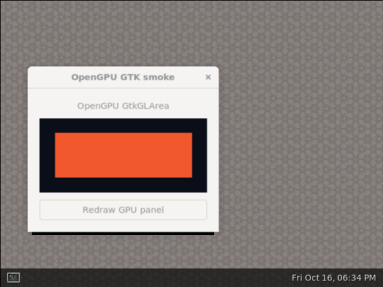
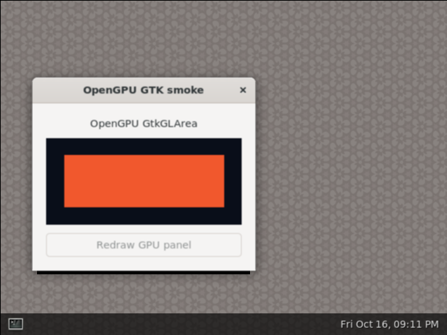

# Full-system simulation performance investigation

## Qualified L2 remapper optimization (2026-10-17)

The lower-memory transaction remapper now stores validity as a bitmap and
routing metadata by index. Balanced lowest-ID encoders, per-entry response-ID
selection and cached waiter-presence bits remove wide control dependencies
while preserving capacity, routing and task cycles.

| Native workload | Previous O2/PGO seconds | New seconds | Time saved |
| --- | ---: | ---: | ---: |
| Solid64 | 0.5674 | 0.5033 | 11.30% |
| Spatial64 | 0.7071 | 0.6195 | 12.38% |
| Spatial256 | 10.8342 | 9.6142 | 11.26% |

Each variant uses four fresh processes in balanced order. All measured ranges
are separate. Complete RAM, task cycles and DMA match; this is a simulator
host-time improvement. Internal hold/commit counts change with the RTL
representation. The candidate uses its own 72-input representative profile.

Fresh compilation of **170 main sources** passes **79 tests in 16 suites**;
all **298 emitted executable modules** match the qualified private runtime.
Native format/swizzle cases, staging controls, O1/O2 comparisons and strict
traces pass. Full-cache synthesis timing meets the unchanged 1 GHz and 25%
I/O budgets at **+29.503 ps core / +36.998 ps I/O**. This screen uses pin-matched
characterized SRAM wrappers; it is not whole-chip placement or routing.

The actual **640×480 Debian/Weston/GTK desktop** and orange redraw pass strict
scanout checks and manual image review. Full strict replay covers **132,803
calls and 15,479,814 ticks** without mismatch or a truncated tail. Capture and
replay overlap, so their elapsed times are functional evidence, not an
isolated desktop-startup comparison. Main sources contain this revision;
the installed default QEMU remains unchanged.

See [the pinned main-source, timing, host and desktop qualification](performance/l2-transaction-remapper-main-qualification-2026-10-17.json).

## Fixed-function texture payload handoff (2026-10-17)

A sampler may accept its successor while delivering the previous result.
The fixed-function texture consumer has one saved fragment payload; accepting
that successor early overwrote the position before publishing the old texel.
The continuous-input regression reproduced **x=11 instead of x=10**, and an
existing textured render wrote the color for x1 at x2.

The consumer now holds admission while its fragment is pending, through output
retirement. The new stalled-output regression and the original 1x/4x
texture/blend/stencil pixel/depth checks pass. Freshly compiling all **169 main
Scala sources** and running ten suites passes **67 tests**. All **296 actual
four-CU executable RTL modules** remain identical to the qualified native
model, so its desktop and strict-trace evidence remains applicable.

See [the before/after regression and whole-source audit](performance/textured-fragment-payload-fix-2026-10-17.json).

## Qualified prepared sampler overlap (2026-10-17)

Each vector sampler can fetch its next prepared sample while holding the
previous result. The tap datapath remains shared, with four outstanding reads.
Issue and retirement use separate cursors derived from shader lane count; the
coordinate lookahead has six elastic stages to keep multiply and bias apart.

| Workload | Previous cycles | New cycles | Reduction |
| --- | ---: | ---: | ---: |
| Matched scene, one CU | 37,041 | 35,137 | 5.14% |
| Matched scene, four CUs | 12,567 | 11,929 | 5.08% |
| Native spatial64, four CUs | 11,304 | 10,826 | 4.23% |
| Native spatial256, four CUs | 129,786 | 122,349 | 5.73% |

The one/four-CU scene preserves pixels, depth, metadata and texture traffic;
its CU scaling remains about 2.95x. Solid64 cycles are unchanged. Balanced
four-sample O2/PGO native timings show **no host wall-time gain**: spatial256
measures 10.957572 → 10.964003 seconds, with overlapping sample ranges. Its
hold evaluations decrease only 0.65%, despite fewer GPU cycles.

Fresh actual main-source emission matches all **296 qualified RTL modules**
after removing source-location annotations. Six Scala suites pass 32 tests,
including 1,200 coordinate cases, VLEN1/2/4/8/16/32, masks and backpressure.
Disabling overlap fails the successor-prefetch control. Forty native
format/swizzle cases, 18 staging controls and nine white-modulation cases pass;
O1/O2 preserve complete RAM and all counters. The new model uses its own 72
representative profile inputs.

The actual 640×480 Debian/Weston/GTK desktop and orange redraw pass scanout
checks and manual image review. Its complete strict trace contains **143,122
calls and 15,959,940 ticks**, with no mismatch or truncated tail. Concurrent
capture/replay and cleanup affect elapsed, so this is functional evidence.
The sampler cone copied from actual native RTL passes the 1 GHz ASAP7
synthesis screen with **+7.786 ps core / +273.148 ps I/O** setup slack; this is
a component estimate rather than whole-chip placement/routing.

See [the sources, every gate, complete samples and trace hashes](performance/prepared-blend-overlap-main-qualification-2026-10-17.json).

## Current prepared-sampler cadence (2026-10-17)

A read-only snapshot at each existing task tick measures the qualified overlap
model. No RTL evaluator is added; all task ticks are observed, and complete
RAM, cycles, commits, holds and DMA remain exact. The diagnostic run changes
only one model object and the fixture's collection checkpoints.

| Workload | Task ticks | Fetch share of active texture-unit clocks | Mean shared texture IDs | Peak IDs |
| --- | ---: | ---: | ---: | ---: |
| Spatial64 | 10,826 | 76.98% | 0.94 | 8 / 16 |
| Spatial256 | 122,349 | 76.17% | 1.22 | 8 / 16 |

The shared ID table never fills in these fixtures. In spatial256, 92,315 fetch
clocks have one outstanding physical leader, 26,061 have two, and only 549 have
four. Cache lookup accounts for 31,436 of 154,084 fetch clocks. These counts
support testing two independent fetch groups under the existing four-read
budget; they do not establish an achievable speedup or general AXI bandwidth
sufficiency. Sampler fetching, rather than ID-table capacity, is the next
cycle-reduction target after the L2 host-work qualification.

See [the per-tick histograms and unchanged-object checks](performance/prepared-sampler-cadence-2026-10-17.json).

An additional read-only observer counts the distinct addresses whose tap
weights are nonzero at each fetch-group entry. Spatial256 has **1,023 / 134,128
addresses (0.76%)** with zero weight. The complete existing Mesa64 trace has
**4,561 / 102,544 (4.45%)**. Its unchanged strict replay still matches all
45,693 calls, 3,311,169 ticks, commits, holds and DMA totals. Cache hits can
already satisfy these addresses, so these percentages bound logical address
opportunities before caching; they are not physical-read or cycle savings.
The complete qualified **640×480 desktop** is less favorable: only **17,078 /
6,469,064 addresses (0.264%)** have zero weight. Its full strict replay matches
all **143,122 calls, 15,959,940 ticks**, reported internal counters and DMA
traffic. Zero-weight suppression is therefore a low priority for this desktop
workload; fetch latency and overlapping groups remain the stronger targets.
Fetching consumes **76.57%** of active texture-unit worker clocks in this
trace. The shared texture ID table peaks at **10 / 16**, never filling; only
121,103 of 7,610,007 fetch worker clocks have three or four outstanding reads.

See [the tap-demand histograms and strict replay checks](performance/prepared-tap-demand-2026-10-17.json).

## Prepared cache admission screen (2026-10-17)

A private sampler reuses its existing CAM at prepared-request admission.
Entirely cached samples enter the registered blend directly. Generic and mip
addressing retain their lookup stage. The regression checks weighted packed
formats, simultaneous invalidation, stalled results and out-of-order refills;
24 samples require eight reads across cold and invalidated cache epochs.

All **33 tests** pass, including VLEN1/2/4/8/16/32 coverage. Warm samples are
accepted every cycle; the unchanged sampler fails that throughput control.
Only `TextureUnit_1.sv` changes among 298 emitted modules. The fresh four-CU
scene preserves pixels, depth, layout and canaries but takes **11,929 → 12,044
cycles**, a **0.96% regression**. The one-CU scene improves only **35,137 →
35,018 cycles (0.34%)**. The original all-scenes-improve screen fails.

Paired native-cone timing reproduces the baseline's **+7.786 ps core /
+273.148 ps I/O** slack. The candidate misses both budgets at **−8.508 ps /
−12.748 ps**, so it is not eligible for promotion. These unit throughput
results do not establish a whole-scene or simulator speedup.

See [the admission regression, four-CU result and failing timing paths](performance/prepared-cache-admission-screen-2026-10-17.json).

## Prepared fetch window screen (2026-10-17)

A private two-context window lets a later prepared sample fetch while an
earlier sample waits. Both contexts share the existing word cache, one blend
datapath and **four physical read credits per CU**. Context count is independent
of shader VLEN. In-flight address aliases share one physical request; results
retire in order under output stalls.

The first revision passes 33 source tests and reduces the four-CU scene from
**11,929 to 11,347 cycles (4.88%)**, preserving pixels, depth and canaries.
An additional existing cache-epoch regression exposes an older sample reading
the newer binding's data. The revision also misses timing at **−7.118 ps core /
−125.256 ps I/O**, so it is not eligible for promotion.

The corrected revision preserves invalidation pulses and waits for older
prepared fetches before clearing their cache or admitting the new epoch. It
also selects blend inputs from registered prepared validity, keeping the
generic FSM state off the shared multiplier inputs; an assertion checks their
ownership invariant. All **35 tests** pass, including one-cycle invalidation
while older samples and the consumer stall. The same epoch regression fails
both cases on the first revision. Only `TextureUnit_1.sv` changes among 298
native modules. Matched scenes preserve pixels, depth and canaries and reduce
**35,137→31,061 cycles (11.60%)** for one CU and **11,929→11,347 (4.88%)** for
four CUs. However, timing still fails at **−2.759 ps core / −16.170 ps I/O**.
A further private revision moves axis bias across an existing register boundary
and removes redundant state guards under a proved ownership invariant. Its
35 tests and decomposed equivalence checks pass, but timing worsens to
**−56.138 ps core / −41.616 ps I/O**; scene compilation is skipped. All window
revisions remain private. Simulator and desktop qualification remain required
for any future revision that passes hardware timing.

See [the overlap controls, epoch failure/fix and qualification gates](performance/prepared-fetch-window-screen-2026-10-17.json).

## Exact held-update attribution (2026-10-17)

A read-only observer surrounds existing hold dispatches, without evaluating
any extra RTL. Collection starts and stops at the fixture's existing task
counter snapshots. Complete RAM, task clocks, commits, holds, write events and
DMA traffic remain exact in three native fixtures.

| Workload | Hold calls | Calls with no recorded write | L2 validity-flag share |
| --- | ---: | ---: | ---: |
| Solid64 | 8,188,998 | 93.19% | 23.09% |
| Spatial64 | 9,726,293 | 92.78% | 22.98% |
| Spatial256 | 144,355,044 | 92.64% | 22.17% |

The current L2 has 564 separate lower-transaction validity flags. In spatial256,
their methods receive **31,999,183 calls**, of which **31,932,431** record no
write. A private packed-bitmap candidate retains all transaction IDs, capacity
and set/clear priority. Its SAT update equivalence passes at widths 8/17/564/576;
27 cache tests and both legacy render image tests pass, and only
`SharedL2Cache.sv` changes among the 296 emitted modules. Nine native fixtures
now preserve complete RAM, task clocks and DMA, with **22.1–23.4% fewer hold
calls**. The existing Mesa64 trace passes the unchanged strict verifier with
the same 45,693 API calls and 3,311,169 ticks. A balanced four-sample O1 screen
saves **3.53–4.22%** wall time. This is preliminary; own-profile O2/PGO and
current desktop qualification remain required before promotion.

Full-cache synthesis also exposes a pre-existing hardware bottleneck: the
564-entry free-ID priority encoder is on a **4.40 ns** core path, failing the
1 GHz target. A private hierarchical encoder preserves lowest-free-ID selection
and the empty-input fallback. SAT checks actual Chisel-emitted logic for every
bitmap at twelve capacities, including 564. Its isolated allocation feedback
loop improves from **3.12 ns to 0.42 ns**, with **+577.433 ps core / +450.902 ps
I/O** slack. Full-cache timing is still required; this isolated pass does not
establish whole-cache or whole-chip frequency.

The packed-bitmap-only full-cache candidate still fails the same target:
**4.09 ns** core delay and **−3,159.991 ps** I/O slack. Its preliminary host
gain is therefore insufficient for promotion. The combined candidate must
pass the actual full-cache gate.

Both indexed owner/original-ID memories and their combination with the
hierarchical encoder pass 27 cache tests and two render tests. The memories
share one asynchronous read per table and retain all 564 entries. A separate
SAT proof excludes observable read/write collisions under the existing
old-state allocation policy. Existing exact hold records attribute another
**33.55%** of spatial256 hold calls to these two metadata tables, in addition
to the validity flags' 22.17%. These call shares are not wall-time predictions.
Nine native scenes now preserve complete RAM, task cycles and DMA with
**55.7–57.8% fewer hold calls** than the selected model. Strict Mesa64 replay
also preserves all 45,693 calls, 3,311,169 ticks and DMA results. A separate
balanced four-sample O1 comparison against the packed-bitmap candidate saves
another **6.37–6.96%**, with non-overlapping timing ranges. This incremental
screen is not a direct release comparison against the selected O2/PGO model.

Extra STA on the existing native netlist locates two more independent failing
cones: regular-response waiter selection has **−3,089.239 ps** core slack, and
MSHR waiter selection has **−1,843.062 ps**. The lower-pool-only tree cannot
address these. Its unfinished native build and timing run were stopped, with
receipts retained, to qualify one shared tree helper at all three wide ID
selection sites. This complete revision passes **38 tests in five suites**
and twelve-capacity SAT checks against the original encoder. Only the three
expected cache modules change among the original 296 native modules; the two
metadata memories remain added. Its nine native scenes and strict Mesa64
reference replay pass. The balanced incremental O1 screen is flat on the large
scene (**−0.078% saved**, overlapping ranges); small-case ranges also overlap.

The complete native cache now passes the **core** 1 GHz target with **+22.189
ps** slack. Its response-ID output still fails the unchanged 25% I/O budget by
**137.830 ps**. The path starts at the saved request address, crosses the
match-selected duplicate-waiter check, and drives response arbitration.

A new private revision factors that merge-response guard algebraically:
once the matched entry equals the response entry, the duplicate waiter can be
read from the selected response entry in parallel with line matching. SAT
equivalence passes at five entry/capacity combinations, including 4×564, with
arbitrary matches, waiters, IDs and allocation conditions. **40 tests in seven
suites** pass, including duplicate-request backpressure and a concurrent new
merge during final-waiter retirement. Only `L2MshrTable.sv` changes relative to
the three-tree revision. Its nine native scenes and strict Mesa64 replay pass.
The full-cache core slack improves to **+32.528 ps**, but the output still
misses by **95.239 ps**. The large O1 workload remains flat versus its parent;
there is no optimized release claim.

The remaining critical path starts in an MSHR waiter register and ends at the
response transaction ID. A further revision encodes each entry's waiter ID
before selecting the entry, keeping selection off the wide encoder data path.
It passes the same **40 tests**, fresh twelve-capacity encoder proofs and
**22 exhaustive selector-case SAT proofs** across five configurations,
including 4×564. All waiter bits remain arbitrary. Case splitting replaces an
unrestricted packed-vector proof that expanded to 58 million SAT variables;
it covers every selector without reducing the theorem. Its nine native cases
and strict Mesa64 replay pass, but full-cache timing regresses to **−16.637 ps
core / −221.286 ps I/O**. The matched incremental O1 large workload is flat
(**−0.244% saved**, overlapping ranges). This revision is not promoted.

Read-only netlist mapping confirms both failing paths start at MSHR waiter
bits; the core path reaches a waiter in another slice, and the I/O path reaches
response data. A new private revision maintains one cached nonempty bit per
entry on the same bitmap-update edges and with the same write priority. This
targets the wide reduction before response arbitration without adding a
pipeline cycle or changing capacity. All **40 source tests** pass; only the
expected MSHR module changes among 298 emitted modules. Inductive SAT checks
pass at **2×1, 4×7, 4×17, 4×564 and 8×576**, including simultaneous same-entry
updates and the original out-of-range one-hot semantics. Nine native fixtures
and strict Mesa64 replay preserve complete RAM, task clocks and DMA.
The final revision meets unchanged full-cache timing at **+29.503 ps core /
+36.998 ps I/O**. Its own-profile O2 model saves **11.3–12.4% host time** in
balanced native measurements. The current 640×480 desktop, redraw, strict
trace replay and manual image review pass. Fresh all-main compilation and
79 tests bind the qualified runtime to the integrated sources; see the final
qualification above. Task cycles remain unchanged.

See [the remapper screens, exact-ID proofs and timing limits](performance/l2-transaction-remapper-screen-2026-10-17.json).

No-write calls are not automatically removable: they can evaluate expressions
or dependencies. The observer's elapsed time is diagnostic. The flag-call
fraction is not a wall-time speedup prediction.

See [the exact per-call/write/wake counts and selected-object hashes](performance/hold-write-attribution-2026-10-17.json).

## Current active-render CPU sample (2026-10-17)

A fresh five-second spatial256 sample of the qualified sampler-overlap model
contains 3,680 observations after a two-second startup delay, with no loader
samples. Exclusive observations group as follows:

| Runtime work | Share of this interval |
| --- | ---: |
| Combinational evaluation | 38.78% |
| Held-register update evaluation | 37.07% |
| Evaluator dispatch and inline work | 11.01% |
| Register commit, excluding invalidation helpers | 7.07% |
| Page-invalidation helpers | 3.83% |
| Memory simulation | 1.63% |

The instrumented run preserves the qualified complete RAM and every counter.
These shares describe this sampled native-render interval, not whole-desktop
CPU costs or removable overhead. Inlined work stays attributed to its caller.
Held-update evaluation now warrants exact per-call write-path and wake-source
attribution before changing its scheduling.

See [the exclusive-count invariants, top symbols and pinned build](performance/current-active-render-cpu-sample-2026-10-17.json).

## Rejected compact dispatch metadata (2026-10-17)

A host-only prototype halves the 17,522-entry ready-pass guard table from
560,704 to 280,352 bytes. Both dispatchers use matched O2 without PGO, while
the other 36 selected O2/PGO objects and the header remain byte-identical.
Every output RAM byte and simulation counter matches in all 16 executions.

Four balanced samples per variant show **0.46% saved on spatial64** and
**0.71% slower spatial256**, with overlapping ranges. The smaller table does
not demonstrate a useful active-render gain, so it is not promoted.

See [the checked layout, reused-object hashes and all samples](performance/compact-pass-guards-screen-2026-10-17.json).

## Concurrent strict trace validation (2026-10-17)

[`scripts/stream_arti_trace.py`](../scripts/stream_arti_trace.py) records and
strictly replays concurrently, saving exactly the bytes delivered to the
unchanged replayer. This overlaps two functional checks instead of waiting
for capture to finish before starting replay. Both commands must succeed;
truncated tails fail even if the replayer exits zero. Existing trace/work
paths are preserved, and child process groups stop on failure or cancellation.

```sh
python3 scripts/stream_arti_trace.py \
  --trace /tmp/gtk.trace --work /tmp/gtk-stream \
  --replayer /path/to/replay -- /path/to/recorder-enabled-guest-launcher
```

The producer inherits `ARTI_MODEL_TRACE` pointing at the recording FIFO. It
must honor that destination and remain alive until recording finishes. A
producer that exits without opening the FIFO fails and its children stop. A
launcher that overrides the destination can use `<work>/record.fifo` explicitly.

Seven transport/lifecycle tests pass, including a producer that exits without
opening the recording FIFO and isolation from inherited replay settings. The
actual optimized current Mesa64 guest
also passes 18 VM cases, 21 GLES cases, GTK64 and all six white-fold transitions
while its complete trace replays strictly. A fragmented-stream test preserves
all known counters, and a deliberately truncated first payload is rejected.
Backpressure can affect recorded wall-clock observations, so capture/replay
elapsed is functional evidence rather than a desktop-speed comparison.

See [the stream hashes, actual guest proof and transport controls](performance/concurrent-trace-validation-2026-10-17.json).

## Current AXI and sampler activity (2026-10-17)

Read-only observers of the qualified current model preserve complete native
RAM, every counter and strict replay of both Mesa recordings. They sample
existing pre-edge AXI fields and registered sampler state without invoking
extra DUT evaluations. Current 512-bit AXI transfers are:

| Workload | Task ticks | Accepted R beats | Accepted W beats | R / W occupancy |
| --- | ---: | ---: | ---: | ---: |
| Spatial64 | 11,304 | 1,113 | 1,180 | 9.85% / 10.44% |
| Spatial256 | 129,786 | 15,716 | 17,721 | 12.11% / 13.65% |
| Fixed Mesa64 trace | 3,619,433 | 42,352 | 76,740 | 1.17% / 2.12% |
| Full640 trace | 16,856,198 | 584,122 | 738,764 | 3.47% / 4.38% |

Every recorded request occupies one beat. Reads are four or 64 bytes; writes
are masked 64-byte transfers. Every channel has **zero observed backpressure**,
and every AR-to-R / AW-to-B latency is **one cycle** in the callback memory
model. Widening this bus alone would leave each current request at one beat.
These measurements describe the simulator's memory model, rather than physical
DRAM latency. DMA callback counts differ from wire beats because writes are
split into eight-byte callbacks.

An ideal independent-channel bound for the full trace is 738,764 cycles to
carry its recorded data beats, versus 16,856,198 actual ticks. That bound
ignores compute, dependencies, request scheduling and control; it is a weak
necessary bound, not a predicted attainable runtime or proof of optimality.

The current full trace's sampler accepts **2,765,252** word requests, with two
pending at trace end. Mean owner lifetime is **2.70 cycles**, peak occupancy
is **9 of 16 slots**, and owner-capacity stalls are zero. The shared port
accepts a request on **99.27% of cycles when any worker presents one**. This
conditional acceptance differs from overall port utilization. Individual
workers still compete during bursts.

Within the vector-sample stage, worker-cycle residency is **66.90% fetch,
14.31% blend and 14.31% result presentation**. These are current-RTL figures,
replacing the older trace as the basis for the next sampler experiment.
The private prepared-overlap prototype starts a successor during the prior
blend, retaining one physical sampler and four outstanding reads per worker.
Unit tests pass across VLEN 1/2/4/8/16/32; the matched full-mask 16-lane case
drops from 176 to 160 cycles and the 32-lane case from 339 to 307. The full
four-CU scene drops **12,567 → 11,929 cycles (5.08%)**, with exact pixels,
depth, metadata and preserved canaries; texture traffic is unchanged. Its
first standalone timing estimate regresses **986.765 → 931.648 MHz** at the
1 GHz target, preventing promotion. The mapped path is coordinate multiply
plus half-texel bias. A follow-up fuses that constant before product slicing;
a SAT proof covers every possible 46-bit product. Further timing and desktop
qualification remain necessary, and these cycle gains establish no desktop
wall-time speedup.

The revised private implementation passes the 1 GHz synthesis screen with
**9.284 ps core and 272.409 ps I/O margin**. It retains the equivalent fused
bias in the generic sampler and separates product/bias in a six-stage elastic
coordinate lookahead. All sampler tests, 1,200 independent coordinate cases,
reset with occupied stages, and VLEN 1/2/4/8/16/32 pass. The initial overlap
also reduces the one-CU scene from **37,041 to 35,137 cycles (5.14%)**; revised
full-scene/native desktop and wall-time checks remain pending. These are
component synthesis results before placement and routing.

See [raw counters, observer source and exact validation](performance/current-axi-and-sampler-attribution-2026-10-17.json).

## Qualified immutable invalidation blocks (2026-10-17)

FlashSim commit `efefca8` predecodes dense immutable page-ID lists into fixed eight/four-cell
increment blocks and scalar remainders. Portable unsigned operations let the
host compiler vectorize contiguous counters. Every occurrence, including
duplicates and wraparound, is preserved. Mutable, partial, shadowed and unknown
uses retain the original helper. `FLASHSIM_COMMIT_BLOCKS=0` selects the legacy
generation path. This host packing is independent of shader VLEN and RTL lanes.

An exact read-only observer counts **6,222,862,861 page increments** in the
fixed Mesa64 trace; **84.51%** lie in runs of at least four counters. A first
variable-length run helper was 1.13–1.55% slower across the four workloads and
was rejected. Fixed blocks avoid its nested short-run loops. The production
pass selects **1,724 tables and 4,253 call sites**. Its output is byte-identical
to the compiled candidate; the header, RTL and unrelated sources are unchanged.

Three balanced fresh-process samples per variant using final packaged O2/PGO
libraries give:

| Same useful workload | Shared-dispatch main | With blocks | Time saved |
| --- | ---: | ---: | ---: |
| Packed-white solid64 | 0.598740 s | 0.579905 s | 3.15% |
| Packed-white spatial64 | 0.732220 s | 0.703225 s | 3.96% |
| Packed-white spatial256 | 11.322210 s | 11.117866 s | 1.80% |
| Fixed actual current Mesa64 trace | 23.500118 s | 22.306446 s | 5.08% |

The same balanced experiment also measures the baseline before both host
changes: **24.302408 → 22.306446 seconds**, or **8.21% less Mesa64 time**.
These are direct same-work measurements. The larger preliminary direct-object
screen gains are not the release result. Idle measures **19.85 → 20.20 MHz**, with zero DMA, commits and holds.

Only the commit caller is rebuilt using its existing compatible CFG profile;
profile mismatch diagnostics are errors. The new small helper uses O2 without
PGO, and all remaining selected archive objects match byte for byte. All native
RAM and counters and all strict trace results match. Qualification passes
120 package tests, 4,103 sanitized reference cases, 40 native formats plus
18 controls, nine current packed-white fixtures, 18 VM cases, 21 GLES cases,
GTK64 white-modulation transitions and the actual 640×480 guest/redraw.
Both full-resolution scanouts were manually reviewed. Strict full replay
matches 151,931 calls and 16,856,198 ticks. Its elapsed overlaps functional
guest work and does not establish a paired whole-desktop gain. The installed
QEMU executable is unchanged.

The older 39 kHz desktop average and idle benchmark MHz describe different
activity. Current active-render samples still put L2 evaluation and output
merging among the next host targets; this result does not establish optimality.

See [the complete qualification, rejected experiment and final samples](performance/invalidation-blocks-main-qualification-2026-10-17.json).

## Qualified shared pass dispatch (2026-10-17)

FlashSim commit `f86b763` shares generation/data/pending guards across
ready worklist passes. It calls each region's eager chunks directly and keeps
the complete lazy dependency walk for regions outside the drained closure.
All 17,446 table entries and six multi-chunk paths match the legacy wrappers.
The RTL, generated header and remaining 36 translation units are unchanged.
`FLASHSIM_UNIFORM_PASSES=0` selects the legacy generation path for comparison.

The changed dispatcher is trained from its own 72 representative executions;
both timed variants retain byte-identical selected O2/PGO objects elsewhere.
Three balanced fresh-process samples per variant give:

| Same useful workload | Selected main | Shared dispatcher | Time saved |
| --- | ---: | ---: | ---: |
| Packed-white solid64 | 0.624063 s | 0.600818 s | 3.72% |
| Packed-white spatial64 | 0.765788 s | 0.728353 s | 4.89% |
| Packed-white spatial256 | 11.872122 s | 11.287641 s | 4.92% |
| Fixed actual current Mesa64 trace | 24.306895 s | 23.547001 s | 3.13% |

All output RAM, task clocks, holds, commits and DMA counters match. The final
profiled gains are smaller than the earlier matched unprofiled-object screen;
use this release table when estimating benefit. Idle has a small cost:
**20.65 → 20.23 MHz**, about 2% lower throughput, measured with ten million
idle ticks per fresh process and zero DMA, holds or commits.

Qualification passes 117 package tests, strengthened mixed ready/lazy tests,
40 native formats and 18 controls in O1/O2, nine current packed-white fixtures,
18 VM cases, 21 GLES cases and GTK64. The full 640×480 guest and green-to-orange
redraw pass, with manually reviewed scanout images. Strict replay matches all
151,931 calls and 16,856,198 ticks of the existing full desktop trace. Its
elapsed overlaps functional work and is not a paired whole-desktop timing.
The installed QEMU executable and canonical README image remain unchanged.

Guest disk preparation initially exhausted storage. The retry uses a
byte-verified APFS clone. Checked cleanup removes only unused reproducible
training binaries and the failed partial disk; all profile inputs remain
available with identical paths and hashes after transparent compression.

The next host targets come from a diagnostic five-second active-render sample:
L2 evaluation, output merging and register-page invalidation. These sampled
shares describe that interval and do not establish whole-desktop CPU costs.

See [the complete shared-dispatch qualification and samples](performance/uniform-pass-dispatch-main-qualification-2026-10-17.json).

## Interpreting the 39 kHz desktop rate

The same compiled four-CU model reaches **21.57 MHz while idle**, with zero
DMA, commits and hold dispatches. Its older desktop trace averages **38.95
kHz**, and sustained active rendering runs at about **10–11 kHz**. Older
benchmark MHz figures measure lighter workloads and sometimes fewer CUs.
They do not predict active desktop throughput. All four CUs currently run
on one host thread. The measured gap is explained by activity; it does not
establish that the active simulator is efficient or near its limit.

A fresh five-second active-render sample identifies substantial evaluator
dispatch and register-invalidation costs. An exact observer of the current
spatial64 fixture counts 8,890,221 pass dispatches: 8,809,255 evaluate their
region, 80,966 return at the generation guard, and none return at the data
guard. Only **0.91%** are no-op calls in that fixture. Removing no-op calls
alone therefore has little headroom. Those counters motivated the shared
dispatcher qualified above.

The private shared-dispatch screen replaces the small wrappers with one typed
guard loop and direct calls to each region's eager chunks. Every guard update
and chunk order is preserved. Both replacement objects use `-O2` without PGO;
all other objects come from the same qualified O2/PGO archive. Three balanced
samples per variant save **7.24% on solid64, 6.79% on spatial64 and 8.24% on
spatial256**, with identical complete RAM and all simulation counters. The
replacement object's text section is 33.84% smaller. These preliminary
matched-object results preceded representative PGO, generic-emitter semantics
and strict Mesa/desktop qualification. The completed release result is above.

See [the private dispatcher measurements and compiler scope](performance/uniform-dispatch-host-screen-2026-10-17.json).

## Qualified texture capacity, response routing and forwarding (2026-10-17)

The main RTL bounds texture ownership and buffered word slots by the physical
sampler's four outstanding tap reads per worker. Four CUs use 16 entries,
retaining all sixteen cache lines and the existing global transaction-ID
reservations. The bound comes from `TextureUnit.maxOutstandingReads` and is
independent of shader VLEN. Direct slot-to-worker response decoding shortens
the forwarding path, and an empty reply queue exposes a ready cached reply
without an extra register cycle while retaining stalled replies.

Three balanced fresh-process O2/PGO samples per variant give:

| Same useful render | Staging-quiet baseline | Combined change | Time saved |
| --- | ---: | ---: | ---: |
| Packed-white solid64 | 0.633772 s | 0.631074 s | 0.43% |
| Packed-white spatial64 | 0.782107 s | 0.766286 s | 2.02% |
| Packed-white spatial256 | 12.154530 s | 11.801322 s | 2.91% |

The large render drops from **139,330 to 129,786 cycles (6.85%)**. Its elapsed
gain is smaller, so cycle reduction alone overstates the simulator benefit.
Each variant uses its own 72-profile PGO set under the same training protocol.
Full native RAM, pixels, depth and canaries pass independent checks. O1/O2
builds of the candidate match complete RAM and every counter across 40 native
formats and 18 controls. Current Mesa/GLES/GTK64, white-modulation transitions,
the full 640×480 desktop, its own strict timed replay and manual image review
also pass. The full desktop run overlaps diagnostic work and is a functional
proof, not a paired elapsed-time comparison with the older desktop trace.

The paired synthesis screen copies the actual native RTL component modules
unchanged. Both core and I/O setup pass at the 1 GHz target; candidate margins
are **129.400 ps core and 44.669 ps I/O**. This is a component estimate before
placement and routing. All 24 main-source regressions pass, and all 296 emitted
RTL modules match the qualified model. Installed/default QEMU executables
remain unchanged.

See [the main-source qualification, timing samples and exact dispatch counters](performance/texture-composite-main-qualification-2026-10-17.json).

## Qualified staging-response payload quieting (2026-10-17)

The main RTL keeps each staging worker's 512-bit response payload quiet when
its reply enqueue is invalid. Accepted replies, ready/valid timing, owner
credits and buffered data under backpressure remain unchanged. Balanced O2/PGO
measurements on identical workloads save **4.14%** on the current Mesa64 trace
and **7.97%** on the active 256×256 render, with unchanged task cycles and DMA
results. The paired measurements and smaller-scene results are below.

Qualification passes 40 native format cases, 12 staging controls, six forced
controls, 18 VM cases, GLES/GTK64 with both the frozen training payload and
current packed-white payload, and the full 640×480 Debian/GTK desktop. The
current white-modulation transition tests pass, and the full-resolution
scanout and redraw images were manually reviewed. The new complete desktop
trace replays **159,539 calls and 17,355,197 ticks**, matching every recorded
API result, clock and DMA event. Its 460.002-second replay overlaps other
qualification work and uses a different recording from the earlier 39 kHz
measurement; it is a functional gate, not a paired desktop speed comparison.

Eight regressions pass after compiling the actual main source. All **296
emitted RTL modules** match the qualified private model after removing only
source-location comments. Paired synthesis estimates for the two-level staging
path meet the 1 GHz target, with 117.900 ps core slack and a tight 2.095 ps I/O
margin. This is a pre-layout estimate; whole-chip timing remains unproven.
The installed QEMU executable and README screenshot remain unchanged.

The follow-up candidate sizes texture ownership by physical sampler
concurrency: four pending reads per worker, or 16 entries for four CUs.
Differential tests pass for 1/2/4/8 workers, and one/four-CU scenes preserve all
cycles and results. The combined texture-path estimate improves from 0.070 ps
to 50.167 ps core slack. That owner-only screen preceded the combined change
qualified above. Shader VLEN does not enter this physical four-tap concurrency
bound.

See [the complete main-source qualification and evidence](performance/staging-response-quiet-main-qualification-2026-10-17.json).

## Texture capacity screens and explicit I/O qualification (2026-10-17)

The owner-only 64-to-16-entry change passes nine native packed-white cases with
exact complete RAM, task cycles and memory results. Its preliminary matched
O1 instrumented host screen is mixed: spatial256 is 3.29% faster, while solid64
and spatial64 are 2.66% and 7.83% slower. Standalone promotion is deferred;
these instrumented results do not establish a release O2 regression.

A separate pending-word reduction from 64 to 16 retains all sixteen cache
lines and every global transaction-ID reservation. Direct comparisons cover
full word/line capacity, reuse, invalidation and fault retry. The one/four-CU
scenes preserve all results and 39,360/13,155 cycles. Its combined-path synthesis
estimate has 290.722 ps core slack and 240.605 ps I/O slack at the 1 GHz target.

With the smaller tables, empty reply-queue forwarding passes core setup but
still **fails I/O by 1.068 ps**. The vendor tool's core-only overview labels it
PASS; `scripts/qualify_ppa.py` now separately checks all reported setup paths,
including the virtual I/O clock. It writes `qualification.json`, preserves the
raw vendor result and exits 2 for a setup violation. Five regressions pass,
including a CLI test for this precise false-positive case.

Directly decoding each matching slot into its worker removes the intervening
binary-owner encode/decode step. That private variant passes legacy-equivalence
tests with 1/2/3/4/8 workers, and its synthesized forwarding path has 101.814 ps
core slack and 18.880 ps I/O slack. Full scenes preserve exact results while
reducing four-CU cycles from 13,155 to 12,567 (4.47%) and one-CU cycles from
39,360 to 37,041 (5.89%). Fresh native performance qualification is underway.
All estimates are pre-layout. These preliminary screens preceded the combined
native qualification above.

See [the complete capacity screens and I/O-gate evidence](performance/texture-capacity-and-io-screen-2026-10-17.json).

## Preliminary combined texture screening (2026-10-17)

The combined bounded-owner/word-buffer, direct-decoder and reply-forwarding
prototype passes all nine packed-white native fixtures with **bit-identical
complete output RAM**, including staging scratch. The 256×256 render drops
from 139,330 to 129,786 ticks (**6.85% fewer**). A paired component extraction
copies the actual native RTL modules unchanged, retaining the native lowering
and constant propagation. Both baseline and candidate pass core and I/O setup;
the candidate has 129.400 ps core slack and 44.669 ps I/O slack at 1 GHz.
This remains a pre-layout component estimate.

The preliminary matched O1 instrumented host screen gives these medians:

| Useful workload | Main staging-quiet model | Combined prototype | Time saved |
| --- | ---: | ---: | ---: |
| Packed-white solid64 | 1.385989 s | 1.345551 s | 2.92% |
| Packed-white spatial64 | 1.537631 s | 1.490923 s | 3.04% |
| Packed-white spatial256 | 26.426378 s | 25.533979 s | 3.38% |

Solid and spatial256 use three balanced samples per variant. Spatial64's first
three samples showed a noisy 1.29% regression; six additional balanced samples
per variant resolve that borderline result. All original samples are retained
in its final nine-sample medians, and the screening thresholds are unchanged.
These are preliminary instrumented results, not release O2 gains. Fewer ticks
can accompany a lower tick rate when useful work per tick increases; compare
elapsed time for the same completed render.

Broader checks pass 40 native format cases, 12 staging controls, six forced
controls, 18 VM cases and an actual 21-case GLES/GTK64 training guest. Its own
captured timed trace replays strictly. The representative 72-profile set is
merged for the O2 release model. Independent output and memory
checks replace old-architecture timing equality; O1/O2 builds of this same
candidate must still match their own clocks, callbacks and complete RAM.
Current packed-white/full640 qualification and final balanced release timing
are recorded in the completed main-source qualification above. The O1 numbers
in this historical screen are not the final release result.

See [the native proofs, all timing samples and training evidence](performance/texture-composite-native-screen-2026-10-17.json).

## Desktop activity cost before payload quieting (2026-10-17)

With qualified packed-white modulation, the complete 640×480 desktop/GTK
trace contains **16,529,708 ticks** and takes **424.367 seconds** in ordinary
strict replay, averaging **38.95 kHz**. Independent balanced native fixtures
calibrate an empirical evaluator-work estimate of **409.9–439.8 seconds**,
within 3.7% of that measurement. This explains the elapsed time; it does not
establish an analytical minimum or simulator optimality. Replay elapsed is
diagnostic, with partial overlap from a supplemental guest capture.

The same four-CU artifact's rendering-heavy 256×256 packed-white fixture takes
12.979 seconds for 139,330 ticks, or **10.74 kHz**. A tick's cost depends on
active logic. Older FlashSim README benchmarks describe a one-CU system and
an AXI ID read followed by idle cycles; their MHz rates cannot predict active
four-CU desktop throughput. The model evaluates all four CUs on one host
thread. That run's guest milestones are 126.692 seconds to wallpaper
and 468.710 seconds to the active GTK proof window, measured separately from
standalone replay; installed default binaries remain unchanged.

A read-only observer replays every recorded API result, DMA event and clock
with exactly matching counters. Of 2,439,887 logical texture reads, 2,439,884
retire and three remain accounted for at trace end. Mean outstanding lifetime
is **3.67 cycles**. The shared port accepts a read on **99.47% of cycles when
any worker presents a request**; there are no outstanding-slot capacity
stalls. More slots therefore have no demonstrated benefit for this trace.
Texture instructions account for **77.76% of held vector worker-cycles**.
These are RTL activity statistics, not host CPU percentages.

A fresh five-second host sample of the qualified packed-white 256×256 renderer
finds 300 of 3,600 main-thread observations in the register-page invalidation
helper. That identifies a concrete host target alongside texture-response
latency. The sampled run preserves every RAM byte and model/memory counter;
its elapsed time is not used for a performance comparison.

A private empty-reply-queue bypass passes 16 existing port/ownership tests and
exact paired pixel/depth/metadata checks. It reduces the current Mesa white
scene from 13,155 to 12,567 cycles on four CUs and from 39,360 to 37,041 on one
CU. However, the combined arbiter/buffer synthesis estimate fails the 1 GHz
target: core timing is about 752 MHz versus 1,000 MHz for the baseline.
The bypass is rejected for promotion; no native model or guest build is
started for it. These are pre-layout estimates, not whole-chip timing closure.

See [the complete texture-port counters, runtime calculation and sampled-host evidence](performance/desktop-texture-port-attribution-2026-10-17.json).

## Same-model idle rate and response-payload screening (2026-10-17)

The pre-quieting four-CU O2/PGO model runs at **21.57 MHz** when reset, warmed and
left without submitted work: three fresh processes each advance exactly one
million ticks, with a median of 46.363 ms and zero DMA, commits or hold
dispatches. The same compiled DUT and archive take 13.476 seconds for 139,330
ticks in the active packed-white 256×256 render (**10.34 kHz**). The desktop
trace above averages 38.95 kHz and about 325 hold dispatches per tick. Its
elapsed measurement is diagnostic and was recorded separately. Idle MHz is
therefore a poor predictor of active desktop throughput. These workload rates
describe different activity, rather than a backend speedup comparison.

The qualified RTL change zeros an arbiter's 512-bit response payload whenever
that worker's reply enqueue is invalid. Valid replies, ownership, backpressure
and registered stalled data remain covered by unit and native checks. Each
variant uses its own representative 72-profile PGO training set under the same
protocol. Three balanced fresh-process samples per variant give:

| Workload | Baseline O2/PGO | Payload quieting | Time saved |
| --- | ---: | ---: | ---: |
| Packed-white solid64 | 0.682412 s | 0.651303 s | 4.56% |
| Packed-white spatial64 | 0.854659 s | 0.799135 s | 6.50% |
| Packed-white spatial256 | 13.475976 s | 12.402274 s | 7.97% |
| Actual packed-white Mesa64 trace | 23.485670 s | 22.514231 s | 4.14% |

Task cycles, complete RAM, commits and DMA results match; internal hold
dispatches decrease. The change passes 40 native format cases, 12 staging
controls, six forced controls, VM/GLES/GTK64 qualification and strict timed
trace checks in training and optimized builds. The current packed-white guest
also passes all 21 GLES cases, exact white-modulation transition checks and
GTK64 scanout. Full 640×480 recording/replay qualification also passes. These
figures establish a modest host-runtime gain on the measured workloads;
main RTL now contains the change, while installed executables remain unchanged.

Separately, FlashSim dead-code elimination now visits each reachable assignment
once through a worklist. The complete four-CU optimizer output is byte-identical
to the previous captured IR, and all 114 package tests pass. FlashSim commit
`656aef3` speeds model generation and verification; it leaves the generated
simulation code unchanged.

See [the rate probe, paired runtime samples and optimizer equivalence evidence](performance/same-model-idle-and-active-screen-2026-10-17.json).

## Active four-CU compiler-level screening (2026-10-17)

Compiling the exact unchanged model at `-O1` with the same representative PGO
profile passes complete output-RAM and strict Mesa-trace checks, but is slower
than the selected `-O2` artifact. Three balanced fresh-process samples per
variant/workload give these runtime medians:

| Workload | Selected O2 + PGO | O1 + same PGO | O1 increase |
| --- | ---: | ---: | ---: |
| Packed-white spatial256 | 12.966 s | 13.521 s | 4.28% |
| Actual packed-white Mesa64 trace | 23.599 s | 24.846 s | 5.28% |

The release runtime remains `-O2`. O1 remains useful for preliminary functional
and profile-training builds. Its independent child compilation took 344.96 s
with three workers; compilation overlapped other diagnostic work, so that
number is not a controlled build-speed comparison. The benchmark launcher
waited until the other native build and functional checks exited before timing.
See [the fixed-source comparison and complete evidence](performance/active-four-CU-O1-PGO-screen-2026-10-17.json).

## Runtime estimate before packed-white modulation (2026-10-17)

The exact complete desktop/GTK trace takes **550.351 seconds** in the qualified
sparse-wake model: 15,447,854 ticks and 6,830,582,608 hold-dispatch invocations.
This trace covers multiple desktop operations and polling, so its duration is
not the time to first wallpaper or a single frame.

An empirical estimate based on evaluation work agrees with this measurement.
The three-sample desktop-prefix median costs 82.22 ns per hold dispatch; the
separate 256×256 render costs 78.80 ns. Applying those costs to the complete
trace predicts **538.2–561.6 seconds**, within 2.3% of the measured result.
These are version-specific work counters: a dispatch invokes a generated hold
function, and its cost depends on which function runs and what it evaluates.
This agreement explains the current runtime; it does not establish an optimal
implementation or an analytical lower bound.

Using one universal simulated-clock rate gives unreliable estimates. The same
artifact averages 7.78 µs/tick in the small Mesa workload, 42.44 µs/tick in the
desktop prefix, and 93.10 µs/tick in the active 256×256 render. Even dispatch
cost varies: extrapolating the small Mesa workload underestimates the complete
trace by 23.75%. Actual guest startup also includes CPU execution and proof
waits outside model replay. Converting ticks to time at a hypothetical hardware
clock does not predict desktop startup or establish achievable hardware timing.

See [the estimate, counter definitions, all three predictions and limitations](performance/desktop-runtime-estimate-2026-10-17.json).

The subsequent full-trace observer preserves every API result, DMA event,
recorded clock and model counter. It finds 133,547 destination-colour reads,
but **zero** satisfy the proposed opaque identity-blend bypass. That private
candidate passes 3,860 independent blend cases and the existing OM/ordering
regressions; its four-CU opaque scene saves 4.27% of cycles. It is deferred
because this desktop trace cannot use the bypass.

Reducing the runtime settle minimum from 128 to 16 also passes 40 native
fixtures with identical complete output RAM and memory traffic, 18 VM cases,
21 actual GLES cases, GTK64 scanout and all 82,641 calls of its own recorded
guest trace. A balanced quiet-read microbenchmark improves from 49.30 to
15.96 ms per 10,000 reads. This saves only 33.34 ms for those reads and leaves
rendering task cycles unchanged; it is not evidence of a material desktop
speedup. The production default remains 128, and the shorter minimum has not
been qualified on the full 640×480 desktop.

The activity observer counts 5,723,797 ticks without AXI or bounded change-tail
activity. Tick shares are not CPU-time shares, and the observed graphics-stage
mask omits other engines. These counts do not establish that removing idle
ticks would reduce wall time proportionally. Active CU execution and sampler
fetch remain the next profiling priority. See
[the candidate results and complete activity counts](performance/desktop-candidate-attribution-2026-10-17.json).

The follow-up CU probe counts all 91,513 vector texture instructions and
independently matches them to sampler instruction starts. Texture instructions
account for **76.7% of vector-dispatch hold cycles**. Active warps are all
blocked during 82.9% of active CU cycles; that includes normal instruction
latency and does not measure ALU utilization. Program addresses are reused, so
instruction histograms distinguish both PC and instruction word, and accepted
vector instructions are tracked by CU and warp until retirement.

Only **10,955 of 1,372,364 prepared samples** hit all four cached taps. Partial
misses already issue during lookup, so removing that lookup stage has little
opportunity. A private warp-sized texture queue passes operand/mask ownership,
FIFO, progress and configuration-order tests. It saves only seven cycles in
the plain four-CU scene and regresses its one-CU counterpart by nine cycles.
With the longer actual Mesa modulation program it saves 3.33% on four CUs and
2.71% on one CU. It remains private while a larger shader simplification is
evaluated. See [the complete CU counters and queue screening](performance/desktop-CU-issue-attribution-2026-10-17.json).

## Qualified packed-white modulation (2026-10-17)

The desktop frequently samples a texture and modulates it by packed white
vertex colours. The current shader computes `floor(channel * 255 / 256)`,
so simply omitting white modulation would change pixels. The replacement
uses packed byte arithmetic to decrement each nonzero channel once, preserving
that rounding exactly. It reduces the canonical program from 45 to 21 words
(51 to 23 after runtime ABI lowering), with no fixed vector length.

Mesa checks every staged vertex and restores the full
program for subsequent non-white batches. Alpha forcing remains in the existing
binding path. Nine paired native fixtures pass independent filtering/colour
references and memory-canary checks. The arithmetic passes 1,786,432 sanitized
RVV/reference cases, including a negative control that incorrectly treats
white as identity. ABI checks cover 1/2/4/8/16/32 lanes.

Three balanced fresh-process samples per shader, using the same qualified
four-CU model and PGO artifact, give these render-time medians:

| Native workload | General modulation | Packed equivalent | Reduction |
| --- | ---: | ---: | ---: |
| Solid64, forced alpha | 0.983 s | 0.670 s | 31.88% |
| Spatial64, forced alpha | 1.124 s | 0.829 s | 26.18% |
| Spatial256, forced alpha | 17.780 s | 12.979 s | 27.00% |

The qualified Mesa build passes 21 GLES cases, GTK64 scanout and all 46,091 calls of
its fresh trace. The modulation test adds white/green/white/mixed/white draws
using one GLES program, with no intervening clear; all five exact pixel checks
pass. The new trace includes those extra draws and has a different polling
schedule, so its runtime is not a fixed-workload comparison with earlier traces.
The full 640×480 guest passes idle/active readback and active onscreen scanout.
Its complete 173,947-call, 16,529,708-tick trace also passes strict replay. Both
full-size frames were visually reviewed; a separate capture with the orange
filter disabled supplies the green idle image. Wallpaper appears at 126.7 s
and active GTK at 468.7 s in the primary run. These are functional milestones;
the 424.37 s replay partly overlaps the supplemental capture and is diagnostic.
The native paired medians above provide the controlled host comparison.

Main sources now match the qualified Mesa inputs and pass the complete C test
suite. The installed QEMU executable remains unchanged. See
[the native samples, source hashes and full qualification](performance/packed-white-modulation-main-qualification-2026-10-17.json).

## Sampler-format channel permutation (2026-10-16)

Gallium now folds a recognized pure texture R/B swap into the sampler's native
format decoder: RGBA8/BGRA8 and RGBX8/BGRX8 pairs exchange the colour channels
with unchanged alpha policy. The texture bytes stay in place. The draw uses
the existing sample shader, reducing the current runtime-ABI program from
26 to 13 instructions. Vector length and staging stride remain runtime values.
Zero-uniform, alpha-forcing, composite and unknown/native-word formats keep
their existing shader/helper selection.

Across four native byte formats, two texture extents and two colour patterns,
complete output pixels/depth and all memory canaries match the original shader.
Spatial draws fall from **12,740 to 11,219 cycles (11.9%)**; solid draws fall
from **8,926 to 8,680 (2.8%)**. Eight legacy-format controls retain their exact
cycles and outputs. The independent filter/RVV reference checks 262,144
bilinear/trilinear colour cases plus 32 policies under sanitizers; a deliberately
wrong peer format fails the reference. The complete main host suite passes.

A private Mesa DSO reconstructs the frozen baseline exactly before rebuilding
only its context. It passes 18 compute replays, 21 GLES cases, depth/quad tests
and GTK64 strict scanout. All 44,295 calls of the new actual Mesa trace then
match in strict replay, including DMA data/masks/order and recorded clocks.
The full 640×480 desktop passes idle/active readback and active-frame strict
scanout plus visual review. This observer saved no idle onscreen frame.

The plain optimized full guest completes in 883.055 seconds, with wallpaper
at 245.316 seconds and active GTK at 881.043 seconds. This is functional timing;
different instrumentation and host conditions prevent a controlled speed ratio
against the earlier diagnostic boot. Installed QEMU remains unchanged. See
[the qualification](performance/sampler-format-folding-2026-10-16.json) and
[the saved active frame](images/opengpu-gtk-sampler-format-20261016.png).

## Qualified generated scheduler (2026-10-17)

FlashSim commit `64d3239` reuses combinational values already drained before
nonblocking-assignment evaluation. Elision requires a complete earlier-ready
dependency closure; other eager groupings keep lazy evaluation. Forced wakeup
updates pass/hold worklists and summaries coherently.

The guarded generator passes 106 tests, including a custom-group stale-value
regression. Its four-CU C++ output is byte-identical across all 39 source/header
files to the fully qualified actual-generator artifact. This preserves the
40,000 sanitized state-cycle proof, native sampler/staging/forced controls,
18 VM replays, 21 GLES cases, GTK64 scanout and exact trace results.

Three balanced samples per artifact reproduce the host improvement:

| Fixed replay workload | Baseline wall median | Candidate wall median | Reduction |
| --- | ---: | ---: | ---: |
| Mesa64, 3,191,999 GPU ticks | 37.091 s | 31.671 s | 14.61% |
| Full640 prefix, 829,297 GPU ticks | 58.475 s | 49.185 s | 15.89% |

CPU medians improve similarly. The candidate uses 73 qualified training profiles
and the baseline 43, so these ratios measure the combined code and training
change. GPU cycles and architectural results remain identical.

The complete 17,897,346-tick desktop trace also passes all 194,602 calls, DMA
payloads/masks/order and recorded clocks in **810.744 seconds**, with 810.767
child CPU seconds. The earlier exact replay took 968.038 seconds; these are
separate diagnostic full runs, rather than balanced full-trace samples.

Actual plain 640×480 Debian/Weston/GTK passes both idle/active readback and
strict onscreen scanout. Wallpaper appears at **207.130 seconds**, idle GTK at
671.702 seconds and active GTK at 842.579 seconds. Both green idle and orange
active frames were visually reviewed. These are functional-run milestones;
the paired speed ratios above refer to fixed traces. The installed QEMU
executable remains unchanged. The qualified local executable is
`.artifacts/shared-cu/drained-pass-nba-generated/qemu-optimized`.


See the [source, all samples and full qualification](performance/drained-pass-main-qualification-2026-10-17.json).

## Qualified ready dispatch (2026-10-17)

FlashSim commit `94ed58c` removes repeated foreign-dependency checks from
ready dispatches whose predecessors have already drained. It keeps the existing
own-generation guard and ordinary lazy/output wrappers. The conservative source
passes 106 tests; all 39 generated C++/header files match the actual native
artifact used for qualification and timing. Both compared artifacts use their
own 73 qualified PGO profiles under the same training protocol.

Three balanced samples per artifact, with own builds and guests stopped, give:

| Exact replay workload | Prior qualified wall median | Follow-up wall median | Reduction |
| --- | ---: | ---: | ---: |
| Mesa64, 3,191,999 GPU ticks | 31.580 s | 25.942 s | 17.85% |
| Full640 prefix, 829,297 GPU ticks | 49.188 s | 40.548 s | 17.56% |

CPU medians improve similarly. GPU ticks, commits, API results and DMA
payloads/masks/order remain identical. These are complete artifact comparisons,
including retraining, rather than an isolated source-only estimate.

O1/O2 native sampler/staging/forced controls, 18 VM replays, 21 GLES cases,
GTK64 scanout and strict replay gates pass. The actual full640 guest also
passes idle/active readback and active onscreen scanout. The saved active frame
was visually reviewed; this observer did not capture a separate idle frame.
Wallpaper appears at 168.934 seconds and the active frame at 605.437 seconds.
Brief texture probes and a three-second stack sample ran during this functional
guest, so its milestones are not controlled whole-guest speed comparisons.
The complete 17,897,346-tick desktop trace also passes all 194,602 calls,
DMA payloads/masks/order and recorded clocks in **667.779 seconds**, with
667.797 child CPU seconds. Its task cycles and register-commit count remain
identical. The prior complete replay took 810.744 seconds; these are separate
diagnostic full runs, rather than balanced complete-trace samples.

Fresh tests on the main FlashSim package pass all 106 cases before commit.
The qualified local executable is
`.artifacts/shared-cu/eager-ready-fastpath-native/qemu-optimized`; installed QEMU
remains unchanged. See [the final source and full-desktop qualification](performance/ready-dispatch-main-qualification-2026-10-17.json)
and [all balanced samples](performance/ready-dispatch-host-experiment-2026-10-17.json).



## Texture fetch footprint (2026-10-17)

A read-only FF observer brackets the native fixture's existing measured interval.
Both scenes retain every task counter, callback count and all 1 MiB of RAM.
The spatial scene performs 2,236 samples in 140 texture instructions, taking
11,219 GPU ticks. Its four samplers together spend 12,559 worker ticks in fetch;
this is summed CU residency, not elapsed task time.

Of 8,944 logical taps, the existing eight-word cache supplies 5,267; 3,677
physical word reads remain. These are sampler-to-line-port requests, rather
than AXI transactions; the downstream line cache also merges and reuses reads.
The exact address union within each instruction
requires **3,674 distinct words even with unlimited cache capacity**. Increasing
capacity can therefore remove at most three physical reads on this fixture.
There are 2,109 four-weight samples, 126 two-weight samples and one single-weight
sample. Ignoring zero-weight taps leaves the same 3,674-word compulsory footprint,
because later samples need those addresses.

These observations favour reducing fetch latency and overlapping successor
samples over enlarging this cache or adding tap-pruning state. They do not prove
that every desktop workload has the same footprint, nor predict a host speedup.
The low-value pruning prototype stays private and uncompiled. See [exact counters,
address bounds and scope](performance/texture-instruction-footprint-2026-10-17.json).

## Qualified sparse hold wakeups (2026-10-17)

The generator groups dense hold IDs into nonzero word masks.
It preserves the exact need/summary bits and summary count while avoiding
repeated shifts and bit writes within the same word. No GPU RTL or shader
changes are involved. The existing full-word-pack option retains priority.

Both O1 and PGO O2 pass 40 native format cases, 12 staging controls, six forced
wakeup controls, 18 VM replays and an actual 21-case GLES/GTK64 guest with
strict scanout. All 58 native outputs and counters match the current baseline
at each optimization level. The same complete Mesa64 trace also matches every
API result, DMA payload/mask/order, clock and counter.

Three balanced fresh-process samples per artifact give:

| Fixed workload | Baseline median | Candidate median | Reduction |
| --- | ---: | ---: | ---: |
| Mesa/GLES/GTK64 trace | 25.5694 s | 24.7788 s | 3.09% |
| Initial full640 trace prefix | 29.5423 s | 28.9413 s | 2.03% |
| Native 256x256 textured draw | 11.7849 s | 11.4792 s | 2.59% |

The artifacts use the same 72-profile protocol, including the exact same fixed
Mesa64 training trace, with their own native/guest training runs. No other own
heavy jobs ran during these samples. GPU cycles and output memory are identical.

Independently calibrated counters on that same 3.19-million-tick training trace
show helper loop iterations falling from 630.3 million to 334.4 million (46.95%).
That measures operations, rather than CPU share or a 47% speedup. The measured
host improvement is the smaller value in the table.

FlashSim `c218278` commits the source after a single main-package
run passes all 109 tests, including sanitized helper and complete-circuit
comparisons. The full desktop trace passes all 154,410 calls and 15,447,854
ticks in 550.35 s, matching every result, DMA transfer, clock and counter.
This is one validation replay, rather than a balanced full-trace benchmark.

A fresh actual 640x480 Debian/GTK guest passes idle/active RGBA and strict
scanout checks; the active image was reviewed. Wallpaper appears at 171.0 s and active GTK at 683.8 s in this
diagnostic run.
The live run uses plain optimized QEMU, while the older
baseline guest used a recorder; their times do not establish a desktop speed
ratio. The installed QEMU remains unchanged.



See [balanced samples and exact-work checks](performance/sparse-hold-wake-host-experiment-2026-10-17.json)
and [committed source, full desktop qualification and selected artifact](performance/sparse-hold-wake-main-qualification-2026-10-17.json).

## Full desktop phase priorities (2026-10-17)

A read-only probe replays the exact 15,447,854-tick desktop trace with unchanged
DUT objects and matches every API result, DMA transfer, clock and counter.
Its elapsed time includes observation and concurrent functional work, so it
is excluded from host performance comparisons.

The trace contains 35 vertex draws/batches and 204 vertices. Vertex-buffer
fetch, SoA staging and readback occupy **39,006 ticks (0.253%)**; vertex shader
execution occupies **79,480 ticks (0.515%)**. The vertex stage also spends
3.406 million ticks in triangle emission, mostly overlapping fragment work.
Use the distinct fetch/staging/readback budget when prioritizing its memory
optimizations.

The combined private vertex prototype now passes 12 distinct unit cases across
the original ten passes and two targeted expectation fixes. All eight widths,
88 line-staging scenarios and four standalone kernel tests are covered. The two
old failures expected one physical read per scalar word; the revised oracle
counts consecutive cache-line runs in ABI access order and still checks every
RAM/canary byte. Main RTL is unchanged. Further native builds for this prototype
are deferred while larger full-workload costs are investigated.

At least one fragment worker runs a shader for **6.841 million ticks (44.29%)**;
at least one emits fragments for **3.024 million ticks (19.58%)**. These phase-any
counts overlap. Across completed batches, sampler fetching consumes **8.088
million of 21.577 million shader worker-cycles (37.49%)**. Worker-cycles sum
across CUs and have a different denominator from elapsed ticks.

The next investigation is destination-colour reads for provably identity blends
in the output merger, followed by sampler fetch overlap. A private output-merger
variant compiles, but has no functional or performance claim yet. See [complete
counters, source hashes and qualification scope](performance/desktop-phase-priorities-2026-10-17.json).

## Qualified prepared sampler handoff (2026-10-17)

The sampler accepts an eligible successor sample on the edge that
retires the current result. The owner selects the next lane and consumes its
matching prepared-coordinate entry. Scalar, broadcast, inactive successors,
the last lane, and a new automatic-LOD quad keep the ordinary path. Shader
programs are unchanged; lane handling follows the hardware configuration.

All 25 current sampler/execute/coordinate/handoff unit tests pass. Two tests
fail as expected against the old sampler's turnaround bubble. An additional
576 instructions across 1/2/4/8/16/32 lanes match the current baseline and the
independent base-mip colour oracle, including masks, rebinding, changing memory,
backpressure and reversed replies.

Paired complete scenes preserve pixels, depth, metadata and omitted bytes:

| Scene | CUs | Baseline cycles | Candidate cycles | Reduction |
| --- | ---: | ---: | ---: | ---: |
| Spatial texture | 1 | 37,853 | 35,759 | 5.53% |
| Spatial texture | 4 | 12,651 | 12,141 | 4.03% |
| Solid texture | 1 | 23,364 | 23,364 | 0% |
| Solid texture | 4 | 9,385 | 9,385 | 0% |

The one-CU shader-run phase loses exactly the 2,094 saved task cycles. With
four CUs, that phase accounts for 2,005 of the 2,040 saved worker cycles; worker
cycles sum across CUs and differ from elapsed task cycles. These phase counters
include shader memory waiting. They support the turnaround explanation without
assuming an equal percentage of host-time improvement.

Fresh generation changes executable RTL in only the sampler and its owner.
A separate source audit confirms that the current committed selected hardware
matches the previously qualified baseline apart from generated Scala location
comments, including the later generic vertex-index fix at capacity 128.
Main-source integration passes 31 sampler tests, including consecutive masked
instructions at 1/2/4/8/16/32 lanes. All 296 selected main SV modules match the
fully qualified candidate after removing only generated Scala location comments.
Native O1/O2 builds each pass 40 format cases, 12 staging cases, six forced
controls, 18 VM replays and an actual 21-case GLES/GTK64 guest with strict scanout.

Three balanced samples per artifact show **1.51% less host time** for the small
textured workload with **4.66% fewer steady ticks**. A separately checked
256x256 workload shows **1.08% less host time** and **5.86% fewer ticks**. The
solid workload is unchanged in cycles and differs by only 0.36% in host time.
These compare complete PGO artifacts: the prior model uses 73 profiles and the
new model 72, excluding the invalid old-RTL desktop-prefix trace.

A fresh actual 640x480 Debian/GTK run passes idle and active RGBA checks and
active onscreen verification. Wallpaper appears at 175.0 s and active GTK at
611.5 s in this diagnostic run. Its new complete trace passes all 154,410 calls,
15,447,854 ticks and every recorded result/DMA/clock observation in 565.0 s.
The old trace contains different work, so their elapsed times do not establish
a desktop speed ratio. The installed QEMU remains unchanged.


See [prototype cycle measurements](performance/prepared-sampler-handoff-rtl-2026-10-17.json)
and [main integration, host timing and full desktop evidence](performance/prepared-sampler-handoff-main-qualification-2026-10-17.json).

## Generated scheduler host experiment (2026-10-17)

A private fixed-layout prototype removes 819,777 generation checks for ready
regions already drained before nonblocking-assignment evaluation. It also uses
correct cold initialization and coherent forced worklist wakeup. Its 73-profile
PGO training includes native formats/staging, compute/VM, actual GLES/GTK64 and
exact trace replay; the baseline uses the prior 43-profile training. This
comparison measures the combined artifact change, not source alone.

Both O1 and O2 candidates pass 40 native sampler cases, 12 staging cases,
six forced-evaluation controls, 18 compute/VM replays, actual 21-case GLES/GTK64
scanout and strict Mesa/full640-prefix replay. The matched traces preserve GPU
cycles, commits, API results, DMA payloads/masks/order and recorded clocks.

Three balanced samples per artifact give these median process times, with own
builds and guests stopped:

| Exact replay workload | Baseline wall | Candidate wall | Wall reduction | Baseline CPU | Candidate CPU |
| --- | ---: | ---: | ---: | ---: | ---: |
| Mesa64, 3,191,999 GPU ticks | 37.335 s | 31.825 s | 14.76% | 37.331 s | 31.820 s |
| Full640 prefix, 829,297 GPU ticks | 58.480 s | 49.464 s | 15.42% | 58.474 s | 49.459 s |

The prefix contains 8,862 calls and ends at a preregistered complete API boundary;
it is not an exact wallpaper milestone or a whole-desktop timing claim. Actual
fresh generator output and full640desktop qualification remain before promoting
the performance change. The installed QEMU executable is unchanged. See the
[protocol, all samples and qualification](performance/drained-pass-host-experiment-2026-10-17.json).

## Initialization of large generated models (2026-10-17)

FlashSim commits `25c3bd4` and `b9aa7c2` preserve cold-state defaults in
large generated models. On the installed Apple Clang 16, a local reproducer
with 262,145 initialized members silently loses most implicit constructor
initializers. The selected four-CU DUT also lost its late ready/hold worklist
defaults in a private diagnostic.

Fresh generation now uses an explicit zeroing pass and restores nonzero
scalar/array defaults when a class has at least 65,536 initialized members.
Grouped declarations, sparse arrays, wide integers and alignment are preserved;
smaller models retain their previous emitted text. The parser also works with
Python assertions disabled.

Independent constructor-only qualification passes 96 package tests and 20,000
sanitized complete-state, memory and counter cycles with unchanged scheduling.
Five focused constructor tests pass after the Python optimization correction;
the previous parser is a failing negative control. This is a correctness fix;
no host speedup is claimed and the installed QEMU executable is unchanged.
See the [qualification](performance/generated-model-constructor-2026-10-17.json)
and `../FlashSim/flashsim/test_emit_bulk_constructor.py` for the executable
compiler regression.

## Full-resolution runtime accounting (2026-10-16)

The selected 640×480 diagnostic guest advances **17,897,346 GPU
ticks** and completes in **1127.438 seconds**. Wallpaper
appears at 263.052 seconds, GTK idle at 906.169 seconds and active redraw at
1125.432 seconds. The wallpaper milestone is not complete GTK startup.

Strict replay of that exact desktop trace, without the live guest, recorder
or cycle probe, takes **968.038 seconds** (967.934 child CPU seconds),
or **18,488 ticks/second**. All 194,602 API
calls, DMA results/data/masks/order and recorded clock observations match;
the trace ends exactly without truncation. This is one diagnostic replay,
including two short stack samples, not a percent-level speedup benchmark.

The prior GTK64 median of 40.600 seconds for 3,203,895 ticks would extrapolate
to 226.797 seconds. Its work mix does not represent full desktop cost. The
desktop trace averages 142.25 register-commit events and 443.58 holds per tick;
the GTK64 trace averages 21.71 and 128.20. An architectural cycle therefore
does not represent a fixed amount of generated C++ work.

Recorded clocks independently bound original time inside GPU model calls at
**1048.231 seconds**, at least **92.97%** of total diagnostic elapsed time.
Those intervals include model work, probes, callbacks, recording and host
preemption. The replay difference cannot separately attribute those costs.

A five-second sample late in this exact replay attributes 44.4% of observations
to generated register updates and 36.4% to generated combinational evaluation.
These are sampled observations of one interval, not whole-guest CPU shares.
The simulator evaluates the four CUs on one host thread: architectural cycle
scaling alone therefore does not predict equal host-time scaling.

When any worker executes a shader, the average running-worker count is 3.236.
Across the complete diagnostic workload, 53.61% of ticks have no shader worker
running. That includes frontend, transfers, output, other commands and polls;
it is not all removable idle time. Phase-any counters overlap across workers.

At an assumed 100 MHz, the measured tick count corresponds to 0.179 seconds
of GPU clock duration (0.0179 seconds at an assumed 1 GHz). These conversions
demonstrate neither a chip frequency nor real DRAM/CPU/OS timing, and are not
real-hardware desktop-startup predictions. See the
[runtime accounting](performance/full640-runtime-accounting-2026-10-16.json).

## Optional faster Verilator builds (2026-10-16)

The verification harness can compile repeated compute units as a shared
hierarchical library. In one matched cold four-CU spatial-render test, with
both model caching and ccache disabled and two compile jobs, elapsed time fell
from **242 to 160 seconds (33.8%)**. Compiler CPU time fell from 322 to 208
seconds. Both runs produced exactly 16,047 GPU cycles and identical complete
colour/depth pixels and shader metadata. This is one cold pair; it is not a
general speedup estimate for every test.

For suites containing `GpuComputeUnit`, enable the mode explicitly:

```sh
sbt -Dopengpu.simHierarchy=GpuComputeUnit -Dopengpu.simJobs=2 \
  'testOnly opengpu.system.FullPoolTextureBufferedSpec'
```

`opengpu.simHierarchy` accepts comma-separated module names present in the
test. The default remains flat. The hierarchy flags and control-file contents
enter the binary cache key, so flat and different hierarchy configurations can
share the cache safely. `opengpu.simJobs` sets a positive build-job limit.
Separate JVMs keep generated scripts and temporary workspaces under
`runs/<pid>` while sharing the compiled executable cache. This prevents a
concurrent run from truncating a script still in use or deleting another
run's workspace. Four concurrent JVMs with different job limits pass all
12 counter, reset and failing-expectation checks in the
[concurrency regression](performance/simulator-workspace-isolation-2026-10-16.json).
Both options still apply with `opengpu.simCache=off`; use
`opengpu.simWorkspace=/absolute/private/path` to isolate an uncached workspace.
Hierarchy mode suppresses the observed `UNOPTFLAT` warnings at Verilator's DPI
boundaries. Assertions remain enabled, and a deliberate hardware assertion
still propagates from fresh and cached models. Fresh/cached independence,
separate configuration keys, job limits, cache-off behaviour and the complete
four-CU scene pass the [mode qualification](performance/hierarchical-verification-mode-2026-10-16.json).

A vertex regression found a separate correctness defect in non-power-of-two
CU capacities: the old index slice drops a live high bit (vertices 64–110 at
capacity 112). Index width now follows the actual vertex-array extent. The
frozen baseline reproduces the failure; isolated tests pass at capacities
3, 28, 48, 112 and 128, and the main regression plus four existing vertex tests
pass. The default 128-capacity control preserves exactly 59,077 cycles. This
fix is independent of the private transfer optimization; see the
[index-width qualification](performance/vertex-index-width-2026-10-16.json).

## Runtime shader address reuse (2026-10-16)

Gallium's ABI lowering now reuses an address already held in a staging
temporary, or adds the runtime array stride for the adjacent semantic field.
The stride still comes from launch capacity and vector length still uses
VLMAX; the same shader binary adapts to different hardware resources.
Integer-register clobbers, branches and control-flow joins invalidate cached
addresses. Floating-point and vector registers retain their separate banks.

The sample and swizzle programs each lose four instructions, while the first
matrix vertex program loses ten. On the existing four-CU coordinate-pipeline
model, the textured sample falls from **11,451 to 11,219 ticks (2.03%)**, and
swizzle from **12,949 to 12,740 ticks (1.61%)**. Solid cases improve less.
All complete colour/depth pixels, omitted scratch bytes, uniforms and other
memory pass independent checks. These runs overlap compilation and provide
task-cycle evidence, not host-time measurements.

The change passes the complete host driver suite, 105 program/resource checks,
seven additional branch-join configurations across all warps and both paths,
sanitizers, and a private 181,260-execution address comparison. A private Mesa
DSO also passes 18 compute replays, 21 GLES cases, quad batching and GTK64
readback/strict scanout. Its requested trace was not captured because the
selected plain QEMU has no recorder; that failed capture record is preserved
separately from functional qualification. The subsequent explicit-trace
[full640 run](performance/coordinate-pointer-full640-2026-10-16.json) passes
both onscreen GTK states, strict scanout and visual review with this Mesa build.
See the [qualification](performance/runtime-pointer-reuse-2026-10-16.json).

## Tagged staging and fast native checks (2026-10-16)

Fragment input omission now removes staging writes for inputs the validated
shader cannot read. Mesa explicitly opts its private scratch into this behavior;
existing callers retain full staging. Analysis uses the immutable shader
snapshot and runtime CU capacity, with hardware/driver capability checks and
DMA-range alias rejection.

In 48 balanced native samples, the same executable takes **7.6% less host
time for solid sampling and 4.1% less for spatial sampling** with omission
enabled. Written bytes fall from 96,816 to 61,040. All pixels, depths, uniforms
and memory outside scratch pass validation. Native GPU ticks fall from
8,827/14,135 to 8,757/14,005; the separate Scala scenes have different memory
timing and must not be used to predict these native reductions. The optimized
stack passes 18 compute replays, the default/opt-in DRM regression, 21 GLES
cases, quad batching and GTK64 idle/active frames with strict scanout checks.
See the [native qualification](performance/fragment-input-usage-native-2026-10-16.json).
The [640×480 desktop qualification](performance/fragment-input-usage-full640-2026-10-16.json)
also passes active/idle readback, strict scanout and visual checks. These task
measurements are not a desktop startup-time claim.

A fresh profile combining native fixtures and the qualified guest workload
also passes native, compute, GLES and GTK64 checks. Its 64 paired native timing
samples show small gains that vary by round, so it remains a separate compiler
candidate; see the [profile comparison](performance/fragment-input-usage-broad-profile-2026-10-16.json).

Fragment output omission now also skips initialization and readback of
unchanged depth/control outputs when validated shader reads and writes permit
it. The main source passes 39 targeted tests and 12 complete scenes, including
unchanged default and input-only paths. Four-CU cycles fall further from
9,817 to 9,385 for solid sampling and from 15,272 to 14,692 for spatial sampling.
The optimized native model, main-built Linux driver, 18 compute replays,
21 GLES cases and GTK64 idle/active readback plus strict scanout checks pass.
The full640 desktop also passes idle/active readback, strict active scanout
and visual review; see the
[output staging qualification](performance/fragment-output-usage-rtl-experiment-2026-10-16.json)
and [full-resolution report](performance/fragment-output-usage-full640-2026-10-16.json).
The wallpaper and panel first appear at **237 seconds**, the active GTK window
at **895 seconds**, and the complete gate ends at **899 seconds** (about
15 minutes). These are separate milestones from one diagnostic boot, including
a cycle probe and short CPU samples. No own builds overlap, but earlier boots
have different compositor workloads and host conditions; these times do not
establish a controlled whole-desktop speedup.

In 64 balanced opt-in native samples, the same optimized executable takes
**5.7% less host time for solid sampling and 4.9% less for spatial sampling**
when output omission is enabled. All four rounds favour omission. Against the
previous qualified native artifact, the new artifact is 4.7% and 3.8% faster.
A separate 24-sample default-path guard shows approximately **1% host overhead**
with only two rounds per scene. These are task timings, with unrelated host
activity recorded, and do not establish a desktop startup speedup; see the
[paired measurements](performance/fragment-output-usage-native-paired-2026-10-16.json).

Native writes fall from 61,040 to 43,152 bytes, a further 29.3%. Field-classified
traces show zero depth/control scratch reads and writes, removing 35,808 bytes
across those fields. Other cached read traffic increases slightly, so the net
read savings are smaller. All 4,096 colour/depth pairs, omitted-field bytes,
uniforms and memory outside scratch are independently checked. Native ticks
fall from 8,757/14,005 to 8,683/13,636, distinct from the Scala cycle reductions.
See the [optimized native evidence](performance/fragment-output-usage-native-training-2026-10-16.json).

A subsequent empty-line scan experiment passes 39 RTL tests and all 12 complete
scenes, but has mixed four-CU results: solid rendering rises from 9,385 to
9,395 cycles while spatial rendering falls from 14,692 to 14,509. Faster local
staging does not guarantee a faster whole render; output waiting grows in the
solid trace. The unconditional variant is deferred, with native compilation
and timing stopped before they begin. A guarded revision also passes 39 tests and 12 scenes, preserving all four
zero-hint scene cycle counts. Its omission-enabled results remain mixed, so it
is deferred too. Downstream ordering and OM pressure remain the next
performance questions. See the
[experiment and trace evidence](performance/empty-staging-scan-2026-10-16.json).

A primitive-safe ready-batch drain also passes 14 scheduler tests, 12 complete
scenes and eight real four-CU blend/depth/stencil/MSAA integration tests.
Its primary four-CU solid scene improves only 9 cycles (9,385 to 9,376), while
spatial rendering rises by 28 (14,692 to 14,720); it remains deferred.
A separate qualified native control disables all depth work without changing
texture shaders or pixels: solid ticks fall from 8,683 to 7,164, but spatial
ticks fall only from 13,636 to 13,280 (2.6%). This counter-only control puts
texture sampling ahead of OM port changes for the next desktop investigation.
It is not a full compositor profile or host timing benchmark. See the
[ordering experiment and control](performance/primitive-output-order-2026-10-16.json).

A fixed-base-mip coordinate lookahead now passes 49 RTL tests,
including 12 complete scenes and 576 frozen-sampler comparison instructions
across 1–32 lanes. It prepares later lanes while the current lane fetches and
filters, preserving the first-request latency and existing sampling arithmetic.
Primary spatial cycles fall from 46,237 to 37,853 for one CU and from 14,692 to
12,651 for four CUs (18.1% and 13.9%); solid cycles stay exactly unchanged.
Both improve, but whole-scene scaling changes from 3.147× to 2.992×. The conservative one-CU full-128 batch control passes at 37,017 cycles,
which gives 2.926× against four CUs at the selected 112 batch limit. Native
training also passes 24 exact pixel/depth/canary fixtures, 18 compute replays,
21 GLES cases and GTK64 readback/scanout. Primary spatial native ticks fall
from 13,636 to 11,585 (15.0%); solid ticks remain unchanged. The exact sources
now pass the main-source compile and 23 sampler/helper tests, plus an actual
full640 Debian/Weston/GTK gate with idle and active frames both visible onscreen,
strict scanout and manual visual review. The change is selected for its
architectural cycle reduction; no host-time gain is established. See the
[RTL evidence](performance/texture-coordinate-pipeline-2026-10-16.json) and
[full-resolution qualification](performance/coordinate-pointer-full640-2026-10-16.json).

That traced run uses the committed runtime pointer-reuse Mesa build. Wallpaper
and panel appear at **263 seconds**, idle GTK at **906 seconds**, and active GTK
at **1,125 seconds**; the full gate ends at **1,127 seconds**. It records
17,897,346 GPU ticks, four concurrently running shared workers, and a complete
558 MiB trace. The earlier untraced output-omission run observed active GTK at
895 seconds but did not separately observe idle onscreen. These diagnostic
boots have different capture/workload timing and host activity, so they do not
establish a controlled startup-time ratio. The installed executable is unchanged.

The optimized coordinate model passes native pixels, 18 compute replays and
21 GLES/GTK64 checks, but wall-time improvement is unproven. Two balanced
timing windows have medians near parity and fail their background-activity
bound, so neither supports a speedup claim. Primary ticks fall 15.0%, while
changed-register commits fall only 0.47% and hold evaluations 1.06%; much of
the simulator work remains. These results guide further host-cost optimization;
see the [host investigation](performance/texture-coordinate-host-investigation-2026-10-16.json).
A read-only probe of the real GLES/GTK64 workload observes **3,972,016** changes
in unselected integer result groups, versus **35,124** unused texture changes.
These are register transitions, not CPU-time percentages. The synthetic sample
shader does not exercise that integer datapath, so its timings alone cannot
evaluate this next change. See the
[register activity](performance/register-activity-2026-10-16.json).

An opcode-selected register-retention prototype now passes 46 RTL/integration
tests, exact-source native training/optimization, compute and GLES/GTK64 gates,
and strict replay of the real Mesa trace. It removes **4,071,536 register
commits (5.85%)** while preserving all 3,203,895 ticks and all observable
traffic. It remains deferred: eight balanced replay samples have nearly
unchanged wall and process-CPU medians, and UI/indexer activity exceeds the
predeclared background bounds. These observations demonstrate neither a
speedup nor a precise slowdown. A separate CPU-stack sample attributes about
36% of observed stacks to generated register-commit functions in its sampled
region; this is not the share attributable to the removed commits. See the
[qualification and private patch](performance/integer-retention-2026-10-16.json).

A separate masked vertex-line staging prototype passes 88 draws across eight
capacities, four existing vertex tests, 12 complete scenes and six ordered
blend/depth/MSAA checks. Every complete scene saves exactly 531 startup cycles;
primary four-CU spatial falls from 12,651 to 12,120 and solid from 9,385 to
8,854. It remains private without native wall-time or full-desktop claims; see
the [RTL qualification](performance/vertex-line-staging-2026-10-16.json).

Commit `3cf451a` overlaps fragment staging with eight local transaction IDs per
worker, scales the shared credit and translation ranges with CU count, pipelines
the shared request queue, and bounds reply buffering by local ownership. It also
removes the forwarding-only mix cycle from non-fractional bilinear samples.
The main source passes 38 targeted tests and four complete runtime-shader scenes,
with identical colour, depth and shader metadata:

| Scene | Previous 1 CU | Current 1 CU | Previous 4 CUs | Current 4 CUs |
| --- | ---: | ---: | ---: | ---: |
| 1×1 texture | 52,050 | 26,008 | 16,640 | 10,730 |
| 64×64 texture | 77,160 | 48,881 | 22,766 | 16,047 |

These are task cycles, not desktop startup times. Both CU counts improve; the
four-CU reductions are 35.5% and 29.5%. A worker request-refill experiment and a
larger sixteen-credit window passed correctness but slightly regressed both
four-CU scenes, so neither was selected. See the
[RTL qualification](performance/pipelined-fragment-staging-2026-10-16.json).
The new frozen native model passes the instrumented 18-case compute replay,
21 native GLES cases, private-depth and offscreen checks, and GTK idle/active
readback plus scanout at 64×64. Identical native render fixtures also pass twice,
with complete memory outputs unchanged: solid rendering falls from 11,952 to
8,827 native ticks, and spatial rendering from 18,523 to 14,135. These reductions
are 26.1% and 23.7%; native callback timing differs from the Scala AXI fixture.
See the [native training qualification](performance/pipelined-staging-native-training-2026-10-16.json).
The optimized build passes the same native suite, and the **640×480 Debian,
Weston and GTK desktop also passes** idle/active readback, strict scanout checks
and visual review. This frozen `3cf451a` boot records 17,395,632 GPU ticks,
33 renders and four fills; compositor workloads differ between boots, so these
totals are not a controlled desktop speedup comparison. See the
[full-resolution qualification](performance/pipelined-staging-native-full640-2026-10-16.json)
and [verified desktop capture](images/opengpu-gtk-staging-20261016.png).
The separately qualified binary remains outside the installed default QEMU.

A paired comparison of the two optimized native models checks identical
complete memory outputs in all 24 measured runs. Three balanced ABBA rounds per
scene give median task times of **1.073 → 1.035 s for solid rendering (3.5%)**
and **1.286 → 1.253 s for spatial rendering (2.6%)**. The agent-owned qualification
guest was paused for 34.6 seconds and fully resumed; other system activity was
sampled. Each round favours the candidate. These modest host-time gains are
distinct from the larger architectural cycle reductions: much of the active
simulation work remains. The full-resolution qualification now includes that
controlled pause, so its elapsed time is not an idle-host startup measurement.
See the [paired native measurements](performance/pipelined-staging-native-paired-2026-10-16.json).

`benchmark_native_render.py` runs the same small scene through an already built
native model, using render-descriptor dimensions to select a 64×64 offscreen
viewport while keeping the desktop model at 640×480. It reuses the qualified
runtime vertex/fragment binaries, validates the advertised lane/warp/CU layout,
and checks every colour/depth pixel, staging canaries, and all memory outside
the permitted write regions. For example:

```sh
python3 scripts/benchmark_native_render.py \
  --model path/to/model \
  --archive path/to/optimized/libarti_rtl_model.a \
  --report docs/performance/pipelined-fragment-staging-2026-10-16.json \
  --repeat 3 \
  --output generated/qualification/native-render
```

The output directory must be new. The archive's build manifest must match its
hash and generated header; use `--profile-runtime` for a training archive. Each
case records input/output hashes, model ticks, DMA counts and host seconds.
MMIO submission can settle the whole job, so the measured interval includes
submission and all model work. Four baseline runs passed with stable outputs
and 11,952/18,523 ticks, taking about 1.1–1.3 seconds each on this host. These
fixtures accelerate native checks and comparisons; Debian, Mesa, GTK readback
and full scanout still require the separate guest qualification. Host-speed
comparisons require paired runs with controlled competing workloads. See the
[fixture qualification](performance/native-render-fixture-2026-10-16.json).

Add `--pattern gradient` to exercise changing RGBA texels, including alpha.
The verifier computes the four-tap integer bilinear result independently from
the initial texture bytes and affine Q16 UVs. Both native models pass both
patterns with identical complete output memory; the default uniform fixture
keeps its original input hashes and ticks. This varying-data workload helps
evaluate operand-activity changes that a uniform texture would miss. See the
[gradient fixture qualification](performance/native-gradient-render-fixture-2026-10-16.json).

Add `--trace-memory` to save binary callback traces and classify bytes by
resource and fragment SoA slice. Trace totals must match the runner's independent
callback counters. Reads include fetched line bytes; writes count only enabled
mask bytes. This mode adds host work, so exclude its times from speed comparisons.
On the qualified four-CU model, fragment staging and shader output account for
**80,496 of 96,816 written bytes (83.1%)** in each fixture. The x, y, input-depth
and input-colour slices alone receive 35,776 bytes and have no lower-memory reads
in these texture-sampling fixtures. General shaders can consume those inputs;
skipping them requires an explicit usage contract with a conservative fallback.
L2 stores are write-through and Linux maps kernargs uncached, so changing a
request cache flag would not remove this write traffic. See the
[callback traffic analysis](performance/native-render-memory-traffic-2026-10-16.json).

The shader validator now offers optional input-read metadata derived from
proven kernarg addresses across all reachable paths. It supports runtime batch
capacity, retains all inputs for complex access forms, and publishes an
optimistic mask only after complete successful validation. Existing callers
keep their validation API and admission rules. Host tests cover all 64 input
combinations at five capacities; 2,880 mutations also match the previous
validator's admission decisions. Production draw records do not yet use this
metadata. Kernarg GEMs are CPU-visible, so shader read analysis alone cannot
authorize omitting observable scratch writes: the integration requires an
explicit transient-staging opt-in. See the
[validator qualification](performance/fragment-input-usage-validator-2026-10-16.json).

The private RTL prototype carries a six-bit per-draw omission hint through
vertex processing, the context FIFO, worker scheduling and first-quad batch
snapshots. It passes 33 targeted tests and eight complete scenes. Zero hints
retain exactly the previous pixels, depth, metadata and cycles. For the UV-only
sampling shader, omitting x/y/input-depth/input-colour gives:

| Scene | Full inputs, 1 CU | Omit unused, 1 CU | Full inputs, 4 CUs | Omit unused, 4 CUs |
| --- | ---: | ---: | ---: | ---: |
| 1×1 texture | 26,008 | 24,792 | 10,730 | 9,817 |
| 64×64 texture | 48,881 | 47,665 | 16,047 | 15,272 |

The four-CU cycle reductions are 8.5% and 4.8%. The private opt-in driver builds
against the guest's Linux 7.2 kernel; its Mesa context and pipe helper also
cross-compile. Native timing, actual guest opt-in/fallback tests and full GTK
qualification remain pending. The production RTL and installed QEMU are
unchanged. See the [RTL experiment and reviewable patch](performance/fragment-input-usage-rtl-experiment-2026-10-16.json).

A warm-render CPU sample also identifies page-invalidation bookkeeping as a
simulator cost. Instrumentation finds repeated helper page increments within
one register commit: 75.8% for solid and 73.1% for spatial rendering. Private
8-bit and 32-bit mark prototypes deduplicate those helper increments and pass
eight native pixel/memory/counter comparisons plus sanitizer checks, including
epoch wrap and concurrent threads. A balanced 48-sample comparison then finds
roughly 5–6% longer host times for both prototypes, consistently across three
rounds. They are rejected; the production emitter is unchanged.
The helper accounts for about 3.6% of top-of-stack samples, so the duplication
percentage is not an estimate of total speedup. See the
[page-invalidation experiment](performance/native-page-invalidation-experiment-2026-10-16.json).
The same screen finds 34.7–38.5% longer host times for the combined bitmap,
sampler handoff and operand-retention RTL candidate using the prior model's
PGO profile. That candidate is not selected: a fresh exact-model profile check
is running before attributing the slowdown to RTL. See the
[matched native screen](performance/staging-sampler-native-screen-2026-10-16.json).

## Shared four-CU candidate: real Weston trace (2026-10-16)

The native-format candidate passes 18 compute replays, 21 GLES cases and
64x64 Weston/GTK readback plus scanout. An actual Weston/GTK trace replays
29,720 calls and 2,564,082 ticks, with every DMA write checked and no truncated
tail. All four shared shader workers run concurrently. The actual 640x480
Debian/Weston desktop also passes: the captured blue background, panel, launcher
and clock were visually verified on both instrumented and PGO builds. The PGO
capture was observed 336.7 seconds after QEMU start while another guest was
active; this is not a clean performance comparison. See the
[desktop qualification report](performance/shared-cu-desktop-qualification-2026-10-16.json)
and [verified scanout](images/shared-four-cu-weston-20261016.png).
A clean three-round comparison replays the same 29,720 calls and 2,564,082
ticks without other active guest or compiler jobs. Median runtime falls from
**43.73 s with O2 to 30.71 s with PGO and symbol ordering: 29.8% less host
time**. Commits, holds, DMA calls/bytes and all output checks match in every
run. This changes simulator speed, not architectural cycles. See
[the clean PGO measurements](performance/shared-cu-pgo-2026-10-16.json).
A clean sequential desktop pair also verifies both captures. First scanout
falls from **413.5 s with O2 to 320.7 s with PGO**, a **22.4% observed
reduction**. The two large background triangles take 171.423/172.764 s versus
133.698/133.964 s. This is one boot per build, sampled every 15 seconds;
it is not a repeated paired median. Both use the same native-format payload,
simulation watchdog and model timing settings. Compilation starts only after
the captures and guest teardown. See
[the clean startup observations](performance/shared-cu-desktop-startup-2026-10-16.json).
This candidate has not replaced the installed executable described below.

| Completed textured batches | Worker cycles/lane | Shader cycles/lane | Sampler fetch cycles/lane | Fetch fraction of shader |
|---|---:|---:|---:|---:|
| 64x32 texture | 87.49 | 72.60 | 52.55 | 72.38% |
| 64x64 texture | 73.41 | 60.51 | 42.77 | 70.67% |

These are per-worker architectural counts, which overlap across CUs. They
identify texture fetch as the main cost within these textured shader batches;
they are not fractions of whole-guest wall time. Host compilation and a
separate correctness guest were active, so this replay's seconds are excluded
from performance comparisons. A texture line buffer with explicit job/VM
invalidation is the next RTL experiment.

The trace also reveals eight-byte write callbacks on the 64-byte AXI bus:
the simulator adapter splits a wide beat into multiple callbacks. Consequently,
615,696 callback writes do not mean that many AXI transactions. The fill engine
already issues complete cache lines. Wider callbacks are a separate simulator
experiment; they would leave architectural cycle counts unchanged.

An optional texture line buffer is available through the emitter flag
`--buffer-texture-reads`; its default is off pending performance and full-guest
qualification. It merges words from a pending fill, allows independent fills
to overlap and pins each line until its word replies have been queued. The
desktop configuration has up to 16 line entries. Job boundaries, SATP changes,
TLB flushes and reset entry revoke reuse, while admitted shader reads can
still drain. The existing L2 policy and CPU upload/invalidate contract remain
in force. Validation passes 21 buffer/translation tests and 30 shared-CU
pipeline tests, including all 25 native-format pairs. See the
[correctness evidence](performance/texture-line-reuse-validation-2026-10-16.json).
Matched full-pool 1/4-CU tests are measuring cycle savings before enabling it.

The first cache measurements pass every colour/depth check but only reduce
the four-CU 64x64-texture scene from 33,727 to 32,300 cycles (4.2%); line
requests fall from 8,944 to 257. This version is not being promoted. Both the
fragment texture request queue and cache word reply queue inserted empty
cycles after transfers. They now refill on the same edge as consumption.
Two throughput regressions fail before that change and pass afterward;
29 unit/routing/translation tests, 30 cached pipeline tests and four targeted
uncached pipeline checks pass. See
[the throughput validation](performance/texture-port-throughput-validation-2026-10-16.json).
The revised full-pool tests pass all eight scenes. Including both queue and
cache changes, the four-CU 64x64-texture scene falls from **33,727 to 26,637
cycles (21.0%)**; the matched 1-to-4-CU speedup rises from **3.02x to 3.27x**.
The 1x1 texture scene falls from **25,884 to 23,993 cycles (7.3%)**, with
**3.29x** matched scaling. Each scene checks every colour/depth pixel, uniform
sentinels and actual peak CU use, with the complete 16-lane/eight-warp
vertex/fragment/FPU pool and the same runtime shader binary. These are
cap-112 matched comparisons. The full-capacity 128-lane one-CU controls also
pass: **78,034 cycles** for 1x1 and **86,360 cycles** for 64x64 textures,
giving conservative four-CU speedups of **3.25x** and **3.24x** respectively.
New full desktop measurements remain pending. See
[the cycle measurements](performance/texture-line-reuse-cycles-2026-10-16.json).

The sampler now skips coordinate and bilinear stages when the resolved mip
level is 1x1. Format decoding, packed mip offsets and trilinear mixing remain
active. In the solid-texture scene this reduces one-CU cap-112 cycles from
**78,828 to 67,648 (14.2%)** and four-CU cycles from **23,993 to 22,087 (7.9%)**.
The full-capacity one-CU control takes **66,854 cycles**, giving **3.03x**
conservative scaling. The 64x64-texture controls are unchanged. All six scenes
check every colour/depth pixel. The one-CU shader phase saves exactly five
cycles for each of 2,236 samples; the four-CU trace still has 6,068 cycles
with staging active and no shader running. Staging and fixed-LOD calculation
are further candidates; these cycle results do not establish desktop wall-time
gains. The new texture configuration passes the instrumented 18-case compute
replay, 21 native GLES cases, medium reproduction, GTK idle/active readback
and scanout at 64x64. Full 640x480 desktop/GTK qualification remains pending;
the optimized build uses only the profile from that passing guest. See
[the native qualification](performance/shared-cu-texture-native-qualification-2026-10-16.json).
See [the sampler measurements](performance/single-texel-sampler-2026-10-16.json).

`scripts/build_arti_cycle_probe.py MODEL_DIR ARCHIVE OUTPUT_DIR` builds a
separate diagnostic replayer; `--qemu-archive` also produces an archive for a
separate QEMU binary. It rejects a model/archive header mismatch and preserves
existing output directories. Its vector texture counters distinguish gradient
work while the accepted instruction has equal mip clamps. Exact replay of the
older real GTK trace preserves all architectural and original probe counters:
34,264 such worker-cycles for 64x64 textures (3.3% of that shader group) and
6,136 for 64x32. These identify a candidate, not a measured bypass speedup or
whole-frame saving. See
[the probe validation](performance/fixed-lod-probe-validation-2026-10-16.json).

Full 640x480 GTK runs exposed an offscreen viewport bug in both prior
models: a 280x124 application target inherited the 640x480 scanout dimensions
and read back its clear colour. Commit `2f9f09f` adds per-job dimensions in
render descriptor words 14/15 and the DRM submit extension; zero dimensions
preserve older callers. The negative regression fails before the change;
host, shared-CU programmable offscreen and driver tests pass, and driver/Mesa
builds succeed. A fresh full model is being qualified. See
[the extent fix](performance/render-target-extent-fix-2026-10-16.json).

Earlier periodic GTK scanout checks accepted any sufficiently colourful
frame. Those recorded markers do not prove that the active GTK redraw was
presented. `verify_gtk_scanout.py` now requires an active readback with viewport
dimensions and a nearly complete rectangle of the expected colour in the
actual framebuffer. It rejects both saved full-resolution failure captures,
stale green frames and partial triangles/tiles. The gate freezes the exact
verified bytes as `gtk-smoke-verified.ppm`, with a hash and rectangle report,
so display timer updates cannot replace the reviewed capture. Compact tests
use a fullscreen GL area; the normal desktop keeps its 320x240 GTK window.

The wider-callback experiment passes its unit and guest correctness checks,
but six clean native GLES guests show **9,395.220 ms with eight-byte callbacks
versus 9,503.885 ms with 64-byte callbacks** (1.2% slower). Eight-byte callbacks
remain the default; 64-byte callbacks remain opt-in, not a claimed speedup.
See [the rejected callback-default experiment](performance/wide-callback-experiment-2026-10-16.json).

See [the trace measurements](performance/shared-cu-weston-trace-2026-10-16.json)
for raw phase counts, hashes, configuration and limitations. A bare guest module
also hit its 30-second kernel watchdog during the first large desktop draw.
The passing full-resolution retries use the documented simulation settings:
a 30-minute watchdog and four-millisecond fence slices.

## Installed RTL optimization (2026-10-15)

The default launcher now uses the qualified RTL changes in `34d8f7a` and
`ed7636b`, with a freshly trained profile. Resolution remains **640x480**;
general compute remains 16 lanes/eight warps per CU, and graphics remains
four lanes/two warps. Guest userspace and the fragment ABI are unchanged.

| Measurement | Previous model | Installed model | Time/cycle reduction |
|---|---:|---:|---:|
| First verified full desktop scanout, after QEMU start | 17 min 56 s | 5 min 51 s | 67.4% observed |
| Native GLES triangle, median of three fresh guests | 34.706 s | 11.958 s | 65.5% |
| Fixed shader scene, 1x samples | 68,026 cycles | 10,754 cycles | 84.2% |
| Fixed shader scene, 4x MSAA | 79,215 cycles | 22,150 cycles | 72.0% |

The native benchmark draws one triangle with a 160x120 bounding box in a
640x480 mode. Six fresh guests alternate executables, all pass pixel checks,
and capture is disabled. The desktop comparison is one fresh headless boot
per model with periodic scanout capture observed every 15 seconds; it is an
observed startup improvement, not a repeated paired median. The new boot also
enables throttled model statistics. Its last black capture is at 335.7 s and
the first verified background, panel, launcher and clock at 350.8 s. Including
launch preparation, the capture takes 354.9 s. Application readiness and
input latency require separate measurements.

The rasterizer now skips wholly uncovered quads after screen, scissor and
sample coverage, preserving all four helper lanes in every nonempty quad.
For the installed eight-fragment batches, staging uses five masked line
writes and two line reads instead of 64 writes and 24 reads. Other batch
widths retain the word path. Partial batches preserve inactive words and
uniforms; full-line cache invalidation and the existing output-control/depth
ABI remain intact. A separate regression fixes retirement when the final
fragment is blocked and raster flush arrives after a full batch completes.

The two full desktop background draws now take **152.597 s and 148.731 s**,
versus 491.562 s and 492.671 s. Surrounding throttled statistics show about
**50 million model ticks** for the pair; these are log brackets, not exact
per-draw hardware counters. The earlier 213–225 million cycle estimate below
applies to the previous RTL. All work through the new capture records about
58.1 million model ticks, including subsequent GTK activity.

A fresh trace replays all 34,707 calls and 8,595,267 ticks, with every DMA write
checked and no truncated tail. Completed 64x64 textured batches average
19.83 staging-write, 132.35 shader, 4.25 readback and 1.93 launch/emit cycles
per processed lane: **158.36 cycles/lane**, with shader execution now 83.57%
of the total. The earlier trace's corresponding group averages 346.60
cycles/lane, but the traces contain different batch populations; total trace
ticks are not a fixed-work speed comparison. Shader instruction count and
serialized texture sampling are the next measured targets. Graphics-width
changes still require a coordinated shader/ABI migration.

For roughly 307,200 processed background lanes after empty-quad rejection,
the new measured batch average predicts about **48.6 million batch cycles**,
consistent with the approximately 50 million observed model ticks. Edge
helpers, texture extent, cache behavior and downstream work prevent an exact
prediction. The staging bus-data lower bound is now roughly **2.15 million
cycles**: seven line transactions per eight-fragment batch, eight data beats
per transaction on the 64-bit bus. This excludes transaction overhead,
translation, shader and output work; it is not a complete frame-cycle target.

Validation includes 16 fragment-stage tests, 61 final integration tests,
a 12-scene pixel-checked workload sweep before the retirement fix, and both
shader cycle scenes rerun afterward. The final executable separately passes
compute rounding, native GLES pixels, GTK idle/active pixels and periodic
scanout. The full desktop image is visually verified in
[`images/weston-desktop-rtl-optimized-20261015.png`](images/weston-desktop-rtl-optimized-20261015.png).

Current artifact SHA-256 values:

| Artifact | SHA-256 |
|---|---|
| QEMU executable | `ba65addea4834f852ac67c82f3c2ca02eec213fe334e0d9b07e94f508b2b43a0` |
| Model archive | `4f8fa67fa308a3f06b8c954dde50d9eb3ff38e932901a1a2b193533dfd2ae27d` |
| Training profile | `226ca0f29d44812e08454bba94b100959acf9c898358336e7a496456b19d1f6e` |
| Complete 456-file RTL bundle | `ed34bb7b496587949e9155033813984018c2156798e4b58b165a2c8d42ddd479` |

The top-level SV text is unchanged; use the complete RTL bundle digest to
identify this change. The digest hashes sorted filelist names followed by NUL
and each file's raw SHA-256 digest. Generated C++, RTL, profile, ordering,
device compile command, qualification and rollback are saved under
`../arti-work/debian-640x480-flashsim-rtl-optimized/`. Its `rebuild.sh` creates
a separate executable. Both default FlashSim executables and the staged model
archive are installed and hash-verified; the previous qualified directory and
its original rollback remain available.

Portable samples, counters, hashes and limitations are in
[`performance/rtl-speed-2026-10-15.json`](performance/rtl-speed-2026-10-15.json).
Raw logs, trace and timing artifacts are in `.artifacts/rtl-speed/`.
The following sections retain the earlier simulator investigation and RTL
audit as the baseline for this optimization.

## Earlier simulator baseline

The earlier reference baseline is the non-tile-binned 640x480 FlashSim model with vertex
and fragment cores, plus the optimized commit invalidation helper from
FlashSim `5614962`. Its archive SHA-256 is
`9be9f2d5b281eaa828895db2264994c257b473ed4d806afaa7f0c8baafac5d71`.
Older timing numbers in the graphics roadmap describe different models and
must not be combined with this baseline.

## Qualification and comparison

Use real shader traffic: the fixed-function render mode of
`scripts/bench_arti_model.py` deliberately rejects a vertex/fragment-core
model. Its clear and idle measurements remain useful secondary workloads.

FlashSim's `scripts/build_arti_trace.py` can capture the current QEMU model's
MMIO, IRQ, DMA, and clock observations. The standalone replayer verifies
results and every DMA write, including scanout traffic. Recorded clocks keep
the simulated work fixed despite wall-clock settle limits. This is a model
benchmark; it cannot establish a QEMU guest speedup.

Compare replay binaries with alternating runs:

```sh
python3 scripts/bench_arti_trace.py work.trace baseline/replay \
  --candidate candidate=candidate/replay --rounds 3 --output comparison.json
```

The comparison records trace/binary hashes, preserves each completed result,
and rejects differing tick or DMA counts. Run timed comparisons after compiler
jobs finish. A loaded host can change even the short clear replay by several
times. Use the median and inspect the spread before accepting a small gain.

For later phases, add `--window-start N --window-calls 512
--window-repeats 7 --window-preheat 64`. The replayer verifies the prefix once
per binary, then forks children from the same warmed model state. Each child
verifies and measures an identical window after its preheat. This reduces the
cost of repeated samples, particularly for texture phases late in the trace.
The comparison rejects zero-tick windows and checks the requested start and
length, as well as matching tick/DMA counts. Full-trace replay remains required.

Accepted candidates also require a fresh native GLES/GTK proof:

```sh
QEMU=/absolute/path/candidate-qemu \
GTK_DEBIAN_BASE="$PWD/../arti-work/debian-gtk-arm64.qcow2" \
GTK_PROOF_SMOKE=1 GTK_PROOF_KMS_MODE=64x64 \
GTK_PROOF_WESTON_REPRO=medium GTK_PROOF_SKIP_BUILD=1 \
GTK_PROOF_SKIP_COVERAGE=1 GTK_PROOF_SCANOUT_PERIODIC=1 \
GTK_PROOF_SMOKE_TIMEOUT_S=900 PROOF_WORK=/absolute/path/proof \
./scripts/run_gtk_coverage_guest.sh
```

The native GLES triangle has a 160x120 bounding box in a 640x480 mode; the following
Weston/GTK proof uses a 64x64 mode. Report these dimensions with the results.
Require native GLES pixel assertions, GTK idle/active readback, and the
periodic scanout gate. A framebuffer captured after the GLES program exits
can show the restored console and is not a valid GLES reference image.

## Earlier profile and function layout (2026-10-15)

The earlier simulator-only model uses FlashSim `b608384`, a fresh representative profile for
every object, and function ordering from that profile. The RTL remains the
same 640x480 design. DUT shards compile at `-O2`, and the API wrapper at `-O1`.
The profile includes successful compute, native GLES, GTK and scanout runs;
its SHA-256 is
`7bd7f3cdc88aa62bf649c5499551ede59b0f08baf98f5918c3eb628182f46722`.

Two alternating rounds of seven warmed samples per binary give:

| Replay workload | Original | Refreshed and ordered | Time reduction |
|---|---:|---:|---:|
| Native shader, 168,582 ticks | 1.232103 s | 0.732583 s | 40.54% |
| Texture, 255,934 ticks | 1.863885 s | 1.121337 s | 39.84% |

All samples execute equal tick and DMA work. Each has the same verified
prefix and 64-call preheat. The native window starts at call 30,308 of
`gtk.trace` and measures 512 calls; texture starts at 7,400 of
`gtk-hvf1024-settled.trace` and measures 256. The final model also passes the
complete 317,616-call, 42,307,012-tick trace with every DMA write checked,
zero mismatches and no truncated tail. Its actual QEMU executable separately
passes compute rounding, native GLES pixels, GTK idle/active pixels, and
periodic scanout.

Refreshing only the changed functions has similar performance, within about
0.5% of the complete refresh in the ordered comparisons. The complete build
is retained to use consistent profile data. Function ordering improves both
workloads by 2.0–2.8% over the refreshed build in the same comparison.

`scripts/arti_profile_order.py` ranks executed functions by recorded call
count and keeps only uniquely defined symbols in the target binary.
`scripts/link_arti_model.py --order-file FILE` applies the Darwin linker
order without changing the configured QEMU build. Replay and normal QEMU
have different wrapper symbols, so their order files are generated separately
and both hashes are retained. Keep these model timings separate from actual
guest draw timings.

The final executable's SHA-256 is
`8d2c4bc6d1f2d7de160a552b0370edae7318a228a66b7003daa022ea20006e5b`;
the model archive is
`33911b84ddc886f84bef7063e381192b983c0e8d8aaee8a4429d4ecc3889cc8c`.
Raw comparison and qualification evidence is under
`.artifacts/full-system-speed/quiet-refreshed-{shader,texture}.json`,
`qualified-final.json`, and `fq-proof/`.

Further hotspot trials used the same two workloads and 14 samples per
candidate. Invalidation prefetch distances of 4, 8 and 16 regress both
workloads by about 2–4%. Loading four IDs as one packed word gains less than
0.5%, and `-O3` on the hot tick/memory code trades a roughly 0.3% texture gain
for a 1.0% shader loss relative to the same refreshed build. None is retained.
`-mcpu=native` resolves to the compiler's existing `apple-m1` target here.
Evidence is in `quiet-hotspot-{shader,texture}.json`.

The final quiet guest comparison uses three fresh guests per executable in
the order baseline/candidate, candidate/baseline, baseline/candidate. HVF/host,
1024-tick IRQ chunks and both 8ms budgets are fixed. Framebuffer capture is
disabled; every run passes native GLES pixel assertions.

| Executable | Three native draw samples | Median |
|---|---|---:|
| Original baseline | 56.078 / 56.499 / 55.570 s | 56.078 s |
| Final candidate | 34.502 / 34.814 / 34.627 s | 34.627 s |

This is a **38.25% draw-time reduction**, or about 1.62 times the throughput,
for the native triangle with a 160x120 bounding box in a 640x480 mode. Boot and build time are
excluded. The result is separate from the replay measurements above.
`native-final/result.json` retains each guest result and the executable
hashes. A portable record of samples, hashes, fixed work, qualification,
and rejected candidates is checked in as
[`performance/2026-10-15.json`](performance/2026-10-15.json).

The local final installation includes complete generated C++ sources, the
archive, profile, both order files, and device compile commands under
`../arti-work/debian-640x480-flashsim-qualified/`. Its `rebuild.sh` recreates
a separate `qemu-rebuilt` executable using the recorded profile and ordering.
The normal launcher uses the installed executable directly. A plain Ninja
link does not apply the optional function order; use the saved recipe to
reproduce the qualified settings. The original rollback files are retained.

The investigation has reached diminishing returns on these workloads:
subsequent measured hot-loop changes do not provide a useful consistent gain,
and remaining samples are spread across many RTL evaluation functions. This
is a measured stopping point, not a proof that every possible simulator or
RTL architecture has been optimized.

## Baseline graphics lane and cycle audit (2026-10-15)

Both desktop models have 16-lane, eight-warp general compute CUs,
but its graphics shader CU has **four lanes and two warps**, giving an
eight-fragment batch. Commit `41229a7` raised the default configuration;
`308e135` subsequently added the explicit `graphicsGpuConfig` override in
`EmitGpuHostSystemAxi.scala` to preserve the desktop shader ABI. The installed
generated model confirms four texture-coordinate lane registers. Desktop
shaders still use VL=4, fixed array offsets and 320-byte fragment banks;
removing the override alone is not a valid graphics-width migration.

A diagnostic wrapper samples the fragment FSM before every tick while replaying
the existing `gtk-hvf1024-settled.trace`. DMA verification remains enabled:
94,095 calls and 34,402,900 ticks complete without a mismatch or truncated tail.
These ticks cover the recorded guest workload, not one desktop frame.
Only batches observed from staging entry through emit exit contribute below.

| Completed textured batches | Processed lanes | Staging writes, cycles/lane | Shader, cycles/lane | Readback, cycles/lane | Total, cycles/lane |
|---|---:|---:|---:|---:|---:|
| 64x32 texture | 20,480 | 158.09 | 149.85 | 51.00 | 360.53 |
| 64x64 texture | 58,112 | 155.67 | 138.34 | 51.00 | 346.60 |

For the 64x64 group, staging writes/readback account for 59.6% of batch cycles,
shader execution for 39.9%, and launch/emit for the remainder. The stage writes
eight words and reads three words per processed lane. Transactions are issued
one at a time, as 64-byte line requests for individual four-byte values, over
the installed 64-bit AXI bus. Staging therefore has substantial transaction
and data-transfer overhead even before shader execution.

The previous quad rasterizer emitted **every quad in the bounding box**, including
quads with no covered samples. `io.quad.valid := active` does not reject empty
quads. The two background triangles consequently process roughly 614,400 lanes
for a 640x479 visible rectangle. At the measured 346.60 cycles per processed
lane this predicts about **213 million batch cycles**. Independently, the
984.23-second measured background time multiplied by the qualified texture
replay rate (228,240 ticks/s) gives about **225 million cycles**. Both are
estimates for the full desktop background; that startup run did not record
per-draw cycle counters. Texture extent, cache behavior, presentation, and
host integration limit the precision of this extrapolation.

For comparison, the previous uncoalesced staging alone has a bus-data lower
bound of `614400 * 11 * 8 = 54,067,200` cycles: eleven full-line transactions
per processed lane, eight data beats per line on the 64-bit AXI bus. This
excludes address/response, translation, shader and output costs; it is not
an achievable frame-cycle target. It explains why pixels divided by lane
count is not a useful render-cycle prediction for this implementation.

This baseline identified architectural optimization space beyond the simulator
changes. Rejecting wholly empty quads could remove roughly half the background
shader/staging lanes while retaining helpers in every nonempty quad. Coalescing
staging transactions and overlapping requests address the largest measured
phase. Graphics-width migration must update the shader VL and ABI together;
texture sampling also serializes active lanes, so lane count alone does not
predict speedup. These are candidates requiring cycle and pixel qualification,
not measured speedup claims. Exact phase counts and estimate assumptions are in
[`performance/fragment-cycles-2026-10-15.json`](performance/fragment-cycles-2026-10-15.json).

## Qualified tick and commit changes (2026-10-15)

FlashSim `b608384` uses the existing pass worklist to avoid re-demanding
already-current eager regions. On this top, 177 of 182 sequence demands
are already maintained by that worklist, and every late memory-enable demand
has already run earlier in the tick. The five remaining checks fit directly
in the tick path. Independently callable demand helpers keep their complete
bodies, preserving the header and unrelated object files.

The same change splits the 46,776-case commit switch into 94 helpers with
at most 512 cases each. These compile at `-O2`; small switches retain the
original path. Typed comparisons, ordered stores, wake masks, and invalidation
epochs remain intact. Tests cover chunk boundaries, 8/16/32/64/128-bit and
wide registers, duplicate invalidation IDs, wraparound, and invalid indices.
All 54 FlashSim tests pass.

Two alternating rounds, seven samples per round, gave these native shader
window medians. Each sample executes 168,582 ticks after the same verified
prefix and preheat:

| Model | Median | Time reduction from original |
|---|---:|---:|
| Original baseline | 1.235177 s | — |
| Memory/outline/unroll changes plus representative PGO | 0.833471 s | 32.52% |
| Above plus satisfied-demand elimination | 0.780629 s | 36.80% |
| Above plus bounded commit switches | 0.757853 s | 38.64% |
| Alternative table-driven commit | 0.752915 s | 39.04% |

The bounded-switch form keeps the original typed case operations and a small
94-entry dispatch table. The alternative has 46,776 metadata entries and
22,942 effect functions; its additional shader gain is about 0.65%, while the
two forms are within about 0.25% in the texture interaction comparison. The
bounded-switch form is the retained implementation.

Texture screening uses a different trace window, with 255,934 ticks per
sample. Separate matched comparisons measured 4.81% for the unprofiled
memory/outline/unroll changes, 31.90% with representative PGO, a further 5.97%
from demand elimination on top of PGO, and a further 3.90% from bounded
switches on top of that. These percentages come from separate batches and
must not be added.

The regenerated candidate has an identical DUT header. Only `dut_0.cpp`
and the replacement `dut_commit_chunks.cpp` change. Its complete recorded
workload passes: 317,616 calls, 42,307,012 ticks, 352,495,253 commits,
2,482,108,618 holds, 4,630,676 DMA reads, 7,983,437 DMA writes and 100,896,920
DMA bytes, with zero mismatches and no truncated tail. A fresh guest passes
compute rounding, native GLES pixels, GTK idle/active pixels, and periodic
scanout. Native GLES draws a triangle with a 160x120 bounding box in a 640x480 mode; GTK uses 64x64.

Evidence: `quiet-shader-combinations.json`, `quiet-texture-screening.json`,
`quiet-pgo-combinations.json`, `quiet-demand-commit-interaction.json`, and
`final-candidate/` under `.artifacts/full-system-speed/`.

The first profile was trained on the matching memory/outline/unroll source.
These intermediate comparisons reused it for unchanged code. The final
profile/layout comparison above uses a refreshed profile throughout. Guest
wall-clock comparisons remain a separate check from model replay timing.

The qualified candidate is installed locally as both
`qemu-build/qemu-system-aarch64` and `qemu-system-aarch64.flashsim`.
`../arti-work/debian-640x480-flashsim-qualified/install-manifest.json` records
the archive, executable and source commits. Its `rollback/` directory preserves
each original executable, staged archive/header and generated device source.
The Verilator executable is unchanged. The generated QEMU staging files now
match the qualified archive and idle-poll device, including the existing
display fixes; those earlier QEMU changes are not included in these commits.

For an actual guest comparison on Apple Silicon, use:

```sh
python3 scripts/bench_arti_guest.py /absolute/baseline-qemu /absolute/candidate-qemu \
  --base-image "$PWD/../arti-work/debian-gtk-arm64.qcow2" \
  --work "$PWD/.artifacts/native-ab" --rounds 3
```

This alternates fresh guests, fixes HVF/host and the 1024-tick/8ms IRQ policy,
disables framebuffer capture, and requires native pixel assertions in every
run. It records the single draw's elapsed time separately from guest boot and
build time. Full GTK/scanout qualification remains a separate requirement.

## Investigation inventory

The post-helper sample placed `_mem_prepare`, commit invalidation, `_commit`,
and tick dispatch at the top of active model costs. Sleeping QEMU threads and
BQL waits overlap model execution; summing blocked samples does not estimate
recoverable CPU time. Gallium present-copy time was negligible compared with
GPU fence time on this workload.

| Candidate | Evidence | Current status |
|---|---|---|
| Evaluate memory data/address dependencies per enabled port | The 384-port prepare helper checks 256 eager generations whenever any port writes | FlashSim `4f70542`; full recorded trace passes; combined guest training passes |
| Avoid initializing disabled-port data/address scratch | 668 scalar stores are emitted although store code reads them only for enabled ports | FlashSim `4f70542`; combined native shader window improves 2.85% |
| Profile-guided compilation of this exact model | Compute, native GLES, GTK, and periodic scanout training all pass | Full matched-source builds complete; 31.9% texture and 32.5% shader replay reduction before the latest changes |
| Outline enabled-port data helpers | Large prepare bodies can make the compiler prepare cold addresses in its prologue | 4.08% faster than original in shader windows; 1.20% incremental over four-way unrolling in a separate comparison |
| Four-way commit invalidation unrolling | Repeated small page-ID increments remain a hot helper | 4.25% faster than original with the memory changes; eight-way is slower and rejected |
| Reuse already-maintained demand regions | Training calls `_demand_mem` 28,822,501 times; all its generation checks hit | FlashSim `b608384` reuses the worklist and early demands; no new leaf-generation tracking is needed |
| QEMU guest CPU and IRQ policy | HVF guest polling leaves gaps with the small TCG IRQ budget | HVF 1024 ticks / 8ms passes compute, native, GTK and scanout; settled idle CPU about 4.15% |


Local raw evidence and candidate manifests are in
`.artifacts/full-system-speed/`. The previous accepted helper experiment is
in `.artifacts/flashsim-commit-bump/`; its three alternating 32 KiB clear
trials improved the median from 51.235 ms to 44.709 ms. The single final
native GLES pair improved draw time from 63.750 s to 60.000 s, so that guest
number has weaker statistical support than the clear result.

The screening trace contains 3,309,682 ticks, 365,676 DMA reads, and 858,136
DMA writes. Baseline times were 24.754/24.533/24.549 s; initialization elision
23.774/23.778/23.834 s; per-port demand 24.093/24.127/24.073 s. The two
changes together passed the complete trace: 317,616 calls, 42,307,012 ticks,
4,630,676 DMA reads, and 7,983,437 DMA writes, without mismatches or a truncated
tail. The emitter changes are committed as FlashSim `4f70542`; the matching-source instrumented model also passes compute, native GLES, GTK,
and scanout in a fresh guest. The regenerated normal build is also qualified as described above.

For native GLES timing alone, the guest script accepts
`GTK_PROOF_REPRO_ONLY=1` with `GTK_PROOF_WESTON_REPRO=medium`; it exits after
the native pixel assertions and records this narrower scope in run metadata.
The complete GTK/scanout proof above is still required for final qualification.

Regeneration also exposed hash-dependent SOP term ordering in five otherwise
unchanged shards. FlashSim `9a96442` canonicalizes the simplifier traversal
and literal-set ordering. Eight hash seeds now produce the same result, with
exhaustive truth-table checks for small and 65-term cones. This improves
compiler-cache reuse; it has no claimed simulation runtime gain.

## Guest CPU and progress budgets

`scripts/run_arti_debian.sh` and `scripts/run_arti_gpu.sh` automatically
select HVF with `-cpu host` on Apple Silicon when the FlashSim QEMU advertises
HVF and has the hypervisor entitlement. They use an IRQ chunk of 1024 ticks
capped at 8ms, with MMIO settling also capped at 8ms. Other hosts and Verilator
retain the TCG defaults. `QEMU_ACCEL=tcg`, `QEMU_CPU`, and explicit
`ARTI_MODEL_*` values take precedence. The lower-level Arti launchers
(`run_linux_test.sh`, `run_interactive.sh`) default to TCG unless `QEMU_ACCEL`
is set.
The proof script records the resolved CPU and budgets in run metadata.

With the same original model, a native 160x120 draw under HVF took 90.879s
with the 16-tick / 200us IRQ budget and 65.462s with 256 ticks / 2ms. These
are single-run diagnostic measurements, not repeated final benchmarks. The
1024-tick / 8ms policy passes compute rounding checks, native pixels, GTK
idle/active pixels, and periodic 64x64 scanout. Its small 32x24 native draw
passed in 4.158s in a separate run.

An initial 94.5% "idle" sample overlapped a final queued compositor render.
Trace command submission/completion records exposed this mistake. A second
probe waited for the command queue to drain and continuously verified that
no new GPU commands arrived during the ten-second sample: CPU usage was
4.15%, and the complete GTK/scanout proof passed afterward. Measure settled
idle this way before changing idle progress policy.

PGO training must exit normally to write its raw profile. Forked replay
windows use `_exit` and are unsuitable for training; use a complete guest or
ordinary full replay. Keep the training executable and generated source
hashes with the merged profile. `scripts/link_arti_model.py` links and signs
a separate QEMU using the configured Ninja link command, without changing
the default executable or staged model library.

Arti `8c3614e` backs off an IRQ timer to at most 8ms only when the model's tick
counter does not advance. MMIO rearms the 100us interval. A weak counter
fallback keeps the original policy for backends without this API. Runtime
checks with tiny model libraries observe 802 polls without counters versus
121 idle polls with counters over the same 1.2s interval. A guest using the
real GPU passes compute/GLES/GTK/scanout checks. Earlier diagnostic console-idle
samples were 3.90% and 2.13%, but differed in setup/capture conditions and do
not establish a paired CPU reduction.

An experimental RAM dirty-page renderer passes GPU scanout and a CPU test
that changes every pixel in place without a page flip. However, the matched
CPU framebuffer workload measures about 0.385% idle CPU with either renderer.
This does not establish a useful performance gain, so the renderer remains an
experiment rather than part of the installed candidate. Console samples taken
while compilers were active are excluded from performance conclusions.

Guest proofs now use private seed/modules ISOs. Arti `97902c6` generates
cloud-init data in temporary staging rather than rewriting tracked templates.
Native-only proofs disable the later GTK framebuffer matcher, which otherwise
kept scanning a restored console. These changes isolate concurrent tests and
remove capture overhead from native timing.
